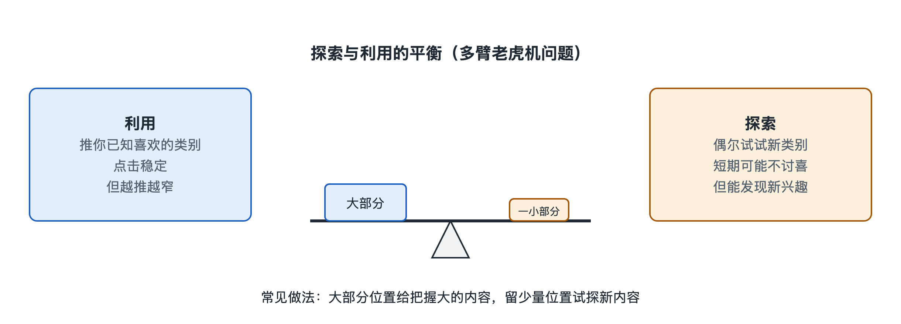

# 6.4 探索与利用：要不要给你看点新东西

周末傍晚，你打开常去的那家面馆。牛肉面你已经吃过二十次，次次满意。今天菜单上多了一道新品“酸汤肥牛面”。点老样子，几乎不会失望；点新品，可能发现新的心头好，也可能踩雷。你犹豫的这几秒，就是推荐系统每一次刷新都要做的决定。

你在短视频应用里连刷了十条猫咪视频，第十一条该推什么？再推一条猫，你大概率会看完；推一条你从没看过的手工木艺，你可能直接划走，也可能从此多了一个爱好。推荐系统把这个两难叫作“探索与利用”（Exploration vs. Exploitation，常称 E&E 问题）。

## 6.4.1 两个词，两种代价

- **利用**（Exploitation）：根据已经掌握的信息，选当前看起来最好的那个。上一节讲的点击率预估模型，主要在做“利用”：算出每条候选内容的预估点击率，把分数最高的放在前面。
- **探索**（Exploration）：有意拿出一部分机会，尝试那些系统还不太了解的选项，目的是收集信息。

两者各有代价，可以对照着看：

| | 只利用不探索 | 只探索不利用 |
|---|---|---|
| 短期效果 | 好，推的都是“稳妥”的 | 差，大量推荐不对胃口 |
| 长期效果 | 兴趣越推越窄，系统对你的了解停滞 | 了解很多，但用户早已流失 |
| 对新内容 | 新内容没有数据，永远排不上来 | 新内容有机会，但质量参差 |

问题的关键在于：系统对一条内容的估计，本身就来自过去的展示。一条从没展示过的视频，模型对它几乎一无所知，分数往往不高，于是更不会被展示，形成一个自我强化的循环。第三章讲过的冷启动困境，从这个角度看，就是探索不足的直接后果。

## 6.4.2 老虎机：一个经典的思考模型

学术界常用“多臂老虎机”（Multi-Armed Bandit，MAB）来描述这类问题。设想赌场里有一排老虎机，每台吐钱的概率不同，但你事先不知道。你手里的硬币有限，怎样投才能总收益最多？每一台机器就像一条候选内容，每次投币就像一次展示，“吐钱”就像用户点击或看完。

这个模型的数学细节留到第八章 8.4 节再展开，这里先看三种直观的策略。

**第一种：ε-贪心**（ε-greedy）。大部分时候（比如九成以上）选当前最好的，剩下一小部分时候随机挑一个。好处是简单，缺点是随机探索不分轻重，可能把机会浪费在明显不好的选项上。

**第二种：置信上界**（Upper Confidence Bound，UCB）。给每个选项打分时，除了看平均表现，还加上一笔“不确定性奖励”：展示次数越少，奖励越大。好比面馆老板对新菜说：“这道菜只有三个人点过，评价还不作数，先给它加点分，让更多人试试。”展示多了，奖励自然缩小，分数回归真实水平。这体现了一种“乐观面对不确定性”的思路。

**第三种：汤普森采样**（Thompson Sampling）。系统对每个选项的真实效果保留一个“可能范围”，每次从这个范围里随机抽一个数来比大小。了解得多的选项，范围窄，抽出的数比较稳定；了解得少的，范围宽，偶尔会抽到很高的值，从而获得被展示的机会。这种方法的思想可以追溯到二十世纪三十年代，后来在在线广告和推荐场景中被广泛研究。

还有一类做法叫“上下文老虎机”（Contextual Bandit），在选择时考虑用户、时间、场景等信息。公开资料中常被引用的一个例子，是雅虎研究人员在 2010 年前后发表的新闻推荐论文，用 LinUCB 方法为不同用户挑选首页新闻。

## 6.4.3 在真实系统里，探索藏在哪里

需要说明：各大平台具体用哪种探索算法、拿出多大比例的流量来探索，大多没有公开。下面是论文、官方说明和行业公开分享中常见的做法，不代表某个具体产品的实现。

1. **新内容的保底流量**。不少内容平台在官方创作者说明中提到，新发布的作品会先获得一定的初始曝光，再根据反馈决定是否扩大推送。这本质上就是对新内容的系统性探索。
2. **在排序分数上加“不确定性”项**。类似 UCB 的思路，对曝光少、数据少的内容给予一定加分。
3. **在重排阶段留出位置**。在一屏推荐里固定留几个位置，放入用户兴趣之外的内容，同时兼顾 3.3 节讲的多样性。
4. **兴趣探索**。偶尔给你推一个你从未互动过的类别，看你会不会停留。你有时刷到一条“和你毫不相干”的视频，原因可能有很多，探索只是其中一种可能，不能一概而论。

## 6.4.4 为什么值得为“不确定”付费

探索在短期内几乎一定会让某些指标下降：推了不合口味的内容，点击率会低一点。平台为什么还愿意这样做？

- **对用户**：人的兴趣会变化，也有尚未被发现的部分。不探索，系统对你的了解停留在过去。
- **对创作者**：新人和新作品需要被看见的机会，否则流量会越来越集中在少数头部作者身上，第四章 4.2 节讨论的内容生态会变得单一。
- **对平台**：长期来看，内容池的新鲜度和用户的持续兴趣，比某一天的点击率更重要。

探索与利用之间没有一劳永逸的标准答案，比例多大、对谁多探索、什么时候探索，都要靠第五章讲的 A/B 测试反复验证。这种“短期收益与长期收益如何权衡”的问题，并不只存在于探索与利用之间。点击、时长、点赞、满意度之间同样需要取舍，这正是下一节多目标优化要回答的问题。
