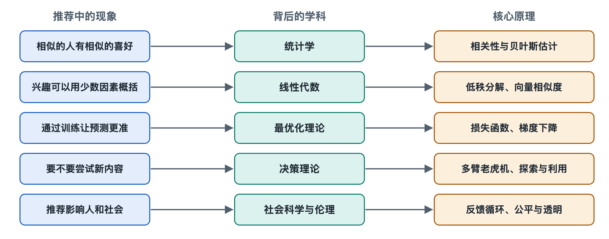

# 8.1 概率与统计：从行为中估计偏好

打开购物应用，你会看到两件同款 T 恤：一件写着“好评率 100%”，只有 3 条评价；另一件写着“好评率 96%”，有两千多条评价。多数人会觉得第二件更可靠。这个判断里已经有统计学的基本想法：**同一个比例，样本越多越可信**。推荐系统每天要对亿万次“你会不会喜欢”做判断，依靠的也是这种从有限行为中估计偏好的方法。

## 8.1.1 偏好看不见，只能用概率去估

系统无法读取你的想法，它能记录的只有行为：点开了没有，看了几秒，有没有点赞、收藏、购买。这些行为都带有偶然性。你这次没点开一条美食视频，原因可能是不喜欢，也可能是刚好在地铁上要下车。

所以推荐系统不会说“你喜欢美食”，而是估计一个**概率**：给你看这条内容时，你点击的可能性有多大。第六章讲的点击率（Click-Through Rate，CTR）预估就是这种思路。点击率是在许多次曝光中，被点击的次数所占的比例。单看一次行为，结果只能是“点”或“不点”；行为积累到成千上万次，比例才会逐渐稳定下来，接近背后真实的倾向。统计学把这个规律称为**大数定律**（Law of Large Numbers）：独立重复的次数越多，观察到的频率越接近真实概率。

## 8.1.2 小样本的陷阱与“平滑”

麻烦在于，推荐系统里大量内容的样本都很少。一条新视频曝光 5 次、被点 3 次，点击率是 60%；一条老视频曝光 10 万次、被点 8000 次，点击率是 8%。如果直接按数字排序，新视频会排在前面。可是 5 次曝光中的 3 次点击，很可能只是运气。

常见的处理办法叫**平滑**（Smoothing）。它的直观做法是：在真实数据之外，先给每条内容加上一些“虚拟的平均表现”。假设整个平台的平均点击率约为 5%，可以先当作每条内容都已经曝光 100 次、被点 5 次，再叠加它自己的真实数据：

| 内容 | 真实数据 | 直接计算 | 平滑后（加入 100 次曝光、5 次点击的先验） |
|---|---|---|---|
| 新视频 | 曝光 5，点击 3 | 60% | (3+5)/(5+100) ≈ 7.6% |
| 老视频 | 曝光 100000，点击 8000 | 8% | (8000+5)/(100000+100) ≈ 8.0% |

平滑以后，新视频的估计值被拉回到平均水平附近，老视频的估计值几乎不变，因为它的数据足够多，可以主要依靠自己的数据。这背后是**贝叶斯统计**（Bayesian Statistics）的思想：先有一个“先验”（Prior），即没看到数据前的合理猜测，再用观察到的数据去更新它，得到“后验”（Posterior）。数据越少，先验影响越大；数据越多，越由数据本身说了算。第三章讲的冷启动，在统计上就是如何为样本几乎为零的新用户、新内容设定合理先验的问题。

## 8.1.3 不确定性本身也是信息

对两条估计点击率都是 8% 的内容，系统的把握程度可能完全不同：一条有十万次曝光支撑，另一条只有几十次。统计学用**置信区间**（Confidence Interval）描述这种把握程度，样本越少，区间越宽。

“不确定”并不等于“不值得推”。估计值不确定的内容，真实表现可能远好于当前估计，给它一些曝光，才能看清它到底怎么样。第六章的“探索与利用”和本章 8.4 节的多臂老虎机，正是把这种不确定性纳入决策的方法。有一类做法会给不确定性高的内容加分，让它们获得一些试一试的机会。

## 8.1.4 数据会“说谎”：几种常见偏差

统计估计还有一个前提：数据要能代表真实情况。推荐系统的行为数据在这一点上天然有缺陷，常见的有以下几种偏差（Bias）：

- **位置偏差**（Position Bias）：排在第一屏的内容更容易被点，不一定因为它更好，只因为它更显眼。
- **曝光偏差**（Exposure Bias）：系统只能观察到用户对已经展示过的内容的反应。从没推给你的内容，系统无从知道你喜不喜欢。
- **选择偏差**（Selection Bias）：主动打分、评论的人往往是特别满意或特别不满的少数，沉默的大多数没有留下记录。
- **流行度偏差**（Popularity Bias）：热门内容曝光多、数据多、估计得更准，于是更容易被推，冷门内容更难翻身。

这些偏差会形成循环：系统推什么，用户就看什么；用户看了什么，又成为系统下一轮学习的依据。学术界和工业界提出了不少纠偏方法，例如按曝光概率对样本重新加权的**逆倾向加权**（Inverse Propensity Weighting，IPW），或者专门留出一小部分流量做随机展示，收集偏差较小的数据。具体平台用了哪种方法，公开资料往往只透露原则，细节一般不公开。

## 8.1.5 小结：推荐是一门“带着误差做判断”的学问

回到开头的两件 T 恤。推荐系统做的事情与你的判断一样，只是规模大得多：用概率表示偏好，用大量样本逼近真实，用先验弥补数据不足，用置信程度衡量把握，并且时刻提防数据本身的偏差。理解了这一层，你就不会把“系统推给我”简单理解成“系统确定我喜欢”，更准确的说法是：根据目前的数据，它估计你喜欢的可能性比较高，而这个估计随时会被你的下一次行为修正。

不过，概率只回答了“对一条内容的估计有多准”。面对亿万用户和亿万内容，系统还需要一种办法，把人和物放进同一个空间里比较远近。这要用到下一节的线性代数。
