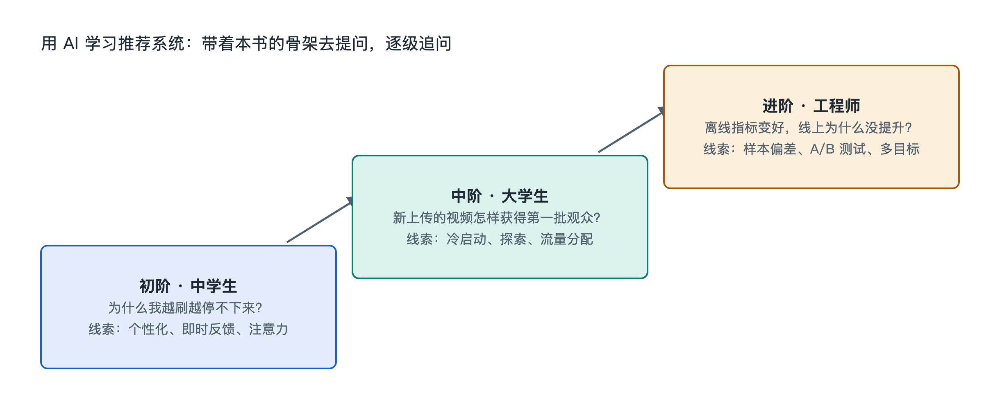

# 9.3 三阶提问阶梯：从中学生到工程师

假设三个人同时打开同一个短视频应用，刷到同一条宠物视频。一位中学生想知道：“它怎么知道我喜欢猫？”一位做运营的职场人想知道：“为什么同类视频，有的播放几百，有的播放几百万？”一位刚入行的算法工程师想知道：“这条视频进入我的列表，经过了几层模型、用了哪些特征？”

三个人面对的是同一个推荐系统，但想问的深度不同。把问题丢给 AI 助手时，问法决定了得到的是一段泛泛之谈，还是一条能继续往下挖的线索。本节把全书的九层认知阶梯压缩成三阶提问方法，帮助不同背景的读者向 AI 提出“问得准、答得实、能核对”的问题。

## 9.3.1 第一阶：看现象——用日常经验提问

第一阶面向中学生和普通读者，目标是把手机上看到的现象和书中的结构对上号。提问时有三个要点：

- **描述具体场景**。不要只问“推荐算法是什么”，而要写清“我昨天搜了一次跑鞋，今天首页出现了很多运动内容”。
- **请 AI 用类比解释**，并指出对应本书的哪一层，比如这属于“行为数据”“召回”还是“重排”。
- **要求它区分“公开原理”和“猜测”**。各平台的具体算法大多没有公开，AI 也不知道某个应用内部的真实做法。

可以直接这样问：

> “我在短视频应用里连着看完了三条做饭视频，后面就一直推做饭的。请用中学生能懂的话解释，这可能涉及推荐系统的哪些环节？哪些是公开资料中的通用原理，哪些只是对这个应用的推测？”

这一阶的收获是一张“现象—环节”对照表：看完率对应行为反馈，相似内容扎堆对应召回与多样性控制，点“不感兴趣”对应用户反馈通道。

## 9.3.2 第二阶：问关系——用产品和业务视角提问

第二阶面向大学生、内容创作者、产品经理和运营人员，关注的是各部分之间的连接与权衡，也就是本书第四到第六章讲的关系、流动与机制。这一阶的问题往往没有唯一答案，提问时要请 AI 列出几种因素，并说明它们怎样相互牵制。

| 想弄清的问题 | 不够好的问法 | 更好的问法 |
|---|---|---|
| 新内容的曝光 | “怎么让视频上热门？” | “新内容在冷启动阶段，平台通常怎样在探索与利用之间分配少量曝光？公开资料里有哪些常见做法？” |
| 平台目标 | “平台是不是只看点击？” | “点击率、观看时长、满意度、商业收入作为多个目标，可能怎样冲突？业界公开讨论过哪些平衡方式？” |
| 实验决策 | “改版有没有用？” | “一次 A/B 测试中，短期指标上涨但长期留存下降，应该如何解读？” |

注意“更好的问法”的共同特征：使用了书中的术语，限定了“公开资料”的范围，并且把问题从“技巧”转向“机制”。对于涉及特定平台的问题，要追加一句“这是哪家公司的做法？有没有官方说明或论文出处？”，避免把一家的做法当成行业通用规则。

## 9.3.3 第三阶：追原理——用工程和数学视角提问

第三阶面向计算机与数据专业的学生和初级工程师，对应本书第七、第八章的关键技术与原理。这一阶的提问目标是“能推导、能实现、能验证”。常用的三种问法：

1. **要推导**：“请从概率角度解释，为什么点击率预估常用对数损失（Log Loss）？用一个三条样本的小例子算一遍。”
2. **要代码**：“请用 Python 在公开的 MovieLens 数据集上写一个矩阵分解推荐器，并解释每个超参数的作用。”这可以直接衔接 9.2 节的动手实验。
3. **要对比**：“双塔召回模型和精排阶段的交叉特征模型，在延迟、效果、可扩展性上各有什么取舍？请给出代表性论文名称，我会自己去查。”

第三阶最重要的习惯是**要求出处并亲自核对**。AI 可能编造论文标题、作者或实验数字。拿到答案后，应在论文检索网站上确认论文确实存在，再对照原文看结论是否一致；代码要实际运行，指标要自己计算。

## 9.3.4 让提问阶梯“向上爬”

三个阶梯并不是固定分给三类人的。一个好的学习路径，是从同一个现象出发连续追问：先问“这是哪个环节”，再问“它和其他环节怎样牵制”，最后问“背后的数学是什么”。例如从“为什么总推做饭视频”出发，可以一路追到序列推荐模型，再追到条件概率与梯度下降。每爬一阶，都回到手机上验证一次：清空部分观看记录、关闭个性化推荐选项，或连续点几次“不感兴趣”，观察推荐列表的变化是否符合 AI 给出的解释。

这套方法的核心只有三条：问题要具体，范围要限定在公开资料，答案要能核对。书提供骨架，手机提供现场，AI 负责展开，而判断真假的责任始终留在提问者自己手里。
