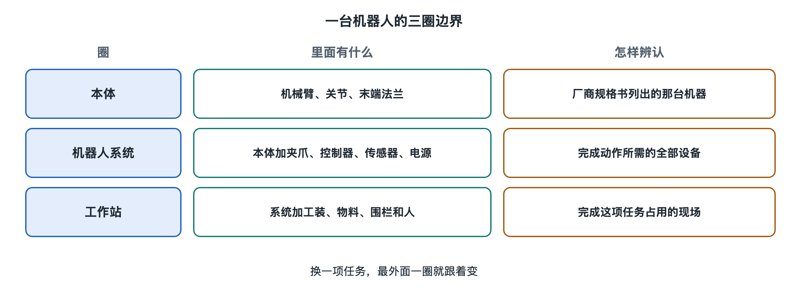

# 1.1 眼前这台机器，边界画在哪里

一张照片里，机械臂正把托盘中的零件放进料盒。画面中央是机械臂，旁边还有夹爪、托盘、料盒、桌面，以及站在工作区外的操作员。若有人问“机器人在哪里”，手指很容易指向机械臂；若问“这项工作靠什么完成”，手指就得在照片上画出更大的一圈。

边界没有唯一的画法。它取决于我们要看的是机器本身，还是机器所在的工作现场。

## 1.1.1 眼前的机器人，指哪一部分

先看机械臂本体。它从固定位置伸出，末端随着姿态变化到达不同地方。人们询问机器的外形尺寸或安装位置时，通常指的就是这个可单独辨认的机器本体。即使把照片裁到只剩机械臂，也仍能认出它是一台机器人。

但照片里夹住零件的那件工具，未必属于机械臂本体。换一道工作任务，末端工具可能随之更换，机械臂仍是原来那台。设备资料有时展示机械臂的标准外形，有时展示已经装好工具的应用照片。两张图上的“机器人”看起来不同，原因可能只是画图的人选取了不同的边界。

这条最贴近机器外形的边界，适合回答“是哪一台”“安在哪里”“外形到哪里为止”。它还不能交代托盘为什么摆在这里、零件被送往哪里，也无法单凭一台机械臂的照片说明现场是否已经具备完整的工作条件。

## 1.1.2 从机器人本体到完整工作站

把视线退后一些：机械臂固定在台面或基座上，托盘有自己的位置，料盒留有放件的空间，现场可能划出人员不得进入的区域。它们共同占据的地方，可以称为**机器人工作站**：围绕一项作业布置的机器人、相关设备和工作空间。工作站的外边界，往往比机械臂在照片里占据的地方大得多。

这种区分在正式文件中也能看到。国际标准化组织于2011年发布的《ISO 10218-2:2011》，标题把“工业机器人系统与集成”列为讨论对象；2025年的修订版《ISO 10218-2:2025》，标题则写明“工业机器人应用与机器人单元”。标准目录里这两个标题的变化很有意思：一台可识别的机器人，与它置身其中、供一项工作开展的场所，是两个不同尺度的对象。查看标准标题和适用范围，就能发现讨论现场时为什么不能只看机械臂的外壳。（出处：国际标准化组织 ISO，《ISO 10218-2:2011》及《ISO 10218-2:2025》标准目录。）

日常说话可以宽松一些。同一个人站在设备旁，可能指着机械臂说“机器人到了”，也可能指着整片区域说“机器人还没装好”。前一句谈到的是本体，后一句谈到的是工作站。读设备照片、平面布置图或新闻报道时，先弄清说话者指向哪一个，许多看似矛盾的描述就能对上。

工作站也不等于一间房。它可能占用厂房的一角，与相邻设备共用通道；也可能有独立围护。照片边缘恰好拍到了什么，并不能决定工作站在哪里结束。更可靠的线索是：哪些地点为这项作业留出，哪些物品在此进入或离开，哪些位置需要与人的活动区分开。边界画在这些关系发生的地方。

## 1.1.3 工装、物料和人，何时进入边界

再回到那张放零件的照片。托盘和料盒都不是机器人。如果只辨认机器本体，可以暂时不把它们圈进去；如果要说清“把哪个零件放到哪里”，它们就是现场不可省略的对象。零件、工装与料盒进入观察范围，是因为此刻的任务涉及它们，并非因为它们变成了机器的一部分。

人也一样。操作员站在工作区外，仍可能把待处理的零件放到指定地点，或在作业结束后取走料盒。画机器外形时无需把人圈成机器人；画整个工作现场时，人的位置却不能从图上消失。照片中的人还可能只是路过者，单靠他出现在画面里，不能断定他参与了这项工作。

边界因此可以画成几圈：最里面是机器人本体；向外扩，是围绕作业布置的工作站；再向外，是与工作站交接物品、共用场地的人和其他设备。每一圈都在回答不同的问题。把三圈混成一圈，容易把机器本身拥有的条件，误当成现场安排给予它的条件。

## 1.1.4 换一道任务，边界也会变

设想这台机械臂原先只把零件从左侧托盘移到右侧料盒。为了看清这项工作，图上至少要留下机械臂、零件的起点和终点，以及相关的工作空间。现在任务改为从旁边输送来的物料中取件。机械臂可能一厘米也没挪，输送线却进入了这张任务图。若完成标准又改成“把装满的料盒交给下一道工序”，观察范围还得延伸到交接处。

这不表示机器的外形随任务伸缩。变化的是我们为理解工作而选取的范围。机械臂本体的边界仍可沿着机器画；工作站的边界要随现场布置核实；任务涉及的边界，则跟着物品从哪里来、到哪里去而变化。

看到“机器人完成了一次放件”的照片时，先确认描述指向哪一圈边界，再核对图注与现场记录。
