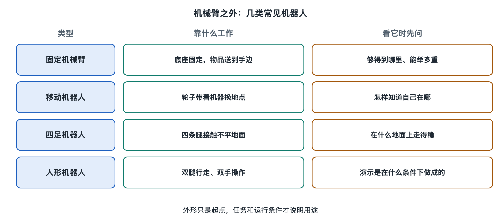

# 1.4 机械臂之外，还有哪些机器人

在工作站里，机械臂通常站在固定位置，物品来到它面前。换到仓库、楼道或室外，任务可能出现在另一个地点。还有些机器人要走过不平整的地面，或进入按人的身形布置的场所。从外面辨认它们，先看整机在哪里活动、以什么形态立足、承担什么任务，再看它能在多大程度上自己行动。

## 1.4.1 移动机器人：工作地点不再固定

走进一座仓库，可能看见一台矮小的机器沿通道驶过，停在货架或工作台旁。这类**移动机器人**可以改变自身的工作地点。它既可能搬运货物，也可能承担巡检、清扫或配送任务。“移动”说的是整机的位置会变；它到了目的地之后，是否还会抓取物品，是另一件事。

丹麦厂商 Mobile Industrial Robots 的 MiR250，是面向室内物料运输的移动机器人。厂商的产品资料将它描述为可在工厂、仓库等场所运输物料的设备。看一张应用照片，最容易认出的也许是车体；判断它能做什么，还要看货物怎样放置、目的地在哪里，以及通道是否允许它通过。一台能够在仓库通道运行的机器，换到台阶、泥地或拥挤的人行道上，面对的已是不同场所。

“自主移动”也有范围。有的设备沿事先确定的线路往返，有的可以在获准的区域内选择通路；有的任务由人指定目的地，设备负责驶到那里。它们都可能被称为移动机器人，却不能仅凭这个名称判断是否能进入任意建筑、自己决定运送什么。固定工作站的边界多半围绕一处工位画出；移动机器人的活动范围则可能覆盖数条通道乃至一片作业区域。

## 1.4.2 四足机器人：面向复杂地面的形态

一台机器走到楼梯口，四只脚交替落下。它让人想到动物，但**四足机器人**的用途不由外形决定。四足形态使整机可以在某些轮式设备不便通过的地面上活动，例如有台阶、障碍或起伏的路线。与此同时，通道宽度、地面状况和可通行区域，仍决定了它能到哪里。

美国厂商 Boston Dynamics 的 Spot 是四足机器人。厂商公开的产品资料展示了工业现场检查、获取现场信息等用途，也说明设备可以接受人的操作，并可在预先安排的巡检路线中运行。于是，同一台 Spot 的画面可能呈现两种不同的工作方式：一次是人操纵它经过现场，另一次是它按已设置的路线走到指定位置。若只看“它自己走上楼梯”的短片，很难看出路线由谁确定、现场是否有人持续照看。

四条腿是整机与地面接触的形态，并不等于它会像人一样处理所有地形。厂房的平整地面、楼梯、碎石地和湿滑地面，不能合并成一个“复杂环境”。讨论一台四足机器人时，场所和任务应与型号一起出现：在什么地方行走，是巡视一条路线，还是到某处查看特定目标？同样的外形，可以服务于不同工作。

## 1.4.3 人形机器人：接近人体的外形

**人形机器人**通常具有接近人的躯干、手臂和腿部的整体外形；不同型号与人体相似的程度并不相同。有人希望它进入原本供人通行和作业的环境，因此门、台面、箱子和通道常出现在演示画面里。外形提供了一种进入这些场所的可能，却不能单独说明它能完成多少种工作。

一个较少被提起的细节是：人形机器人的公开试用，起点可能是一件极窄的日常工作。美国亚马逊在2023年介绍，它正在测试美国厂商 Agility Robotics 的 Digit；公布的初步用途是搬运已清空的周转箱，以配合箱子的回收使用。镜头里的任务具体到“空箱”这一种物品。亚马逊当时用的是“测试”，并未把它表述为 Digit 已能独立承担仓库里的各类工作。（来源：Amazon News，2023年关于 Digit 测试的公开说明。）

这也解释了为什么辨认人形机器人时，要把“像人”与“替人完成一整份工作”分开。画面中，机器人可能走向箱子、搬起箱子、再走到另一处；现场任务还涉及哪些箱子可以处理、哪段区域允许它活动，以及工作完成由谁确认。这些事实需要从具体演示和发布说明中逐项查找，不能由外形推得。

## 1.4.4 同一种外形，用途和自主程度也可能不同

把几张照片并排放：一台仓库运输车、一台四足巡检设备、一台搬运空箱的人形机器人，还有一台固定工位的机械臂。外形能帮我们先分辨它们怎样占据空间、主要在哪里工作；任务说明才能告诉我们它们在做什么。反过来，同样是“搬运”，货物可能由移动底盘送到工位，也可能由人形机器人拿起；任务相同，整机面对的场所却不同。

**自主程度**指机器人在既定任务和环境中，有多少行动可以不靠人逐步发令而完成。人实时操纵、设备按固定路线运行、设备在限定区域内自行前往目标，是不同情形。还要问人何时指定任务、何时可以接管，以及现场变化超出设定范围后怎样处置。“自主”后面若没有任务与场所，这个词就太宽了。

因此，见到陌生机器人，可以先记下四件事：它属于哪种整机形态，站在或走在什么地方，眼前承担哪项任务，动作由人指挥到什么程度。照片能回答一部分，产品资料和现场记录能补足一部分。剩下无法确认的地方，留在边界之外，比凭外形替它填上能力更准确。

资料来源：Mobile Industrial Robots，*MiR250* 产品资料；Boston Dynamics，*Spot* 产品资料；Amazon News，2023年关于测试 Agility Robotics Digit 的公开说明。
