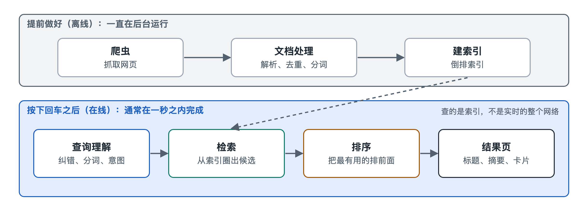

# 1.1 按下回车之后：不到一秒钟里发生了什么

晚上十点，你在手机浏览器的搜索框里输入“发烧38度要不要去医院”，按下回车。屏幕闪了一下，一页结果就出来了：最上面可能是一段医学科普摘要，下面是十来条网页链接，有的标着“广告”，有的来自医院官网，有的来自问答社区。整个过程快到你几乎感觉不到等待。

这一瞬间里，你的手机、网络和远方的数据中心之间发生了一连串分工明确的动作。本节先把这段过程放慢来看，搭出一条最粗的时间线。后面各章会逐段放大。

## 1.1.1 请求出发——从你的手指到数据中心

按下回车时，浏览器把你的问题打包成一个网络请求。文字会先被编码，再和语言设置、大致地区、设备类型等信息一起发出去。如果开启了定位权限或登录了账号，请求里可能还会有更多上下文。哪些信息被使用，取决于各家搜索引擎的隐私政策和你的设置。

请求先通过域名解析系统（Domain Name System，DNS）找到搜索引擎服务器的地址。大型搜索引擎通常在多个地区部署数据中心，你的请求一般会被引导到较近、较空闲的一处。这样做的目的很直接：网络信号的传播速度受物理距离限制，离得越近，往返越快。

## 1.1.2 读懂问题——查询处理

请求到达后，系统首先要弄清“你到底想找什么”，这一环节叫查询处理。对“发烧38度要不要去医院”这句话，系统大致要做几件事：

- **分词**：中文词与词之间没有空格，需要切成“发烧 / 38度 / 要不要 / 去 / 医院”这样的单元；
- **纠错与规范化**：如果你打成“发骚”，系统可能会提示“您是不是要找：发烧”；
- **意图判断**：这是一个健康类的求助问题，不是想买体温计，也不是想找某家医院的地址。

意图判断会影响后面几乎所有环节。同样带“医院”二字，“附近的医院”更需要地图结果，“医院排名”更需要榜单类网页。

## 1.1.3 圈出候选——在“超级目录”里查找

接下来，系统要从它保存的海量网页里找出可能相关的那些。按公开资料中常见的说法，大型网页搜索引擎的索引规模在数千亿网页的数量级。逐页翻找一遍，在不到一秒内显然做不到。

秘诀在于事先编好的**倒排索引**（inverted index）。它很像一本书末尾的“关键词索引”：不是按页码列内容，而是按词列出出现过它的页码。系统拿着“发烧”“医院”等词去查这本目录，就能直接得到包含这些词的网页编号清单，再把几份清单对照取交集。这本目录太大，一台机器装不下，所以被切成许多份，分布在成百上千台服务器上同时查找，最后汇总结果。这就是为什么查找速度主要取决于机器分工，而不是网页总数。

需要注意，这本目录不是你按回车时才编的。在此之前，**网络爬虫**早已把网页抓回来，经过解析、去重、分词，整理进了索引。你的搜索只是在读取一份提前备好的“存货”。这也解释了一个常见现象：刚发布几分钟的网页，往往还搜不到。

## 1.1.4 排出先后——排序与结果页组装

候选网页可能有成千上万个，而你通常只看第一屏。于是进入**排序**环节：系统会综合许多因素给每个候选打分，例如网页内容与问题的相关程度、网站的可信度、内容是否新、页面是否适合手机阅读等。各家搜索引擎具体用了哪些因素、权重如何，大多没有公开；公开资料能确认的是原理层面的做法，比如词频统计、链接分析和机器学习排序，这些会在第六章展开。

常见做法是分层筛选：先用计算简单的方法把候选压缩到较小范围，再用更精细、更耗算力的模型对少数结果细排。这好比招聘先看简历筛掉大部分，再对少数人面试。

排好序之后，系统还要**组装结果页**：为每条结果从网页正文中截取一段摘要，把你的关键词加粗；判断要不要放知识卡片、地图、图片或视频；广告系统同时进行自己的匹配，并在页面上标明“广告”。写作时，一些搜索引擎还会在顶部放一段由大语言模型生成的综合回答，它同样建立在先检索、再生成的流程上（第四章和第七章细讲）。

## 1.1.5 一张时间线与一个隐藏的回路

把上面的过程连起来，大致如下：

| 阶段 | 发生在哪里 | 核心任务 | 何时完成 |
|---|---|---|---|
| 抓取与建索引 | 数据中心（后台） | 把网页搬回来、编成目录 | 搜索之前，持续进行 |
| 发送请求 | 你的设备 → 网络 | 把问题送到最近的服务器 | 按下回车时 |
| 查询处理 | 前端服务器 | 分词、纠错、判断意图 | 实时 |
| 检索 | 大量索引服务器并行 | 圈出候选网页 | 实时 |
| 排序与组装 | 排序与页面服务 | 打分排序、生成摘要和结果页 | 实时 |
| 返回与反馈 | 网络 → 你的设备 | 显示结果，记录交互 | 实时，并回流后台 |

最后一行常被忽略：你点了哪条结果、有没有很快退回重新搜，这类交互信号可能被汇总分析，用来评估和改进排序。至于具体怎样使用，各家做法不同且多未公开，第四章和第五章会区分公开原理与推测。

一个搜索框背后，于是至少有两条节奏不同的线：一条是你按回车后实时运行的“查询流水线”，另一条是日夜不停、在后台抓取和整理网页的“准备流水线”。看懂这两条线怎样咬合，就抓住了搜索引擎的第一根骨架。下一节，我们退后一步，问一个更根本的问题：搜索引擎到底在替我们完成什么任务。
