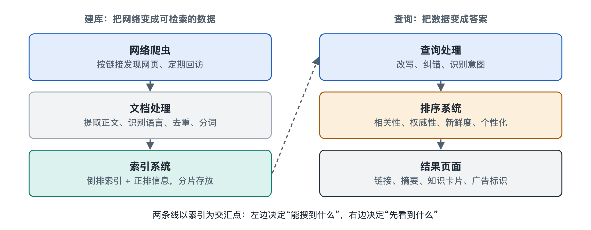

# 2.1 网络爬虫：把网页“搬”回来

打开浏览器，在搜索框里输入一个词，一秒钟内就出现了成千上万条结果。这里有一个容易被忽略的事实：你按下回车的那一刻，搜索引擎并没有跑到整个互联网上去现场翻找。它查的是自己事先保存好的一份网页副本。负责把网页“搬”回来、建起这份副本的程序，叫作**网络爬虫**（Web Crawler），也常被称为“蜘蛛”（Spider）或“机器人”（Bot）。可以说，搜索结果的来源早在你搜索之前很久，就由爬虫一页一页地准备好了。

## 2.1.1 爬虫在做什么：一个不知疲倦的“浏览者”

先看你自己是怎么上网的：打开一个网页，读完内容，看到感兴趣的链接就点进去，再从新页面点向更多页面。爬虫做的事情和这个过程几乎一样，只是没有眼睛和耐心的限制：

1. 从一批已知的网址出发，这批起点叫作**种子网址**（Seed URLs）；
2. 向网站服务器发出请求，下载网页内容；
3. 从下载的网页中找出所有链接，提取其中的新网址；
4. 把新网址放进待访问的队列，再从队列中取出下一个网址，重复上述过程。

互联网上的网页通过链接彼此相连，像一张巨大的网，爬虫就沿着这些“丝线”不断爬行，“蜘蛛”的名字由此而来。你可以打开任意一个网页，右键选择“查看网页源代码”，会看到大量形如 `<a href="...">` 的标记，每一个都是爬虫眼中可以继续前进的路口。

## 2.1.2 爬虫的内部结构：几个分工明确的部件

一个能在工程上运转的爬虫，远不止“下载—找链接”这么简单。按照信息检索教材中常见的划分，它大致由以下部件组成：

| 部件 | 中文说明 | 类比 |
|---|---|---|
| URL 前沿队列（URL Frontier） | 存放“待抓取网址”的队列，并决定先抓谁 | 待办清单 |
| 域名解析（DNS Resolution） | 把网址中的域名翻译成服务器的 IP 地址 | 查通讯录找门牌号 |
| 下载器（Fetcher） | 通过 HTTP 协议向服务器请求网页 | 跑腿取件的快递员 |
| 解析器（Parser） | 从网页中提取文字和链接 | 拆包裹、记下新地址 |
| 去重模块（Duplicate Elimination） | 判断网址或内容是否已经见过 | 核对“这件已经收过了” |
| 存储（Repository） | 保存抓回的网页，交给后续处理 | 仓库 |

其中，**前沿队列**是爬虫的“大脑”。互联网上的网址数量庞大，公开资料中常见的说法是可发现的网址以“万亿”计，任何爬虫都不可能一视同仁、全部抓取，所以必须排队、分先后。去重模块同样关键：同一个页面可能以多个网址出现（例如带不同参数），如果不加识别，爬虫会在重复内容上白白耗费资源。

## 2.1.3 先抓谁、多久再抓：调度的学问

爬虫面对的核心问题是：资源有限，网页无限。由此产生两类决策。

**一是抓取优先级。**一般认为，被更多重要网页链接的页面、权威网站的页面、用户经常访问的页面，应当更早被抓取。最简单的策略有“广度优先”（先把离种子近的网页都抓一遍）和“深度优先”（沿着一条链接一路往下走）。研究表明，广度优先倾向于较早发现重要页面，但真实系统通常会综合多种信号打分，具体权重各家并未完整公开。

**二是重新抓取的频率。**网页不是抓一次就完事的：新闻首页可能每隔几分钟就变化，而一篇几年前的论文页面可能长期不变。爬虫需要估计每个网页的变化频率，对常变的页面多来几次，对稳定的页面少来几次。这就像超市补货员，畅销品货架多巡视，冷门货架偶尔看看。关于“新鲜度”的保持，本书第五章“更新流”还会展开。

## 2.1.4 做一个有礼貌的访客：robots 协议与访问频率

爬虫本质上是在别人家的服务器上“取东西”。如果它短时间内发出大量请求，小网站的服务器可能不堪重负。因此，主流搜索引擎的爬虫普遍遵守两项约定：

- **robots 协议**（Robots Exclusion Protocol）：网站可以在根目录放一个名为 `robots.txt` 的文本文件，声明哪些目录不希望被抓取。你可以在浏览器里输入任意网站域名加上 `/robots.txt` 亲自看看。这项约定长期作为行业惯例存在，后来被整理为互联网工程任务组（IETF）的标准文档 RFC 9309。需要注意，它是“君子协定”，规范的是守规矩的爬虫，并不能从技术上阻止恶意程序。
- **礼貌性**（Politeness）：对同一网站的请求要拉开间隔，避免集中访问。一些搜索引擎还允许站长在其站长工具中调整抓取速度，这属于各家产品的具体做法，以写作时官方文档为准。

此外，爬虫在请求中会通过“用户代理”（User-Agent）字段表明身份，例如谷歌公开的爬虫名称是 Googlebot，百度的是 Baiduspider，站长可以据此识别来访者。

## 2.1.5 规模带来的难题：分布式爬取与“看不见的网页”

单台计算机抓取全网是不现实的。大型搜索引擎的爬虫通常由大量机器协同运行，常见做法是按域名把网址分配给不同机器，这样同一网站的请求集中在一处，既便于控制礼貌间隔，也便于共享该站点的状态。分布式系统的一般原理将在第七章讨论。

爬虫还会遇到几类“抓不全”的情形：

- **动态网页**：很多页面的内容由浏览器执行 JavaScript 后才生成，简单下载只能拿到空壳。谷歌在官方文档中说明其系统会对页面进行渲染，但渲染耗费资源，并非所有搜索引擎、所有页面都会同等处理。
- **深网**（Deep Web）：需要登录、填写表单才能看到的内容，例如数据库查询结果、私人邮箱，爬虫通常进不去。
- **爬虫陷阱**（Spider Trap）：比如一个可以无限往后翻页的日历，会生成无穷多的网址，爬虫必须设定规则及时止步。

这也解释了一个日常现象：你在搜索引擎里找不到某个页面，未必是它“排名太低”，也可能是它根本没被抓回来。

## 2.1.6 小结：一切搜索的原材料

爬虫决定了搜索引擎“能看到什么”。它从种子网址出发，沿链接穿行，按优先级排队，遵守网站的约定，把网页一页页搬进仓库。但搬回来的只是原始的网页代码，里面混杂着导航栏、广告、重复内容，文字也还没有切分成可供检索的词语。下一节，我们就来看这些“原材料”怎样经过解析、去重与分词，变成搜索引擎能够理解的文档。
