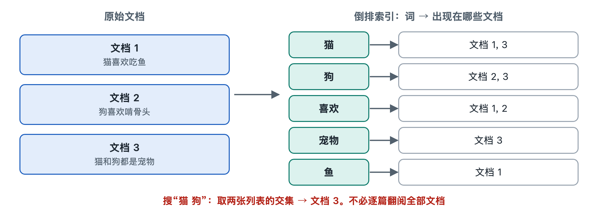

# 2.3 索引系统：倒排索引这本“超级目录”

拿出一本厚一点的教科书，翻到最后几页，很多书在这里附有“索引”：按拼音或字母排列的术语，后面跟着页码，比如“光合作用……23，56，102”。想找某个概念时，你不会从第一页读到最后一页，而是先查索引，再直接翻到那几页。

搜索引擎面对的是数以十亿计的网页，公开资料中常见的说法是大型搜索引擎的索引规模在数千亿网页的数量级。如果每次搜索都把这些网页从头读一遍，几秒钟远远不够，几年也未必够。它能在不到一秒内给出结果，靠的就是同样的思路：事先编好一本“超级目录”。这本目录叫作**倒排索引**（Inverted Index），是索引系统的核心。

## 2.3.1 正着排与倒着排

理解“倒排”，先看“正排”。爬虫抓回网页、经过上一节的文档处理之后，系统手里最自然的数据是“每个网页包含哪些词”：

| 正排索引（Forward Index） | 内容 |
|---|---|
| 网页1 | 熊猫、竹子、四川 |
| 网页2 | 熊猫、动物园、门票 |
| 网页3 | 竹子、家具、价格 |

这种结构按“文档→词”组织，适合回答“这篇网页讲了什么”，却不适合回答“哪些网页提到了熊猫”，因为后者仍要逐篇检查。

把这张表倒过来，改成按“词→文档”组织，就得到倒排索引：

| 词 | 包含该词的网页 |
|---|---|
| 熊猫 | 网页1，网页2 |
| 竹子 | 网页1，网页3 |
| 门票 | 网页2 |

现在你搜“熊猫”，系统直接找到“熊猫”这一行，网页1和网页2立刻出现，不必再看网页3一眼。书后索引正是这种结构：由术语指向页码，而不是由页码指向术语。“倒排”这个名字，就是相对于“文档在前、词在后”的正排而言的。

## 2.3.2 一本超级目录由什么组成

倒排索引在工程上通常分为两部分：

- **词典**（Dictionary，也叫词表）：收录所有出现过的词，相当于书后索引左边那一列。它要能被快速查找，常用的组织方式包括排序后的列表、哈希表、树结构等。
- **倒排列表**（Posting List，也译作“倒排记录表”）：每个词后面跟着的那串记录，相当于右边的页码。

与书后索引不同，倒排列表里往往不只记“哪篇文档”，还会记录额外信息，常见的有：

1. **文档编号**（Document ID）：系统给每个网页分配的数字编号，用数字比用网址省空间、好比较。
2. **词频**（Term Frequency，TF）：这个词在该文档中出现了几次，后面计算相关性时要用。
3. **位置**（Position）：这个词出现在文档的第几个位置。有了位置，系统才能判断“北京 大学”是连在一起的“北京大学”，还是分散在一篇文章的开头和结尾。
4. **字段信息**：词出现在标题、正文还是链接文字里。许多系统会区别对待这几种位置，但各家具体如何加权，大多没有公开。

这样一来，搜索“熊猫 竹子”时，系统取出两个词的倒排列表，求它们的交集，就得到同时包含两个词的网页1。多词查询本质上就是几张列表的合并运算：取交集对应“都要有”，取并集对应“有一个就行”。

## 2.3.3 为什么值得提前花大力气编目录

编写倒排索引是一项繁重的工作，要把每个网页拆成词、记下位置、按词归类、排序后存储。之所以值得，是因为搜索引擎的工作有一个显著特点：网页更新的频率远低于被查询的频率。同一批网页可能被成千上万次搜索反复用到。

| 对比 | 不建索引（逐篇扫描） | 建倒排索引 |
|---|---|---|
| 准备阶段 | 几乎不用准备 | 耗费大量计算和存储 |
| 每次查询 | 扫描全部文档，随规模线性变慢 | 只读取相关词的列表 |
| 适合场景 | 文档很少、查询很少 | 文档海量、查询频繁 |

这是一种典型的“用空间换时间、用离线换在线”的设计：把繁重的工作放在用户看不见的后台提前完成，把用户等待的那一刻压缩到最短。你电脑里的文件搜索、邮箱的邮件搜索、电商网站的商品搜索，只要数据量大，背后通常也有类似的索引。

## 2.3.4 超级目录面临的三个现实难题

真实的倒排索引比书后索引复杂得多，至少要应对三个问题：

- **太大**：像“的”“是”这样的常见词，倒排列表可能长到包含绝大多数网页。存储和读取这些长列表都很费力，因此工业系统普遍对列表进行压缩，第六章会讲具体方法。
- **太散**：一台机器装不下整个网络的索引，必须拆分到许多台服务器上，各自负责一部分，查询时再汇总结果，这是第七章分布式架构的话题。
- **在变**：每天都有新网页出现、旧网页修改或消失。目录要不断增补和重编，第五章“索引流”和“更新流”会讨论它怎样跟上变化。

还要注意，倒排索引只回答“哪些文档包含这些词”，并不回答“哪个最好”。它负责从海量网页中快速圈出候选，排出先后则是排序系统的工作。另外，近年出现的语义检索会把文本转成向量，另建一套“向量索引”来找意思相近的内容，它与倒排索引常常配合使用，而不是简单替代。

## 2.3.5 小结

倒排索引把“文档→词”的自然记录翻转为“词→文档”的查找结构，由词典和倒排列表组成，列表中记录文档编号、词频、位置等信息。它让搜索从“读遍全网”变成“查几行目录”，是搜索引擎能够在一秒内应答的结构基础。目录编好了，下一个问题是：用户在搜索框里敲下的那串文字，系统要怎样理解，才能知道该去目录里查哪几行？这就是下一节查询处理要回答的问题。
