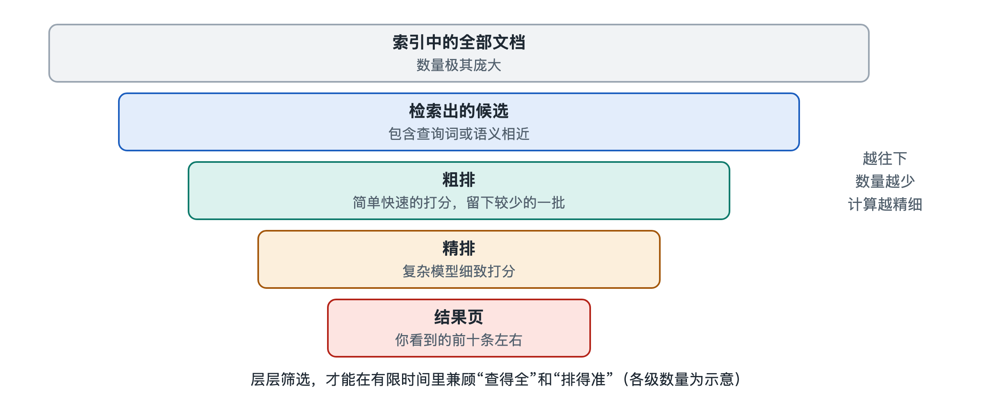

# 3.3 排序：把最有用的结果排在前面

在搜索框里输入“感冒了吃什么好”，结果页会告诉你找到了数量级可能在百万以上的相关网页。可你通常只看第一屏，最多翻到第二页。上一节讲的检索已经从海量文档里圈出了一批候选，但几十万个“都沾边”的网页对你没有用处。你真正需要的是：最有用的那几条排在最前面。排序（Ranking）这道工序决定了你看到什么、看不到什么，是搜索引擎最核心、也最受关注的功能。

## 3.3.1 从“沾边”到“有用”：排序要回答的问题

可以把检索和排序比作图书馆里的两个步骤。检索像管理员按书目卡把所有提到“感冒”的书都搬到桌上；排序则是一位懂行的馆员把这堆书重新摆放，把权威、清楚、正好回答你问题的那几本放在最上面。

排序要回答的问题看似简单，就是“哪个结果对这位用户、在这个时刻最有用”。真正判断起来，要同时考虑好几个方面：

| 考察维度 | 要回答的问题 | 生活化的例子 |
|---|---|---|
| 相关性 | 内容和查询对得上吗？ | 搜“苹果价格”，水果行情页和手机报价页哪个对题 |
| 质量与权威 | 内容可靠、专业吗？ | 医院官网的科普与匿名帖子 |
| 时效性 | 信息是不是新的？ | 搜“台风路径”，要的是今天的，不是三年前的 |
| 用户情境 | 用户在哪、用什么设备？ | 搜“附近的药店”，结果因所在城市而不同 |
| 体验 | 页面能否顺利打开、阅读？ | 手机上排版错乱、弹窗遮挡的页面 |

没有哪一个维度能单独决定名次。排序的本质，是把多种证据综合成一个分数或一个先后顺序。

## 3.3.2 排序看哪些信号

搜索引擎把这些可以测量的证据叫作排序信号（Ranking Signal），也常称为排序特征。按来源大致可以分成几类：

- **查询与文档的匹配信号**：查询里的词是否出现在标题、正文、链接文字中，出现得多不多，是否连在一起出现。第六章会介绍的词频、逆文档频率与 BM25，就是衡量这类匹配程度的经典方法。
- **文档自身的质量信号**：页面是否原创、结构是否清晰、是否被很多可靠网站引用。网页之间的链接关系是一类重要证据，PageRank 就是基于链接的著名方法，第六章同样会展开。
- **语义信号**：即使没有出现同样的词，意思是否相近。比如搜“手机没电很快”，讲“电池续航下降”的页面同样对题。
- **用户与情境信号**：地理位置、语言、设备类型等。
- **时效信号**：发布时间、更新时间，以及这个话题当下是否正在被大量讨论。

需要说明的是，各家搜索引擎具体用了哪些信号、每个信号权重多大，大多没有公开。Google 在其官方文档中表示会使用数量众多的信号，并公开说明过相关性、质量、可用性、上下文等大类；百度、必应等也在官方站长指南中说明了一些原则。但细节属于商业机密，网上流传的“某某因素占百分之几”之类的说法，大多是推测，不能当作事实。

## 3.3.3 分几轮筛选：漏斗式排序

如果对几十万个候选都用最精细的方法逐一打分，计算量会大到无法在一秒内完成。因此大型搜索系统通常采用“漏斗”结构，分阶段逐步收窄。这是公开论文和工程资料中普遍描述的做法：

1. **粗排**：用计算量小的方法，快速从大量候选中挑出几千个左右。
2. **精排**：对剩下的候选使用更多信号、更复杂的模型精细打分，挑出几百个乃至几十个。
3. **重排**：在最终名单上做调整，比如让结果更多样，避免前十条都来自同一网站，或把最新消息适当前移。

这很像大学招生：先按分数线筛掉大部分，再看综合材料，最后兼顾专业搭配。每一轮用的“尺子”越来越精细，处理的数量越来越少，这样既保证了速度，也保证了精度。

现代搜索引擎在精排阶段大量使用机器学习：工程师不再手工规定每个信号的权重，而是让模型从大量标注数据和用户反馈中学习怎样组合信号。这就是第六章要讲的“学习排序”（Learning to Rank，LTR）。近年来，基于深度神经网络的语言模型也被用于理解查询与文档的语义匹配，Google 曾公开介绍过将 BERT 等语言模型用于搜索的做法。

## 3.3.4 好的排序是什么样：“有用”由谁来判断

排序做得好不好，最终要由人来判断。业内常用两种方式：

- **人工评估**：请评估员对“查询—结果”逐对打分。Google 公开了它给评估员的《搜索质量评估指南》，其中强调页面质量、专业性与可信度，以及结果能否满足用户需求。按照这份公开文件，评估结果主要用来检验和改进算法，而不是直接决定某个网页的排名。
- **用户行为**：观察大量用户是否点击、点击后是否很快返回再换一条。这类反馈怎样回到排序模型中，第四章和第五章会进一步说明。

还要注意，“最有用”并不总是只有一个答案。搜“Python”，有人想学编程，有人想了解蟒蛇。面对含义模糊的查询，好的排序会让前几条覆盖几种主要含义，这就是重排阶段强调多样性的原因。

## 3.3.5 小结：排序是一场综合权衡

排序不是简单地数一数关键词出现了几次，而是在相关性、质量、时效、情境之间做综合权衡，并借助多阶段漏斗和机器学习在毫秒级时间内完成。正因为排名直接决定流量，总有人试图用不正当手段把低质量网页挤到前面。搜索引擎如何识别并对抗这些手段，就是第 3.5 节“反作弊与内容质量”要讨论的内容。在此之前，下一节先来看排好序的结果怎样呈现在你眼前。
