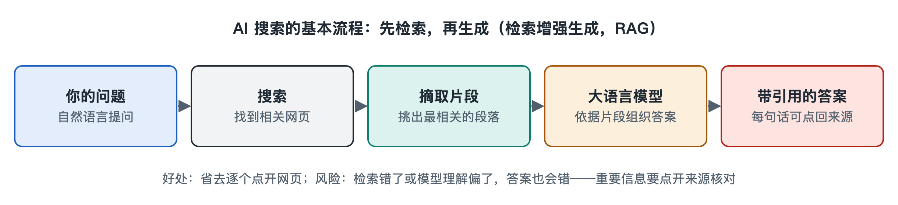

# 4.4 搜索引擎与大语言模型：检索增强生成与 AI 搜索

打开手机上的搜索应用，输入“高血压患者能不能喝咖啡”，写作时不少搜索产品给出的已经不止是十条蓝色链接。结果页顶部常常先出现一段整理好的文字，分几点说明，句子后面挂着小小的角标，点开就是来源网页。再打开一个 AI 对话助手，问同样的问题，它也可能先显示“正在搜索”，几秒后给出带引用的回答。

这两种界面看起来不同，背后却是同一种连接方式：**搜索引擎负责找资料，大语言模型负责读资料、写答案**。本节要讲清楚这两套系统怎样接在一起，以及这种连接会在哪里出问题。

## 4.4.1 两种系统各有短板

大语言模型（Large Language Model，LLM）是在海量文本上训练出来的生成模型，擅长理解问题、归纳要点、组织语言。它的知识来自训练数据，有三个公认的局限：

- **知识有截止时间**：训练结束后发生的事，模型本身并不知道。
- **会“幻觉”**（hallucination）：模型可能生成通顺却与事实不符的内容，比如编出不存在的论文标题。
- **说不清出处**：仅凭模型自身参数生成的回答，很难指出某句话依据的是哪份材料。

传统搜索引擎正好相反。它的索引可以持续更新，每条结果都对应一个真实网页，出处清楚；但它只把文档“递”给你，阅读、比较、归纳的工作要你自己完成。

| 能力 | 传统搜索引擎 | 单独使用的大语言模型 |
|---|---|---|
| 信息时效 | 随索引更新 | 停在训练截止时间 |
| 出处可查 | 每条结果都有网址 | 通常难以追溯 |
| 归纳表达 | 需要用户自己读 | 能直接写成段落 |
| 主要风险 | 结果多、信息杂 | 编造看似合理的内容 |

把两者接起来，让搜索补上“时效与出处”，让模型补上“阅读与表达”，就是检索增强生成的基本思路。

## 4.4.2 检索增强生成：先查资料，再写答案

检索增强生成（Retrieval-Augmented Generation，RAG）这一名称，来自 Facebook AI Research（该公司后更名为 Meta）等机构的研究人员 2020 年发表的一篇论文。今天它泛指一类做法：**在模型生成回答之前，先从外部资料库检索相关内容，把内容和问题一起交给模型，让模型“看着材料作答”**。

可以拿开卷考试来类比。闭卷时，学生只能凭记忆答题，记错了也不知道；开卷时，先翻书找到相关段落，再据此组织答案，答错的概率小，还能注明“见第几页”。RAG 就是让模型从闭卷变成开卷，而搜索引擎扮演的正是那本书和翻书的手。

一个典型的 RAG 流程大致分四步：

1. **改写查询**：把用户口语化的问题改写成一个或多个更适合检索的查询词，复杂问题还可能拆成几个子问题。
2. **检索候选**：用关键词检索（第六章的倒排索引与 BM25）、语义检索（向量检索），或两者结合，找出相关网页或文档片段。
3. **筛选整理**：对候选结果重新排序，截取最相关的段落。模型一次能读的文字长度有限（这个长度称为“上下文窗口”），所以不能把整页网页原样塞进去。
4. **生成并标注**：把问题和这些片段一起交给模型，要求它依据材料回答，并在句子后标出引用来源。

可以看到，RAG 里排在前面的三步，几乎都是本书第二、三章和第六章讲过的搜索引擎老本行。**检索质量决定了答案质量的上限**：材料找错了，模型写得再流畅也只是把错误讲得更好听。

## 4.4.3 AI 搜索产品的几种形态

写作时，搜索引擎与大语言模型的结合在产品上大致有三种形态：

- **搜索结果页里嵌入 AI 摘要**：传统搜索引擎在结果页顶部加一段生成式概览，下面仍保留链接列表。谷歌、微软必应以及国内多家搜索引擎都推出过这一类功能，具体名称和覆盖范围变化较快。
- **以对话为主的 AI 搜索**：界面是聊天框，每个回答都附引用来源，还支持追问。Perplexity 等产品属于这一类。
- **AI 助手调用搜索工具**：通用对话助手在判断问题需要最新信息时，自动调用联网搜索，再据结果作答。

三者形态不同，底层都是“检索 + 生成”。区别主要在于：检索用的是自家的大规模网页索引，还是调用第三方搜索接口；以及何时触发检索、取多少条结果、怎样展示引用。这些细节大多未公开，外界能确认的主要是官方说明中给出的流程框架。

## 4.4.4 新连接带来的新问题

接上大语言模型以后，搜索系统内部各环节的关系发生了变化，也带来了值得读者留意的问题：

- **引用不等于正确**：模型可能把来源里的意思理解偏了，或者把两个来源的内容拼在一起，出现“引用了，但原文并没这么说”的情况。点开角标核对原文，是使用 AI 搜索的基本习惯。
- **来源本身的质量**：如果检索到的是低质量或带有误导的网页，生成的答案就会继承其中的错误。第三章讲的反作弊与质量评估，在 AI 搜索里变得更加重要。
- **与网站的关系在变**：用户在结果页读到概括后，可能不再点进原网站。内容生产者的流量、网站与搜索引擎之间的协作关系（见 4.1 节）因此受到讨论。写作时，一些网站已开始通过爬虫协议区分“允许被索引”与“允许被用于 AI 训练或生成”。
- **成本与速度**：每次生成都要运行大模型，计算开销远高于返回一页链接，所以不少产品只对部分查询触发 AI 回答。

## 4.4.5 小结：搜索是地基，生成是楼上的房间

大语言模型并没有取代搜索引擎，而是把搜索引擎变成了自己的“外接记忆”。爬虫、索引、检索、排序这些看似传统的部件，在 AI 搜索里依然在做最基础的工作；模型则在最后一步，把找到的材料读懂并写成答案。理解了这层关系，就能明白为什么 AI 回答也会出错，以及该怎样核实它。

至此，本章介绍了搜索引擎与网站、用户、广告、大语言模型的四组连接。下一节将把这些连接汇总成一张关系图，并安排几项动手观察任务。
