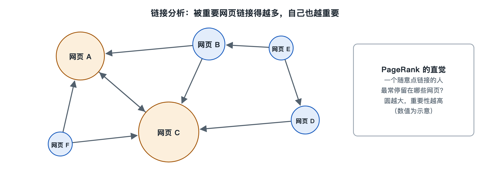

# 6.3 链接分析：PageRank 与网页权威性

打开任意一篇百科词条，拉到页面底部，你会看到一长串“参考资料”；再打开一篇学术论文，末尾同样是密密麻麻的引用列表。人们早就习惯了这样一种判断方式：被很多可靠来源引用的东西，大概率更值得信任。网页也是这样。一个网页里的超链接，就像作者对另一个网页的一次“引用”。上一节讲的 BM25 只看网页自己写了什么，链接分析则去看别人怎样指向它。这一节要讲的，就是怎样把这些“引用”变成可以计算的权威性分数。

## 6.3.1 从“自说自话”到“别人怎么说”

早期的网页搜索主要依靠文本匹配，这很快暴露出一个漏洞：网页作者可以在页面里大量重复热门关键词，让自己显得“高度相关”。只看内容的打分方式，相当于只听网页自己介绍自己。

链接提供了另一种证据。网页 A 链接到网页 B，通常说明 A 的作者认为 B 有参考价值。一个网页被许多网页链接，它就像一篇被大量引用的论文。这个想法在学术界有现成的先例，即用引用次数评价论文影响力的“引文分析”。

不过，单纯数链接有两个问题：

| 问题 | 例子 |
|---|---|
| 链接来源质量不同 | 一个权威机构首页的链接，和一个无人访问的空白页面的链接，分量显然不一样 |
| 链接容易伪造 | 有人可以批量建几千个页面互相链接，人为抬高链接数 |

PageRank 主要针对第一个问题给出了解法。

## 6.3.2 PageRank：一个在网上随便逛的人

PageRank 由谷歌创始人拉里·佩奇（Larry Page）和谢尔盖·布林（Sergey Brin）在 1998 年前后发表的论文中提出，名字里的“Page”既指网页，也取自佩奇的姓氏。它的核心思想可以用一句话概括：**一个网页重要，是因为有重要的网页链接它。**

这句话听起来像循环定义，论文用“随机冲浪者”（random surfer）模型把它变成了可以计算的东西。设想一个人在网上漫无目的地浏览：

1. 他随机打开一个网页；
2. 在当前页面上，从所有外链中随便挑一个点进去；
3. 一直这样点下去，偶尔觉得无聊，就不再点链接，而是随机跳到全网任意一个网页重新开始。

让这个人逛上很长很长时间，统计他停留在每个网页上的时间比例。比例越高的网页，PageRank 值越高。被许多页面指向的网页更容易被“走到”；被高 PageRank 页面指向的网页，得到的“访问流量”也更多。

还有一个细节：一个网页的分量会被平均分给它的所有外链。一个只链接三个网页的页面，每个链接分到三分之一；一个链接了三百个网页的页面，每个链接只分到三百分之一。所以，来自“精挑细选”的推荐页的链接，分量往往比来自“链接大杂烩”的更重。

## 6.3.3 阻尼系数：为什么要“偶尔随机跳一下”

第 3 步里的随机跳转不是可有可无的点缀。它的比例由“阻尼系数”（damping factor）控制，原论文中给出的常用取值约为 0.85，意思是大约 85% 的时候沿链接走，15% 的时候随机跳转。

随机跳转解决了两类结构问题：

- **死胡同**：有些网页没有任何外链，冲浪者到这里就走不下去了；
- **闭环陷阱**：几个网页只互相链接、不链向外部，冲浪者一旦进去就永远出不来，分数会在小圈子里不断累积。

有了随机跳转，冲浪者总能离开这些地方，全网的分数分配才会稳定下来。计算时，系统先给每个网页一个相同的初始分数，然后反复按“沿链接传递＋随机跳转”的规则重新分配，迭代几十轮后，各网页的分数基本不再变化。为什么这个过程一定会收敛到稳定结果，涉及图论中的随机游走和马尔可夫链，留到第八章 8.2 节再细说。

## 6.3.4 其他思路与现实中的位置

PageRank 并非唯一的链接分析方法。几乎同一时期，康奈尔大学的乔恩·克莱因伯格（Jon Kleinberg）提出了 HITS 算法（Hyperlink-Induced Topic Search，超链接诱导主题搜索），把网页分成两种角色：

| 角色 | 含义 | 生活中的类比 |
|---|---|---|
| 权威页（authority） | 被许多好的导航页指向 | 被很多书单推荐的好书 |
| 枢纽页（hub） | 指向许多好的权威页 | 一份靠谱的推荐书单 |

两者互相强化：好书单推荐好书，被好书单推荐的书才是好书。与 PageRank 对全网预先计算不同，HITS 通常针对某次查询的相关网页集合临时计算。

还要澄清一个常见误解：PageRank 不是今天谷歌排序的全部。在写作时，谷歌官方公开说明其排序使用了大量信号，链接只是其中之一，具体用哪些信号、权重各是多少并未公开。外界流传的“某某权重值”多为第三方工具自行估算，不是官方数据。至于其他搜索引擎是否使用、如何使用链接分析，也只能以各家公开文档为准。

## 6.3.5 链接作弊与“不传递分量”的链接

链接一旦变得有价值，就会被人利用。“链接农场”（link farm）、批量购买链接、在论坛和博客评论区大量留链接，都是常见的作弊手段。第三章 3.5 节提到的反作弊系统，很大一部分工作正是识别这类异常链接结构，比如大量新建页面集中指向同一站点，或一群网站之间形成封闭的互链圈。

网站方面也有对应的工具。谷歌等搜索引擎在官方文档中支持在链接上加 `rel="nofollow"` 等属性，表示“这个链接不代表我的推荐”，常用于用户评论、付费广告链接等场景。这相当于网站主动声明：这一票不算数。

## 6.3.6 小结

链接分析把网页之间的链接当作“投票”，让搜索引擎在“网页说了什么”之外，多了一个“别人怎么看它”的视角。PageRank 用随机冲浪者模型，把“重要网页指向的网页也重要”这个看似循环的说法，变成了可迭代计算的分数。它和 BM25 一样，都只是排序时的一个信号。怎样把成百上千个这样的信号合在一起，给出最终名次，就是下一节“学习排序”要回答的问题。
