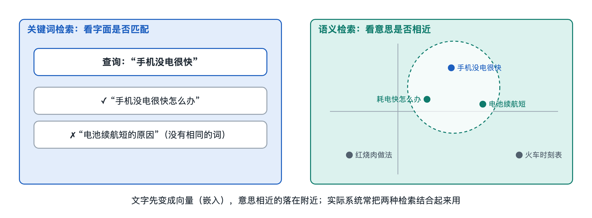

# 6.5 语义检索：嵌入向量与近似最近邻搜索

在搜索框里输入“手机屏幕碎了怎么办”，排在前面的结果里，常常有一篇标题写着“iPhone 显示屏破裂维修指南”的文章。仔细对照会发现，这篇文章的标题里既没有“手机”，也没有“碎了”，更没有“怎么办”。上一节讲的 BM25 靠的是词语的匹配，词对不上，分数就很难高。这篇文章能被找到，是因为另一类技术在起作用：系统不只比较“字面上像不像”，还会比较“意思上近不近”。这类技术叫语义检索（Semantic Retrieval）。

## 6.5.1 词对不上的老难题

基于关键词的检索有两个经典难题。

- **同义不同词**：用户说“感冒”，网页写“上呼吸道感染”；用户说“便宜”，网页写“性价比高”。意思相近，字面却毫不相干。
- **同词不同义**：“苹果”可能是水果，也可能是一家公司；“Java”可能是编程语言，也可能是印尼的岛屿。

信息检索领域把前一种叫作“词汇鸿沟”（Vocabulary Mismatch）。早年的解决办法主要是人工整理同义词表，或者在查询处理阶段做查询扩展，比如把“感冒”自动补上几个相关词。这些办法有效，但同义词表要靠人维护，覆盖不了千变万化的说法。语义检索换了一个思路：先把文字变成能直接比较“意思”的数字形式，再去比较。

## 6.5.2 嵌入向量：给意思找一个坐标

可以先用一个类比理解。地图上每座城市都有经纬度，两座城市坐标接近，实际距离也近。设想有一张“意义地图”，每个词、每句话、每篇文章都有一个坐标，意思接近的内容坐标也靠在一起，“感冒”和“上呼吸道感染”就成了邻居。

这个坐标在技术上叫嵌入向量（Embedding Vector），简称嵌入。它是一串数字，和地图坐标的区别在于维度很多：地图只有经度、纬度两维，嵌入向量通常有几百到上千维，这是公开资料中常见的典型范围。每一维单独看没有明确含义，但整串数字合在一起，记录了这段文字在“意义空间”中的位置。

嵌入向量由神经网络模型生成，称为嵌入模型或编码器。它们通过在大量文本上训练，学到了“哪些说法经常表达同一个意思”。在搜索场景中，常见的做法是双塔模型（Dual Encoder，又称双编码器）：一座“塔”把用户的查询编码成向量，另一座“塔”把文档编码成向量，训练目标是让查询和真正相关的文档向量尽量靠近，和无关文档尽量远离。学术界有代表性的公开工作如 2020 年前后提出的 DPR（Dense Passage Retrieval，稠密段落检索）。

衡量两个向量“近不近”，最常用的是余弦相似度（Cosine Similarity），也就是看两支箭头的方向夹角，夹角越小意思越近；也有系统直接用内积或欧氏距离。

| 对照项 | 关键词检索（如 BM25） | 语义检索（嵌入向量） |
|---|---|---|
| 表示方式 | 稀疏：词表中大部分位置为 0 | 稠密：每一维都有数值 |
| 匹配依据 | 词语是否出现、出现多少 | 向量在空间中的距离 |
| 擅长 | 专有名词、型号、精确短语 | 同义改写、口语化提问 |
| 薄弱处 | 换个说法就找不到 | 对生僻编号、精确数字不敏感 |
| 可解释性 | 能说清是哪个词命中了 | 难以说清为什么“近” |

所以有人把关键词检索叫“稀疏检索”，把向量检索叫“稠密检索”。

## 6.5.3 近似最近邻搜索：在亿万个点里找邻居

文档变成向量之后，检索就成了一个几何问题：给定查询向量，在所有文档向量里找出离它最近的若干个，这叫最近邻搜索（Nearest Neighbor Search）。

最直接的办法是逐一计算距离。文档只有几千篇时完全可行；可如果有上亿篇、每篇是几百维向量，每次查询都全部算一遍，耗时远远超出搜索要求的毫秒级响应。倒排索引能靠“词”快速圈出候选，但稠密向量没有可以直接拿来建目录的“词”。

工程上的答案是近似最近邻搜索（Approximate Nearest Neighbor，ANN）：不保证每次找到的都是严格意义上最近的那几个，但以极高的概率找到足够近的，速度却快上几个数量级。用一点点准确性换大量速度，是这类方法的核心取舍。主流思路有几类：

- **图索引**：把向量连成一张“邻居网”，查询时从某个入口出发，沿着越来越近的邻居一路走过去。代表方法是 HNSW（Hierarchical Navigable Small World，分层可导航小世界图），它像城市交通网：先走高速公路跨城，再换主干道，最后进小街巷。
- **聚类分桶**：先把所有向量分成许多簇，查询时只到离自己最近的几个簇里细找，好比找书时先定位到书架区。IVF（倒排文件索引）就是这一思路。
- **向量压缩**：用乘积量化（Product Quantization，PQ）等方法把长向量压成短编码，省内存、算得快，代价是精度略有损失。

这些方法在公开的开源工具中都有实现，例如 Meta 开源的 Faiss 库；写作时，Elasticsearch、OpenSearch 等搜索系统也已提供向量检索功能，专门的“向量数据库”产品也很多。

## 6.5.4 实际系统怎样用：混合检索

语义检索并没有取代关键词检索。用户搜“GB/T 7714 格式”这样的标准编号，或某个零件型号，字面精确匹配往往更可靠。因此公开资料中常见的做法是混合检索（Hybrid Retrieval）：关键词和向量两路各自召回一批候选，再合并，交给上一节介绍的学习排序模型或更精细的重排模型打分。

至于大型商业搜索引擎，谷歌、微软必应等公司都公开表示过在搜索中使用了基于深度学习的语义理解技术，但具体在哪个环节、怎样组合，大多没有完整公开。可以确认的是原理和方向，不能确认的是各家的内部细节。

语义检索还是第四章讲过的检索增强生成的基础：大语言模型回答问题前，往往先用向量检索找到相关段落，再据此生成答案。从“对词”到“对意思”，搜索引擎多了一种理解方式；而把向量检索真正放进覆盖海量网页的系统，还需要分片、副本等分布式架构的支撑，这正是第七章要展开的内容。
