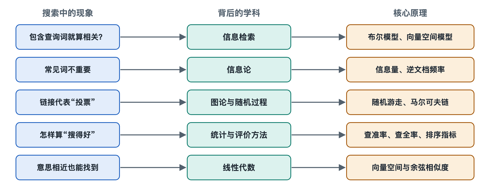

# 8.1 信息检索的基本模型：布尔模型、向量空间模型与概率模型

打开电脑上的文件管理器，在搜索栏里输入“合同 2025”，系统会列出文件名里同时带有这两个词的文件。它只回答“有”或“没有”，不管哪个文件更重要。换到网页搜索框输入同样的词，结果却排出了先后，最上面那条往往最切题。这两种体验背后，是信息检索（Information Retrieval，IR）领域三类经典模型的差别。所谓“模型”，是一套关于“文档与查询怎样匹配、怎样打分”的数学约定。第六章讲过 BM25 和学习排序怎样运行，本节往回追一层，说明这些做法依据什么样的基本思想。

## 8.1.1 布尔模型：只问“是”与“否”

布尔模型（Boolean Model）是最早被系统使用的检索模型，名字来自 19 世纪数学家布尔创立的逻辑代数。它把每篇文档看成一组词的集合，把查询写成用“与（AND）、或（OR）、非（NOT）”连接的逻辑式。比如查询“搜索引擎 AND（排序 OR 索引）NOT 广告”，系统就去找同时满足这几个条件的文档。

它和第六章的倒排索引配合得很好：每个词对应一张文档编号列表，AND 就是求两张表的交集，OR 是并集，NOT 是差集。计算干脆，结果可以精确复现，所以图书馆目录、专利数据库、法律文献库至今仍保留布尔检索，专业检索员也常用它写复杂的检索式。

它的局限同样明显：

- **没有排序。** 文档要么命中，要么不命中，命中的一千篇在模型看来同等重要。
- **过于严格。** 一篇文章八个条件满足了七个，也会被排除。
- **门槛较高。** 普通人很难写出恰当的逻辑式，条件写宽了结果太多，写窄了一条也搜不到。

网页搜索面对的是数量级上亿乃至更多的网页和不懂检索语法的大众，只给出“命中集合”远远不够，必须能比较“谁更相关”。

## 8.1.2 向量空间模型：把相关性变成“夹角”

20 世纪 60 至 70 年代，美国学者杰拉德·索尔顿（Gerard Salton）领导开发 SMART 检索系统，推广了向量空间模型（Vector Space Model，VSM）。它的想法是：把词表里的每个词当作空间里的一个方向，一篇文档就成了这个空间中的一支“箭头”（向量），某个方向上的长度表示这个词在文档中的分量。查询也同样变成一支箭头。

两支箭头方向越接近，说明文档和查询谈论的内容越一致。衡量方向接近程度的常用办法是余弦相似度（Cosine Similarity）：夹角为零时值为 1，完全无关时为 0。用夹角而不用长度，是为了不让长文档仅靠字数多就占便宜。

每个方向上的分量怎么定？最常见的是第六章提到的 TF-IDF：词频（Term Frequency，TF）高说明这个词在本篇里重要，逆文档频率（Inverse Document Frequency，IDF）高说明这个词在全部文档里少见、区分力强。“的”“是”这类词到处都有，权重被压得很低；“倒排索引”只在少数文章里出现，权重就高。

向量空间模型带来三点进步：

1. **部分匹配。** 不必所有词都出现，出现得多、出现得关键，分数就高。
2. **天然排序。** 每篇文档都有一个连续分数，可以从高到低排列。
3. **思路可延伸。** 第六章讲的嵌入向量语义检索，把“词的方向”换成神经网络学出的“语义方向”，计算相似度的思路仍是这一套。

它的弱点在于理论依据偏经验：为什么用 TF 乘 IDF、为什么用余弦，更多是因为实验效果好，模型本身没有说明“相关”究竟是什么意思。

## 8.1.3 概率模型：估计“这篇有多大可能是你要的”

概率模型（Probabilistic Model）换了一种问法：给定查询，一篇文档对用户“相关”的概率有多大？英国学者斯蒂芬·罗伯逊（Stephen Robertson）等人在 1970 年代提出概率排序原理（Probability Ranking Principle）：如果系统按相关概率从高到低排列文档，在一定假设下，整体检索效果可以达到最优。这给“排序”这件事提供了理论依据。

在此基础上发展出二元独立模型（Binary Independence Model），再经过对词频、文档长度的修正，最终形成了第六章介绍的 BM25（Best Matching 25）。BM25 的几个关键设计都能在概率框架里找到解释：

- 词频增加带来的加分逐渐饱和，一个词出现第 50 次和第 51 次差别不大；
- 文档越长，单个词出现的意义越要打折扣；
- 少见的词提供更多证据，对应 IDF 的作用。

此外，概率思路还有另一支：语言模型方法（Language Model Approach），它把每篇文档看作一个“会说话的模型”，计算它“说出”这条查询的可能性有多大。这一思路在学术研究中被广泛采用。

## 8.1.4 三类模型对照

| 维度 | 布尔模型 | 向量空间模型 | 概率模型 |
|---|---|---|---|
| 文档表示 | 词的集合 | 带权重的向量 | 词出现的概率证据 |
| 匹配方式 | 逻辑条件是否满足 | 向量夹角（余弦） | 相关概率估计 |
| 能否排序 | 不能 | 能 | 能 |
| 典型代表 | 专业数据库检索式 | TF-IDF + 余弦 | BM25、语言模型方法 |
| 主要长处 | 精确、可控、可复现 | 部分匹配、直观 | 理论依据清楚，效果稳定 |

这三类模型不是“新的淘汰旧的”，而是层层叠加。从公开资料和开源系统可以确认的情况是：Lucene、Elasticsearch 等开源搜索引擎在写作时默认使用 BM25 打分，同时保留布尔查询语法；用户在网页搜索框里用的引号、减号等高级语法，本质上也是布尔条件。大型商业搜索引擎的具体做法大多未公开，公开论文和行业资料中常见的描述是：先用布尔条件和 BM25 一类方法快速圈出候选，再交给学习排序和语义模型精排，词匹配得分往往仍是众多特征中的一项。具体到某一家怎样组合，外界只能推测。

## 8.1.5 小结：从“有没有”到“有多大可能”

回头看文件管理器和网页搜索框的差别：前者停在布尔模型的“有没有”，后者走到了向量与概率模型的“像不像”“有多大可能”。三类模型分别回答了“怎样筛选”“怎样比较”“为什么这样排序最合理”三个问题。不过它们都只看文档本身的文字，还没有回答另一个问题：同样切题的两篇网页，哪一篇更可信、更重要？下一节将转向网页之间的链接，用图论与随机游走来解释答案。
