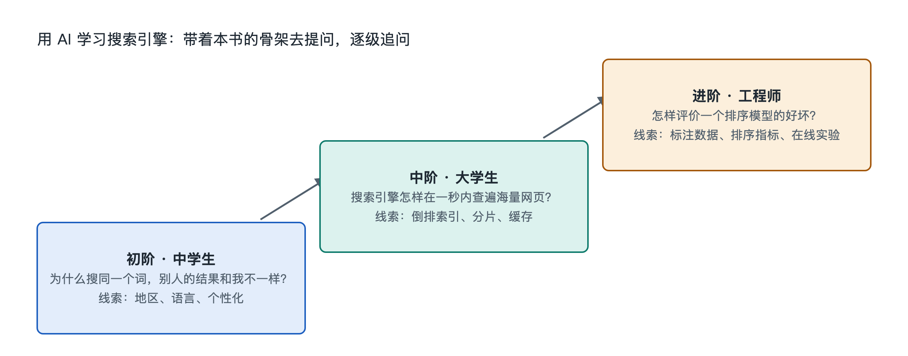

# 9.3 三阶提问阶梯：从中学生到工程师

打开手机上的搜索框，输入“为什么搜索结果每次不一样”。一个初中生、一个信息管理专业的大二学生、一个负责公司站内搜索的工程师，都可能问出这句话，但他们想知道的东西并不相同。初中生想要一个能听懂的解释，大学生想知道背后有哪些模型和算法，工程师则想知道在自己的系统里该查哪条日志、调哪个参数。把同一个问题拿去问 AI 时，问法决定了答案的深度。本节把前八章的骨架整理成三级提问阶梯，帮助读者按自己的起点，一级一级往下追问。

## 9.3.1 第一阶：看懂现象——“它是什么、为什么会这样”

第一阶面向中学生和普通读者，目标是把搜索框背后的现象和书中的骨架对上号。这一阶的问题通常从自己亲眼看到的东西出发，要求 AI 用类比解释，不急于要公式。

- “我搜一个刚发生的新闻，为什么几分钟后才搜得到？请用快递分拣作比喻解释爬虫和索引。”
- “搜索结果第一条旁边写着‘广告’，它和下面的普通结果是怎么排出来的，有什么区别？”
- “同一个词，我和同学搜出来的顺序不一样，可能有哪些原因？哪些是公开资料确认过的，哪些只是猜测？”

这三个问题分别对应第五章的更新流、第四章的广告关系和第四章的用户反馈。最后一问末尾的半句很重要：要求 AI 区分“公开确认”和“推测”。在这一阶，读者要养成一个习惯：AI 说“搜索引擎会根据你的位置调整结果”时，追问一句“出处是哪家搜索引擎的官方说明”。

## 9.3.2 第二阶：理解机制——“它怎样运行、为什么能这样运行”

第二阶面向大学生和专业入门者，目标是把现象拆成可以计算、可以复现的机制。这一阶的问题要带上术语，并要求 AI 给出推导过程或小例子。

- “请用三篇各十个词的小文档，一步步手算 BM25 得分，并说明参数 k1 和 b 各自控制什么。”
- “PageRank 里的阻尼系数为什么常取 0.85 左右？这个取值出自哪篇论文？如果设成 0.5 会怎样？”
- “向量检索里的近似最近邻搜索（ANN）为什么要牺牲一点准确度？请对比 HNSW 和倒排文件（IVF）两类方法的思路。”
- “查准率高而查全率低，在什么搜索场景下是可以接受的？请各举一个例子。”

这一阶的关键做法是让 AI“算给你看”，然后自己再算一遍。第九章 9.2 节搭的小型搜索引擎正好可以用来对照：把 AI 给出的 BM25 结果与自己程序的输出比一比，数字对不上时，往往就是理解出偏差的地方。此外，涉及论文的问题要请 AI 给出论文标题和作者，再到学术搜索引擎里核对，因为大语言模型可能编造看似合理的文献。

## 9.3.3 第三阶：解决工程问题——“在我的系统里怎样做、怎样权衡”

第三阶面向工程师和做网站、做内容的职场人士，目标是把原理落到具体约束下的决策。这一阶的问题必须交代清楚背景：数据量级、所用软件、业务目标和遇到的现象。

- “我们用 Elasticsearch 做商品搜索，文档在百万量级，用户搜‘苹果’时手机和水果混在一起。请从查询理解、字段权重和类目意图识别三个角度给出排查顺序。”
- “站点新发布的文章常常要好几天才被收录。请按站点地图、robots.txt、内部链接和服务器响应列一份自查清单，并注明哪些建议来自搜索引擎官方文档。”
- “我们想在知识库问答中加入检索增强生成（RAG），文本切块长度、召回数量和重排序模型该怎样做对照实验？用什么指标评价？”

这一阶的回答很少有唯一正确解，好的追问是“这个方案的代价是什么”“有什么反例”。对于开源软件的配置和接口，AI 的知识可能落后于当前版本，最终应以官方文档和实际测试为准。

## 9.3.4 三阶对照与核查原则

| 阶梯 | 典型读者 | 对应章节层次 | 提问要点 | 核查方式 |
|---|---|---|---|---|
| 第一阶 | 中学生、普通读者 | 对象、结构、功能、连接 | 从现象出发，要类比 | 追问出处，区分事实与推测 |
| 第二阶 | 大学生、入门者 | 流动、机制、原理 | 带术语，要推导和例子 | 自己复算，核对论文 |
| 第三阶 | 工程师、从业者 | 关键技术、AI 协同 | 交代约束，问权衡 | 查官方文档，做实验 |

三级阶梯并不是固定身份。一个中学生完全可以在弄懂倒排索引之后，跳到第二阶去手算词频；一个工程师在面对陌生的多模态搜索时，也不妨回到第一阶，先请 AI 用比喻讲清楚。无论站在哪一级，有两条原则不变：一是把问题挂在书中的骨架上，知道自己问的是哪一层；二是把 AI 的回答当作线索，而不是结论，用搜索、原始文献和动手实验去核实。

从搜索框出发，沿着这条阶梯往下走，读者问出的问题会越来越具体，得到的答案也会越来越可检验。下一节将回顾本章的骨架，并留下最后几项实物探索任务。
