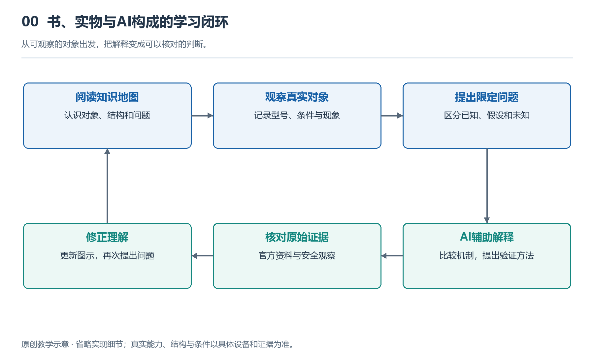

# 0.1 一套面向AI时代的系统知识基础读物：八个系列与62本规划

当你戴上一副智能眼镜，开口询问眼前的路牌，一句回答背后可能已经发生了图像采集、无线传输、文字识别和语音播放。看起来只是眼镜在回应，实际参与工作的却可能还有口袋里的手机、通信网络和远处的服务器。日常用品越来越容易使用，支撑它们的系统却未必越来越容易理解。

文军提出的《AI时代系统知识基础读物》，正是希望为普通读者提供一张理解这些系统的知识地图。全套规划包含八个系列、62册，覆盖从个人设备到社会运行的不同尺度。这是系列的规划数量，不表示所有书目都已经出版。本书《智能眼镜》属于第一系列“个人数字与计算系统”，为该系列第五册。

{width=95%}

从可观察的对象出发，把解释变成可以核对的判断。 原创教学示意，不按比例，不代表某一产品的实测或拆解。

为什么在AI能够回答大量问题的时代，还需要这样的基础读物？因为得到解释不等于建立理解。我们可以很快查到“光波导”“传感器”或“云计算”的定义，却仍然不知道它们在一件产品中分别承担什么任务，也不清楚一个环节变化为何会影响整体体验。系统知识要补上的，正是零散概念之间的联系：谁依赖谁，什么在流动，哪里存在限制，以及一个看似简单的结果怎样由多个环节共同产生。

八个系列不是把知识装进互不相通的盒子，而是为读者安排不同的观察入口。第一系列“个人数字与计算系统”规划8册，从身边可接触的设备进入，理解个人如何获取、处理和使用信息。智能眼镜就在这一层：它贴近人的眼睛和耳朵，却又连接着更大的计算与通信系统。

第二系列“芯片与电子系统”规划8册，把视线移向设备内部，关注计算、存储、感知和电路怎样获得物质基础。第三系列“人工智能与软件系统”规划8册，转向程序、数据和智能处理，帮助读者理解硬件为何能执行不同任务，以及软件能力为什么也有条件和边界。

第四系列“通信与信息基础设施”规划7册，关注设备之间如何建立连接，以及信息服务怎样获得持续支撑。第五系列“智能机器与制造系统”规划8册，把观察对象扩展到能够感知、运动和参与生产的机器。第六系列“能源与交通系统”规划8册，关注能量供给与人员、物资的移动。第七系列“现代城市与基础设施系统”规划7册，进入城市公共生活所依赖的系统。第八系列“现代社会运行系统”规划8册，进一步观察组织、协作与社会运行。

这些尺度彼此相连。一副眼镜需要芯片和软件，联网服务依赖通信设施，制造与使用又离不开能源和生产体系。不过，建立联系不意味着每次都要追溯全部背景。知识地图的作用，是让读者知道自己正在观察哪一层，以及遇到问题时可以向哪个方向深入，而不是要求一次掌握所有领域。

这套读物面向普通读者、学生及教师，不预设工程专业基础。它希望提供的不是一份不断加长的术语清单，而是一种可逐步积累的理解：看见一个对象，能分辨它的组成；了解一种功能，能追问它的实现条件；听到一项能力宣称，能想到需要核对哪些依据。

从智能眼镜开始，我们将遇到光、声音、计算、感知与AI，也会遇到佩戴舒适、隐私和使用环境等现实约束。眼镜虽小，却足以成为认识复杂系统的入口。沿着这一入口展开，八个系列的意义便逐渐清楚：不是把世界压缩成62个答案，而是为继续理解世界建立一套彼此连通的基础。
