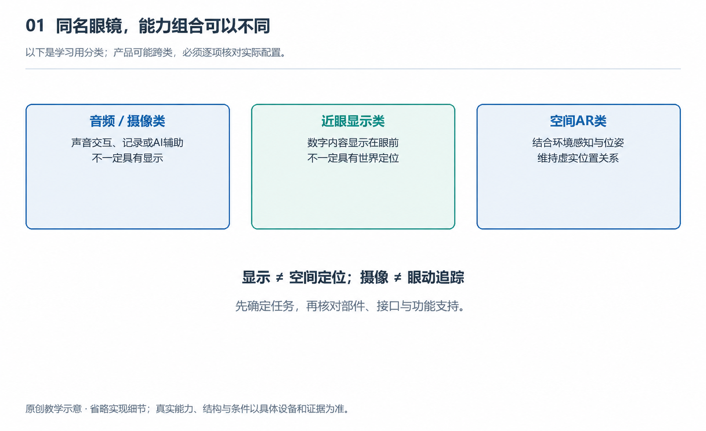

# 1.1 从一天的使用场景认识智能眼镜

早晨出门前，你戴上一副眼镜。它可能只是替代耳机，让你听见天气和日程；也可能在镜片前呈现消息；还可能在你走动时，让一个数字标记保持在房间里的某个位置。这些体验都可能被称为“智能眼镜”，背后的系统却并不相同。认识它们，最好先不看宣传中的功能清单，而是沿着一天的生活，观察它接收什么、输出什么，又依靠谁完成任务。

下面的场景涉及不同类型的设备，并不意味着某一副眼镜同时拥有全部能力。实际功能取决于型号、配套设备、软件服务和所在地区，购买或使用时都需要逐项核对。

{width=95%}

以下是学习用分类；产品可能跨类，必须逐项核对实际配置。 原创教学示意，不按比例，不代表某一产品的实测或拆解。

## 1.1.1 早晨：耳边有声音，不等于眼前有画面

你一边整理背包，一边让眼镜播放音乐。镜腿中的扬声器把声音送到耳边，耳道没有被耳塞堵住，因此仍可能听见门铃和家人的说话声。这种开放式听音方式方便交流，却不能保证周围声音总能听清，也不能保证旁人完全听不到播放内容。环境越嘈杂，越容易让人想提高音量，而提高音量又会改变聆听舒适度和对环境的注意。

这时的眼镜可能没有显示器，镜片也没有呈现任何数字信息。它的“智能”首先体现在连接和控制：眼镜接收按键、触摸或语音指令，与手机配合选择内容，再播放声音。音乐可能保存在手机里，也可能来自网络。看起来是眼镜在工作，实际参与者还包括手机上的应用和通信连接。

出门前，你说：“告诉我今天的安排。”如果设备支持相关功能并获得权限，它可以读取日程并用语音播报。但能播放音乐，不代表一定能读取日历；能识别一句指令，也不代表能自由回答所有问题。每一种体验都有相应的软件、权限和服务条件。

## 1.1.2 通勤：记录、提示与导航是不同任务

走到街角，你想拍下刚开放的花。带摄像头的眼镜可以让你不用掏出手机就记录眼前景物，但相机拍到的是镜头朝向和取景范围内的画面，并非眼睛正在注视的内容。你只转动眼球看向路边，镜头未必也对准那里；花朵进入画面，也不表示它已经清晰成像。第一视角记录只是接近佩戴者的观察位置，并不等于完整复制人的视觉体验。

拍摄还把周围人带进了系统关系。录制提示有助于旁人察觉设备正在工作，却不能代替征得同意。在住宅、教室或工作场所，应先考虑是否允许拍摄，而不是因为操作方便就默认可以记录。

接下来，手机收到一条消息。无显示眼镜可能发出提示音，或在设置允许时朗读内容；显示眼镜则可能把文字送到眼前。两者都能提醒你，却占用不同的注意资源。私人消息是否适合在耳边播报，文字是否遮挡了需要观察的道路，都是功能之外的实际问题。

导航同样不能只看“支持导航”四个字。有的设备仅播报转弯提示，有的显示方向和距离，还有的空间AR系统能够依据环境追踪，把数字提示与现实位置关联。显示一个箭头，不等于已经理解街道；眼镜收到的位置，也可能来自手机，而非自身装有卫星定位模块。过路口时，仍应以实际交通情况为准。

## 1.1.3 白天：把屏幕放到眼前，与把物体放进空间

到达教室或办公室，你连接一副显示眼镜，阅读文档或观看课程。微小的显示器与光学组件配合，把图像光送入眼睛，使你看见仿佛位于一定距离处的画面。这里的“屏幕”不必是一块摆在桌上的实体面板，但它也不是凭空出现的：内容需要由眼镜或连接的主机生成，再经过显示和光学系统呈现。

这样的设备可能主要承担显示任务，不一定带摄像头，也不一定知道桌子和墙壁在哪里。有些画面随头部方向移动，有些可以借助相应的跟踪能力保持一定的方向关系，但不能仅凭“画面很大”就判断它具备空间AR能力。

如果教学任务是观察一个放在桌面上的数字分子模型，并绕到另一侧查看，要求便不同了。系统必须持续估计眼镜相对环境的位置与朝向，据此更新画面，让模型看起来仍留在桌面原处。这种数字内容与真实环境保持位置关系的体验，需要环境追踪、计算和显示共同配合。光线不足、环境特征不明显或跟踪中断，都可能影响稳定性。

因此，“能显示”与“能在空间中稳定呈现”是两层能力。前者解决信息如何进入视野，后者还要解决信息应当出现在环境的什么位置。

## 1.1.4 傍晚：一句回答背后，还有一套系统

回家路上，你面对一张外文告示，想让眼镜帮助理解。具备相应能力的设备可能采集图像，再由本地、手机或云端处理，最后用语音或文字给出解释。这不是摄像头单独完成的工作：图像是否清楚、网络是否可用、文字是否被遮挡，都会影响结果。回答流畅也不意味着识别无误，涉及日期、费用或安全要求时，应回看原文核验。

晚上取下眼镜充电，一天的体验便有了另一种解释：方便来自多个环节的配合，限制也来自这些环节。镜架里的空间、电池储能、散热条件、无线连接以及人的注意力，共同决定它能连续做什么。认识智能眼镜的起点，不是问它是否足够“聪明”，而是先看清：这副眼镜属于哪类设备，在什么条件下，与哪些伙伴一起完成了什么任务。
