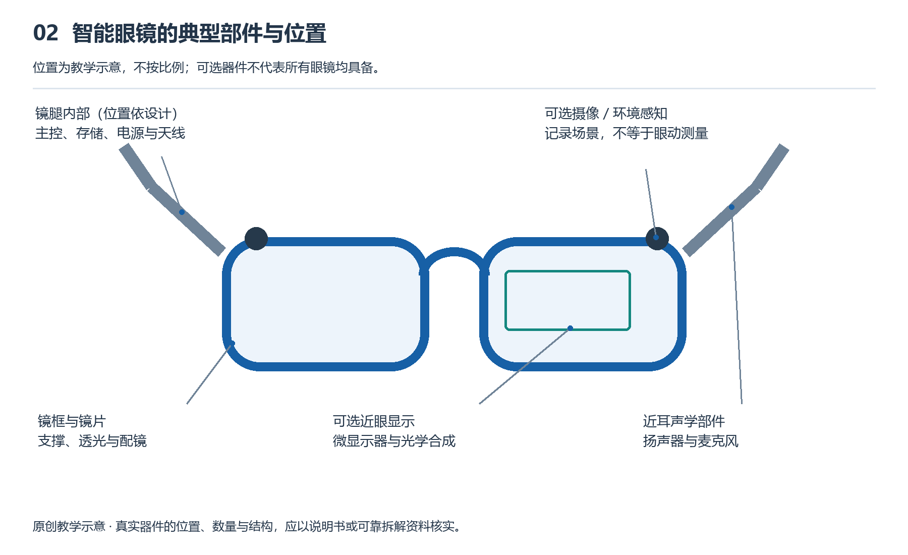

# 2.1 从整机示意图看各部分如何组合

把一副智能眼镜放在桌上，首先看到的是镜框、镜片、镜腿和铰链。这些熟悉的外形容易让人以为，它只是普通眼镜加上几个电子零件。然而，镜腿为什么较厚，摄像头为什么朝前，扬声器为什么靠近耳朵，充电触点为什么设在某个位置，都与整机如何工作有关。看懂结构的起点，不是背下零件名称，而是知道各部分放在哪里、怎样连接，以及为什么这样安排。

整机示意图正是帮助我们建立这种理解的工具。它会省略螺钉、表面纹理等细节，突出支撑结构、电子部件和连接关系。不过，示意图不是内部照片，也不一定按真实比例绘制。图上为了便于阅读而分开的部件，在实物里可能紧贴、重叠，或封装在同一模块中；图上相邻的两个模块，也未必直接连接。读图时必须分清：哪些表示位置，哪些表示功能，哪些线条代表电路或信号联系。

{width=95%}

结构示意不按比例；显示、摄像和眼动部件均取决于具体型号。 原创教学示意，不按比例，不代表某一产品的实测或拆解。

首先要确认图画的是哪一类眼镜。无显示的音频眼镜可能主要包括麦克风、扬声器、处理器、电池和无线连接部件；加入摄像能力后，还需要镜头、图像传感器及相应处理电路。显示眼镜则增加微型显示器与光学组件，但未必配有摄像头，也未必能判断自己在房间里的位置。具备环境追踪能力的空间AR设备，还需要支持运动与环境感知的硬件及计算系统。不能把这几类产品的部件全部拼在一起，便称作每副智能眼镜的标准结构。

确认类别后，可以从最外层的机械结构看起。镜框固定镜片，也可能为摄像头或显示光学组件提供安装基准；镜腿既承担佩戴支撑，也常用于容纳电池、电路板和扬声器。鼻托、铰链与连接件看似不参与计算，却决定整机能否稳定地停在合适位置。对于显示眼镜，镜架轻微下滑就可能改变眼睛与出光区域的相对位置。因此，机械结构不只是电子系统的外壳，也是功能正常发挥的条件。

接着寻找系统与外界交换信息的位置。麦克风把声音转成电信号，扬声器把电信号转成声音，摄像头接收环境光并形成图像数据。它们的安装方向受任务约束：摄像头需要朝向待拍摄区域，扬声器要让声音有效到达耳边，麦克风的开孔则不能被结构轻易遮挡。示意图上的小孔未必都是麦克风，透明窗口也未必都是镜头；辨认具体产品时，应结合官方说明，不能仅凭外观推断内部用途。

有显示的眼镜还要单独追踪成像部分。微型显示器负责产生图像，光学组件负责改变光的传播方向和成像关系，把图像送到眼睛可以观看的位置。这两者功能不同，不能把整块镜片都当作显示屏。有些设计使用波导，也就是引导光传播并将其导向眼睛的光学结构；另一些采用其他光学组合。读图时，重点是找出图像从哪里产生、经过哪些组件、最终从哪里进入眼睛，而不是先认定所有产品都有同一条光路。

再往内部看，是处理器、存储器与各种传感器。处理器执行指令、处理数据，存储器保存程序或暂存工作数据，运动传感器则提供与转动、加速度等有关的测量信息。图中这些功能可能画成几个方块，实物中却可能集中在少数芯片或模块里。反过来，一个“计算模块”方块也可能包含多颗器件。功能上的分工与物理上的分件并不总是一一对应，这是阅读系统示意图时很重要的区别。

把这些部分连起来的，是电路板、导线和连接器。电路板不仅承载元件，也通过导电线路传递电能和信号。眼镜内部空间狭长，有的区域需要坚硬稳定的电路板，有的连接则适合使用可以弯曲的柔性电路。若线路经过铰链附近，还要考虑反复折叠带来的应力。因此，图上一条简单的连接线，到了真实产品中，可能涉及走线空间、装配方式和长期可靠性等多项要求。

电池和天线也不能作为图边缘的附属物略过。电池要向各部分供电，相关电路还要完成电压转换、充电管理和保护。天线用于收发无线信号，其周围的金属、电路和人体都会影响工作条件。与此同时，处理器等部件工作时产生的热量需要向周围传递。于是，一个位置是否“放得下”，并不是布局的全部标准；它还必须适合散热、通信、重量分配和佩戴接触。

可以用一次拍照来检查自己是否读懂了组合关系。对于具备拍摄功能的眼镜，操作输入触发拍摄，摄像头获得图像，处理器完成相应处理，数据进入存储器，系统再通过声音或其他方式反馈结果。照片是否传到手机，则取决于产品设计和连接状态。沿着这项任务追踪，会发现摄像头不是孤立工作的：它同时依赖供电、控制、存储以及反馈部件。整机结构的意义，就体现在这些配合之中。

最后，还应看看示意图的边界是否只围住了镜架。有些眼镜需要手机提供网络、定位或计算，有些显示眼镜通过线缆连接外部主机。镜架内没有某个部件，不一定意味着整个系统无法完成相关任务，也可能是任务被分配到了外部设备。具体分工及可用功能，应以型号、地区和使用条件为准。读懂整机示意图，就是从外形走向组织关系：既看见各部分，也看见它们怎样共同构成一套能够工作的系统。
