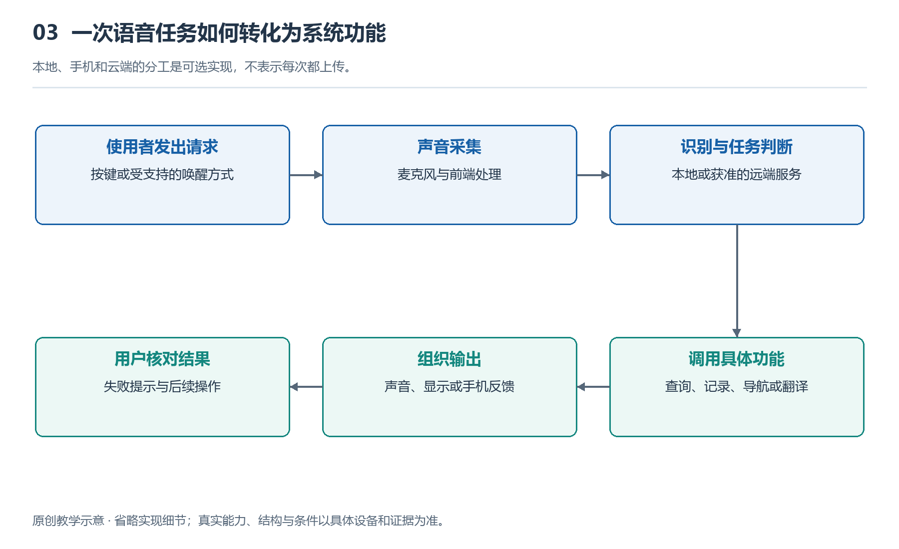

# 3.1 听音乐与接电话：开放耳朵如何传递声音

早晨出门，你戴好眼镜，在镜腿上轻触一下，手机里的音乐便从耳边响起。走到小区门口，仍能听见保安的招呼；来电时，再做一次操作，音乐暂停，对方的声音接了进来。这个过程看似只是“把耳机装进眼镜”，实际却包含两项不同的任务：一项是把声音送给佩戴者，另一项是把佩戴者的话清楚地送到远端。理解它们，才能知道开放式音频为什么方便，又为什么不能适合所有环境。

所谓开放式音频，首先描述的是佩戴关系：设备不以耳塞封住耳道，耳朵仍然与周围空气相通。常见做法是在镜腿靠近耳朵的位置设置微型扬声器，让声音经过一小段空气路径进入耳道。它与骨传导不是同一个概念；骨传导主要通过机械振动把声音传向内耳，不能因为眼镜没有耳塞，就认定它采用了骨传导。具体使用哪种发声方式，需要查看对应型号的说明。

{width=95%}

本地、手机和云端的分工是可选实现，不表示每次都上传。 原创教学示意，不按比例，不代表某一产品的实测或拆解。

## 3.1.1 音乐怎样到达耳边

以眼镜连接手机播放音乐为例，手机先取得音乐数据，再通过无线连接把音频送往眼镜。眼镜中的电路把数字形式的声音还原为驱动信号，经放大后推动扬声器振膜振动。振膜带动空气产生压力变化，这些变化传到耳朵，才形成我们听到的音乐。有些设备还会调整不同频段的强弱，使小体积扬声器在特定佩戴位置获得较合适的听感。

这里的关键不只是“扬声器够不够好”，还有它与耳朵的相对位置。同一副眼镜，镜腿离耳道入口的距离、出声口的朝向以及佩戴松紧发生变化，听到的音量和音色都可能改变。眼镜向鼻尖滑动后，声音变薄，不一定是无线连接出了问题，也可能只是声音传播的条件变了。因此，调整佩戴位置往往比直接提高音量更值得先尝试。

开放结构带来的自由，也有声学上的代价。耳道没有被封住，外界噪声容易进入，扬声器发出的声音也可能向周围扩散。低频声音波长较长，小型开放结构要高效呈现有力度的低音并不容易。设计者可以借助出声口布局、声学腔体和信号处理改善表现，但无法让轻巧、低音、低漏音和低功耗都毫无代价地达到最好。

在安静房间里，较低音量就可能听清人声；到了车流密集的街道，同样的声音会被环境声掩盖。这种“掩蔽”不是音乐数据消失了，而是其他声音让耳朵更难分辨它。继续提高音量，可能同时增加耳朵承受的声音和旁人听到的漏音。更合理的选择，常常是暂停播放、走到安静处，或改用更适合当时环境的设备，而不是要求眼镜压过所有噪声。

## 3.1.2 接电话为何更复杂

听音乐主要关心向耳朵送声，接电话则需要双向同时工作。对方的话从手机传到眼镜，再由扬声器播放；你的话则由麦克风采集，经处理和传输送往对方。连接方式、手机系统与应用支持都会影响这条链路，不能仅凭“可以无线播放音乐”，就断定所有应用的通话功能都同样可用。

麦克风收到的并不只有你的声音，还可能包括风声、身旁人的谈话，以及眼镜扬声器正在播放的对方声音。若后者又被传回去，对方就可能听见自己的回声。为此，系统可以利用已知的播放信号，估计它经过空气和镜架传播后进入麦克风的部分，再尽量从采集信号中去除，这就是回声消除。它不是简单地把某一种声音关掉，而是在不断变化的声学条件下进行估计。

有些眼镜使用多个麦克风，通过比较声音到达不同位置的差异，增强更可能来自佩戴者嘴部方向的成分，同时减弱部分干扰。这类处理不能把所有背景声彻底消除：风直接吹过麦克风形成的扰动、身旁很近的说话声，都可能让处理变得困难。降噪过强时，还可能把人声的一部分误当作噪声，使对方听到断续或失真的话语。

因此，一次通话“我听得清”和“对方听得清”是两个判断。前者更多受到扬声器、佩戴位置和环境噪声影响，后者则与麦克风、语音处理、网络和说话方式有关。遇到问题时，可以先区分方向：是对方声音太小，还是对方抱怨你的声音不清楚？这一问，比笼统地认为“眼镜音质不好”更有助于找到原因。

## 3.1.3 开放不等于没有边界

开放耳朵有助于保留环境声音，但不保证佩戴者一定注意到周围变化。音乐、通话内容和路面情况仍会争夺注意力。过路口、骑行或操作设备时，应按当地规则和现场风险决定是否暂停使用，不能把“耳道没堵住”当作安全保证。

同样，定向发声也不意味着旁人绝对听不到。在安静的电梯或办公室里，即使音量不高，附近的人仍可能听见部分内容；涉及私人信息时，换到合适地点比依赖宣传中的“私密音频”更可靠。实际漏音、通话效果和控制方式，应按具体型号、地区功能及使用条件核对。

听音乐与接电话的便利，来自扬声器、麦克风、处理电路、手机和网络的共同配合。开放式设计让声音更自然地伴随日常活动，也把环境、隐私和注意力带进了系统。理解这些条件，才能判断什么时候该继续听，什么时候该暂停或换一种沟通方式。
