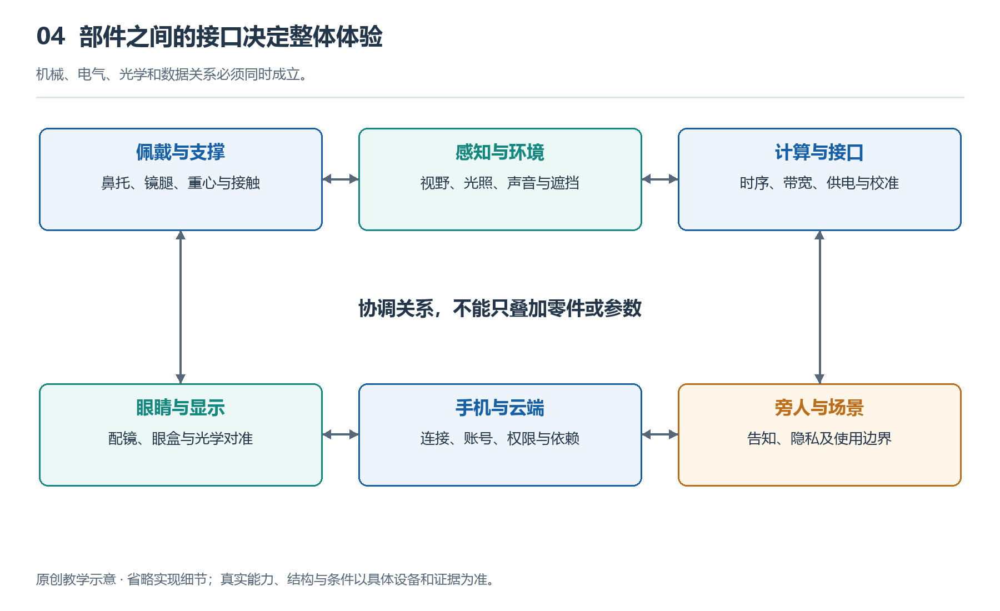

# 4.1 从关系示意图看系统为何不能只看零件

设想你戴着一副支持通话的智能眼镜，从安静的房间走到车流不断的街边。眼镜没有更换任何零件，通话体验却可能明显改变：你听不清对方，对方也觉得你的声音混入了风声。如果只检查“有没有麦克风、有没有扬声器”，这件事很难解释。真正变化的是零件与环境、零件与佩戴者之间的关系。认识系统，不仅要知道它由什么组成，还要知道各部分通过什么相互作用，在什么条件下才能共同完成任务。

前面讨论结构时，我们把眼镜分成镜架、声音器件、摄像头、计算单元等部分。现在需要把这些部分重新联系起来。结构回答“什么放在哪里”，关系进一步回答“谁影响谁、谁依赖谁”。一副眼镜即使拥有性能不错的器件，也未必能形成同样出色的整机体验，因为器件之间还需要位置匹配、信号配合和资源协调。

{width=95%}

机械、电气、光学和数据关系必须同时成立。 原创教学示意，不按比例，不代表某一产品的实测或拆解。

## 4.1.1 把零件清单变成关系图

理解关系示意图，可以从一项具体任务开始，而不必一开始就把所有连接画满。以接听电话为例，先确定几个对象：佩戴者、眼镜、手机、通信网络以及周围环境。再追问它们之间发生了什么：手机向眼镜传递通话声音，扬声器把声音送向耳朵；麦克风采集佩戴者的讲话，经处理后送回手机；周围的车声和风声也会进入这条链路。

这里的连线不能只表示笼统的“有关”。从手机到眼镜的连线可以标注“音频数据”，从扬声器到耳朵的连线可以标注“声音传播”，从街道环境到麦克风的连线则表示“环境声干扰”。同样是连线，代表的作用并不相同。标清作用，才能知道问题可能在哪一段发生。

关系还有方向。手机发送声音给眼镜，不代表手机也能直接知道佩戴者是否听清。系统若没有相应的检测与反馈，就只能按既定设置播放。人觉得声音太小后调高音量，才形成了另一条从感受到操作的反馈关系。不要把图上的连接，误读为系统已经具备理解结果的能力。

## 4.1.2 同一零件，换一种关系就有不同表现

扬声器是一个直观的例子。开放式音频不堵住耳道，但声音能否清楚到达耳朵，还与扬声器的位置、出声方向、佩戴松紧和环境噪声有关。镜腿略微滑动，器件本身没有变化，耳边的声音却可能变化。因此，佩戴结构并非声音功能之外的包装，而是声音传递条件的一部分。

摄像头也一样。它固定在镜框上，拍摄方向随镜架姿态变化，但人可以只转动眼球而不转头。于是，镜头朝向、头部方向和眼睛注视方向之间并没有天然的一一对应关系。若某项功能要判断佩戴者正在看哪里，就必须核对是否配备相应传感器、校准过程和软件支持，不能因为眼镜有摄像头，就补上一条并不存在的“读取视线”关系。

这些例子说明，参数通常描述器件在特定条件下的表现，体验则发生在多个对象相互作用的过程中。只比较器件名称或单项指标，容易漏掉安装位置、人体差异和使用条件带来的影响。

## 4.1.3 关系不只有数据，还有约束

系统中有些关系不直接传递信息，却决定任务能持续多久。例如，处理器运行会消耗电能并产生热量；电池、散热路径和镜腿接触皮肤的区域，共同约束着处理器能够持续承担的负荷。提高计算能力可能改善某些识别任务，但如果功耗和温升随之增加，系统就可能降低运行强度。这里不是某个零件单独“拖后腿”，而是多种要求需要协调。

显示眼镜还存在光学组件、眼睛位置与镜架稳定性之间的关系。图像已经产生，并不意味着眼睛在任何位置都能完整看见。眼睛需要处于设计允许的可视区域，也就是“眼盒”内；镜架滑落可能使眼睛偏离这一区域。此时，调整佩戴位置可能比修改画面内容更有效。没有显示的音频摄像眼镜则不存在这条近眼显示关系，不能把不同类别的系统强行画成同一张图。

还应区分“互相连接”与“能够替代”。眼镜连接手机后，手机可能提供网络、定位或部分计算，但不能由此断定所有功能都能转交手机。数据能否及时传送、软件是否支持、权限是否开放，都会影响分工。具体能力仍要按型号、地区和使用条件核对。

## 4.1.4 用关系定位问题，也识别边界

遇到功能异常时，关系图提供的不是现成答案，而是一种排查顺序。比如语音请求没有回应，可以先区分：眼镜是否收到声音，是否触发识别，手机连接是否正常，相关服务是否可用。若一开始就认定“麦克风不好”，可能更换了器件，也没有触及真正的问题。

反过来，一项功能成功，也不能证明所有关系都可靠。安静房间里完成一次通话，只说明当时的声音、连接和环境条件允许任务完成，不能直接推出嘈杂街头也有同样效果。评价系统，需要说明任务、条件和观察到的结果，而不是把一次体验扩大成无条件的能力。

从零件走向关系，我们便开始把眼镜看作处在人体、设备和环境之中的系统。接下来讨论眼睛、耳朵、摄像头与外部设备时，始终可以保留同一个问题：眼前的体验，究竟由哪些相互作用共同造成？
