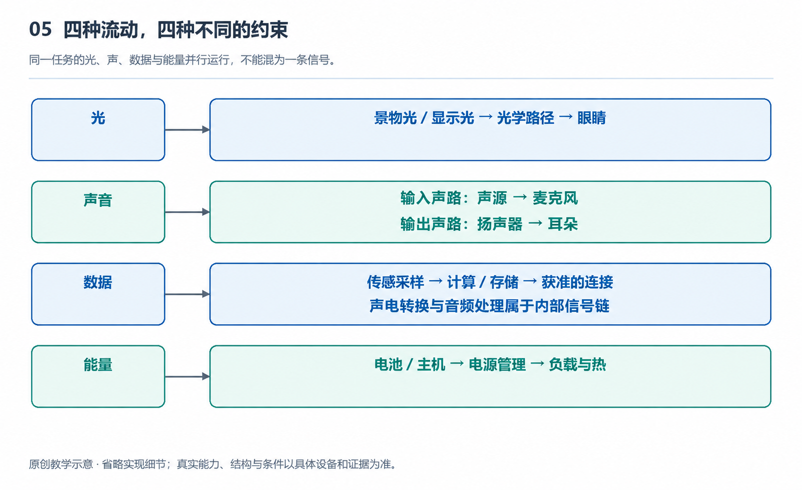

# 5.1 沿着流动示意图追踪一次完整任务

站在一块外文展牌前，你对眼镜说：“帮我读一下这段介绍。”稍等片刻，耳边传来中文解释。这个过程看起来只是一问一答，实际上，光、声音、数据和能量已经在多个部件之间接力。理解智能眼镜，不能只知道它装着什么，还要追问：什么从哪里来，经过哪里，最后变成了什么？

我们以一副支持拍摄、语音交互和图像问答的无显示眼镜为例，假设它连接手机，并由云端服务参与识别和翻译。这是用于解释的任务场景，不代表所有产品都有这些能力；具体功能仍取决于型号、地区、软件版本与权限。它没有显示器，结果通过扬声器播放，不能因此被称为空间AR。

{width=95%}

同一任务的光、声、数据与能量并行运行，不能混为一条信号。 原创教学示意，不按比例，不代表某一产品的实测或拆解。

## 5.1.1 先画清任务的起点和终点

理解流动示意图，首先要确定这次任务包括哪些对象。展牌、佩戴者、眼镜、手机和云端都在任务链上，但职责不同。展牌提供待识别的内容，佩戴者发出请求，眼镜负责采集与播放，手机可能承担连接和部分处理，云端则可能完成图像理解与语言生成。

画图时，可以把这些对象分别标出，再用带名称的箭头连接。箭头上写“景物光”“语音数据”或“图像数据”，比只画一条笼统的连线更有用。因为连接存在，不等于任何信息都能通过；同一条无线连接也可能先后承载控制指令、图像和音频。

还要给任务划出终点。“云端已经生成答案”不是用户任务的终点；答案真正到达耳边，而且能够听懂，才算完成这次交互。这样划定范围，便不会把某个部件工作正常，误认为整个系统已经成功。

## 5.1.2 两种输入在这里会合

首先到达眼镜的是声音。你说话时，空气中的压力变化传到麦克风，转成电信号，再被转换为数字形式。系统由此判断你说了什么、是否需要调用摄像头，以及接下来该执行哪项操作。语音唤醒不等于持续向云端上传录音，哪些声音被处理、保存或发送，要看具体实现与设置。

另一条输入来自展牌。环境光照到牌面，部分光被反射，经过镜头到达图像传感器，形成可以处理的图像数据。这里必须分清：不是文字本身穿过镜头进入计算机，而是文字区域的明暗、颜色等光学信息先被记录，随后才可能被识别成文字。

你的眼睛和摄像头也并非共用同一个观察位置。你觉得已经看清的字，可能处于镜头画面边缘，或被反光遮住。因此，语音中的“这段介绍”并不天然对应一块明确的图像区域。系统需要把请求与拍到的内容联系起来；如果画面中有多段文字，可能还需要追问，不能仅凭一句“读一下”就保证选对目标。

## 5.1.3 数据不是原封不动地搬运

图像采集完成后，数据通常还要经过筛选、调整和压缩。压缩是用更少的数据表示内容，便于存储和传输，但压缩过度可能损失细小笔画。由此可见，传得更快与保留更多细节之间存在取舍，不能孤立地追求某一项指标。

在这个假设场景中，眼镜把必要的信息传给手机，再由手机经网络送往云端。手机可能只负责转发，也可能先做部分处理。云端收到的可能是图像和语音，也可能是已转换的文字与任务指令，具体路径由产品设计决定。不能因为回答来自云端，就认定所有原始输入都一定上传。

数据沿途还会改变含义。最初是图像中的明暗分布，经过文字识别后成为字符，再经过翻译或解释变成中文回答。每次转换都有出错的可能：拍糊可能导致漏字，识别错误可能改变句意，生成解释时也可能加入图中没有的信息。流动示意图因此不仅标明“经过哪里”，还应标明“在哪里发生转换”，以便沿链条查找错误来源。

## 5.1.4 回答返回时，能量一直在流动

结果生成后，还要沿返回路径到达眼镜。系统可以先传回文字，再由相应设备合成语音，也可以传回音频数据。眼镜的播放电路把数字音频转换为驱动扬声器的电信号，扬声器振动空气，声音最终到达耳朵。网络传输成功，并不能保证这一段也顺利：音量、环境噪声和佩戴位置都会影响听清程度。

与数据流同时存在的，是能量流。电池通过供电电路，为麦克风、摄像头、处理器和无线通信等部分提供电能；播放回答时，扬声器也需要能量。部分能量成为声音等输出，许多最终转化为热。能量不是像文件一样从眼镜“发给云端”，手机和云端设备各有自己的供电来源。

这些环节还占用时间。采集、处理、传输和播放的等待可能逐步累积，也可能因并行工作而有所重叠。若回答迟迟未到，原因可能在网络，也可能在排队处理或设备状态。只看一个芯片的速度，无法解释完整任务的响应时间。

沿着一次任务追踪下来，我们得到的不是一串零件名称，而是相互衔接的因果关系：光和声音提供输入，数据承载与改变信息，能量支持每一步，时间则贯穿全过程。接下来分别观察这些路径，就能更准确地理解眼镜为何有时顺畅，有时却在某个环节停下来。
