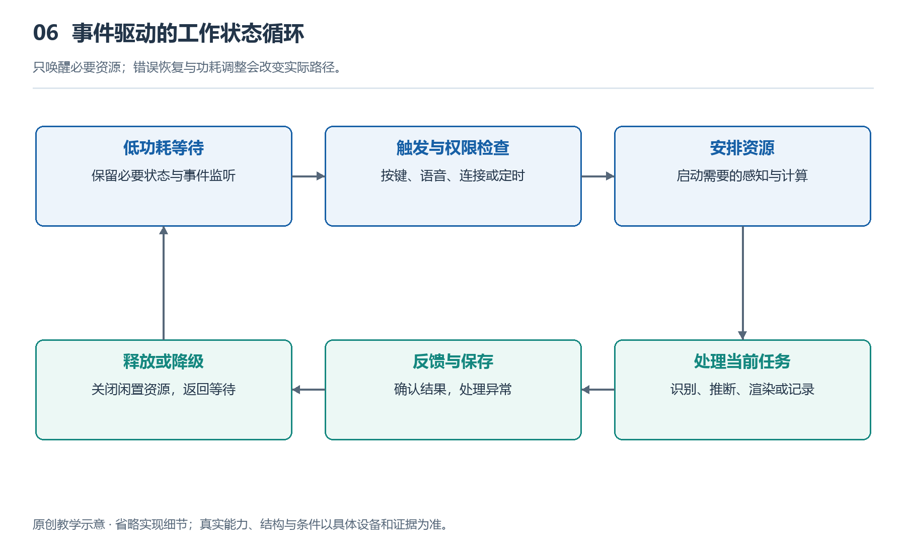

# 6.1 从唤醒到休眠：眼镜如何切换工作状态

早晨戴上智能眼镜时，它可能先发出一声提示；走到街口，你说出唤醒词，它开始接收指令；通话结束后，声音停止，系统却没有完全关机。晚上摘下眼镜，它又可能在一段时间后进入更省电的状态。看起来只是“用”与“不用”的区别，内部却涉及一连串协调：哪些部件继续工作，哪些暂时停下，什么事件能够让它们重新启动。

理解这些变化，需要先区分“没有输出”和“没有工作”。扬声器安静，不代表麦克风一定关闭；显示画面熄灭，也不代表无线连接已经断开。眼镜的工作状态，是计算、感知、通信和输出等部分在某一时刻的组合，而不是一个简单的电源开关。

{width=95%}

只唤醒必要资源；错误恢复与功耗调整会改变实际路径。 原创教学示意，不按比例，不代表某一产品的实测或拆解。

## 6.1.1 待机不是所有部件原地等待

设想一副支持语音唤醒的音频眼镜。如果它一直让主要处理器全速运行，只为等待一句指令，电池会很快消耗，镜腿也更容易升温。因此，一种常见设计是把“发现有人需要我”和“完成具体任务”分开。

待机时，系统可能保留低功耗声音检测、按键检测或无线连接维护，而让承担复杂计算的部分进入低功耗状态。这里的“低功耗”不是完全不耗电，而是减少运算、降低活动频率，或关闭暂时不用的电路。支持语音唤醒的设备，还可能由专门的低功耗处理单元判断声音是否接近设定的唤醒词，再决定是否启动后续处理。

这并不意味着所有眼镜都在持续识别语音。有些需要按键或触摸才能进入交互；有些功能可以关闭；具体采集、处理、保存和上传方式，也取决于产品实现与权限设置。不能仅凭“支持唤醒词”，就断言设备在全时上传录音。

同样，“休眠”也不是各产品统一的一种状态。浅一些的休眠可能保留连接，便于迅速接听电话；更深的休眠可以关闭更多电路，但恢复时需要重新准备。省电程度与恢复速度，往往不能同时做到最好。

## 6.1.2 一次唤醒是有次序的接力

当手指按下镜腿上的按键，最先接收到事件的，可能只是仍在工作的检测电路。它向控制系统发出请求，随后相关电源和时钟恢复，处理器继续执行程序，再按任务需要启动麦克风、扬声器或其他部件。时钟在这里是协调电路运行节奏的信号，并不是日常计时的钟表。

这套过程通常不会让全部器件同时进入最高工作状态。用户要求拍照，系统需要准备摄像头、图像处理和存储；用户接听电话，则更需要声音采集、播放和通信。无显示音频摄像眼镜不需要因此启动显示光路；只有具备相应显示硬件的设备，才涉及显示部分的恢复。

系统还需要告诉用户：现在能否开始说话？提示音、指示灯或眼前的符号，实际承担着状态反馈的作用。如果提示过早，用户说出的前几个字可能赶不上完整的采集准备；如果提示太晚，人又会误以为设备没有响应。好的反馈应与真实准备程度相匹配，而不只是营造“反应很快”的感觉。

唤醒也不等于任务已经成功。眼镜可以在本地被唤醒，却因为手机未连接或网络不可用，无法完成依赖外部服务的请求。因此，“已听到呼叫”“正在接收指令”和“正在处理任务”，是需要区分的状态。

## 6.1.3 状态怎样决定下一步

工程上常用“状态机”描述这类规则：系统先确定自己处于什么状态，再根据发生的事件和满足的条件，决定是否转入另一种状态。例如，待机时按一下按键可能启动交互，通话时按同一个按键却可能结束通话。按键没有改变，改变的是系统理解它的上下文。

触发状态变化的不只有人的操作，也包括来电、连接断开、电量不足或温度升高。为了避免相互冲突，系统需要规定优先次序。正在播放音乐时收到来电，可能先降低或暂停音乐，再进入通话；通话结束后，是否恢复播放，还要依据应用规则和用户设置。

佩戴检测也可以参与判断，但只有配备相应传感器并支持此功能的型号才具备这种能力。检测到摘下眼镜后，系统可能暂停播放或关闭显示，却不宜把一次短暂的信号变化立即当成确定事实。头发遮挡、调整镜架等都可能影响检测，因此软件常需结合持续时间或其他条件，避免反复暂停与恢复。这说明状态切换不仅需要“发现变化”，还需要判断变化是否足够可靠。

## 6.1.4 结束任务不等于立即断电

拍摄结束后，系统可能仍需完成文件写入；交互结束后，可能还要释放音频资源、清理临时数据。若立刻切断所有相关电路，就可能留下不完整文件，或让下次启动遇到异常。因此，从活跃状态返回待机，通常也有收尾次序。

系统还可能短暂保留部分资源，以便用户连续提问。这会增加一些待机能耗，却能减少反复启动的等待。若长时间没有新任务，再逐步进入更深的休眠。显示眼镜和空间AR设备还要考虑画面恢复与环境追踪准备，不能把重新点亮屏幕等同于空间内容已经能够稳定呈现。

从唤醒到休眠，眼镜始终在回答三个问题：现在需要做什么，必须让哪些部分工作，何时可以让它们停下。看懂这些状态变化，才能理解为什么同一副眼镜有时立即回应，有时需要等待，以及安静的外表之下，哪些工作仍在继续。
