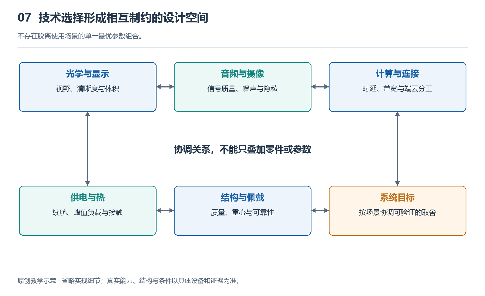

# 7.1 近眼显示与光学：清晰度、视野和体积如何兼顾

戴上一副显示眼镜，眼前出现一行消息。你能否看清小字，稍微转动眼睛后文字是否完整，窗外明亮时内容是否仍然可辨，都不只由屏幕分辨率决定。近眼显示要把一块很小的显示器发出的光，经过光学组件送进眼睛，让人看见适合阅读的虚像。工程难点就在于：清晰度、视野、亮度和佩戴空间，需要共同满足，而它们往往相互牵制。

这一问题只适用于带显示的眼镜。无显示音频摄像眼镜可以通过声音回应，却没有这里讨论的成像光路；具有显示能力，也不意味着设备已经具备环境定位和空间AR能力。

{width=95%}

不存在脱离使用场景的单一最优参数组合。 原创教学示意，不按比例，不代表某一产品的实测或拆解。

## 7.1.1 清晰度要看光最终怎样到达眼睛

把手机紧贴眼前，通常无法舒服地看清，并不是手机像素不够，而是眼睛难以对这样近的物体调焦。显示眼镜用光学组件改变光线的传播方向，让眼睛感觉图像位于某个距离之外。这种看起来存在、却没有实体屏幕放在那里的图像，就是虚像。虚像距离由设计决定，并非所有产品都相同。

显示器上有多少像素，只是清晰度的起点。同样数量的像素，铺在较小视野里可以排列得更密，铺在较大视野里则更稀。这里常用“每度像素数”，简称PPD，描述一度视角内分布了多少像素。比较时必须采用相同方向和测量口径，不能拿水平数值与对角数值直接比较。

即使像素足够密，光学组件仍可能让细节变模糊。不同颜色的光偏折程度不同，可能在文字边缘形成彩边；视野边缘的成像质量也可能弱于中心。装配偏差、镜片表面质量和杂散光，还会影响对比度。因此，判断一段文字是否清楚，要看显示器、光学组件、装配与眼睛位置共同形成的结果，而不是只找规格表里最大的数字。

## 7.1.2 视野扩大，为什么不只是换一块大屏

视野是眼睛通过设备能够看到显示内容的角度范围。水平、垂直和对角视野分别描述不同方向，阅读规格时必须分清。较大的视野适合呈现宽画面或更多空间内容，但并不自动带来更好的阅读体验。

假设显示器像素总数不变，扩大视野后，每个像素占据的视觉角度增大，小字边缘就可能更容易显出颗粒。若想同时维持细节，就需要增加像素，并让光学系统继续传递这些细节。随之增加的，可能是显示驱动负担、数据量与功耗，而不只是屏幕成本。

更大的视野还要求光学组件接纳和传送更宽范围的光线。在受限的镜框空间内，边缘光线更难处理，图像均匀性和杂散光控制也可能变得困难。因此，只为显示短提示而设计的眼镜，不一定需要追求尽可能大的视野；任务不同，合理的取舍也不同。

## 7.1.3 镜片薄，不等于整条光路简单

一种思路是用透镜、反射镜等组件折叠光路，在有限空间内形成所需虚像；另一种思路是把光引入透明片状结构，让光在其中传播，再从眼前区域导出，这类结构称为光波导。光波导可以采用反射式、衍射式等不同路线，并非所有显示眼镜都使用波导，也不是所有波导都依赖同一种光学原理。Lumus的官方资料就介绍了几何反射式波导这一技术路线[R6]。

波导看起来像一片镜片，但仍需要配套的图像光源和入光组件。光进入、传播和导出的每一步，都可能损失能量，也可能产生亮度不均、重影或颜色差异。镜片变薄，不能直接推导出整机一定轻巧，更不能推导出画质必然更好；光源、结构支撑和散热仍占用空间。

另一个容易忽略的指标是“眼盒”，也叫可视眼区，指眼睛能够接收到设计图像的一定空间范围。镜架稍微下滑，或不同人的瞳距和鼻梁形状不同，眼睛位置便会变化。眼盒过于局促时，使用者可能必须反复调整镜架，才能看到完整画面。

扩大眼盒可以增加佩戴余量，但要把有限的光分配到更大的区域，并尽量保持各处图像一致。它与亮度、效率和结构复杂度存在关联，不能只靠软件把一个设置调大。

## 7.1.4 明亮环境会把取舍带到整机

对于透视式显示眼镜，真实景物的光与显示图像的光同时进入眼睛。室内清楚的文字，到了明亮街道上可能显得淡，因为背景光增强，显示内容与背景之间的对比降低了。

提高光源亮度是一种办法，但光学传输存在损失，眼前增加的有效亮度需要更多电能支持，继而影响续航和温升。降低镜片透光率也能改善某些条件下的对比，却会让真实环境变暗，影响其他使用场景。显示亮度、镜片透光率和户外可读性因此不能分开判断。

理解近眼显示，最有用的不是寻找一个“全都最高”的参数组合，而是追问：它要显示什么，在哪种环境显示，允许多大的体积和能耗，又为多少佩戴差异留下余量？具体能力仍应按型号和使用条件核对。清晰度、视野与体积的平衡，最终要落实为眼前稳定、可读且适合任务的图像。
