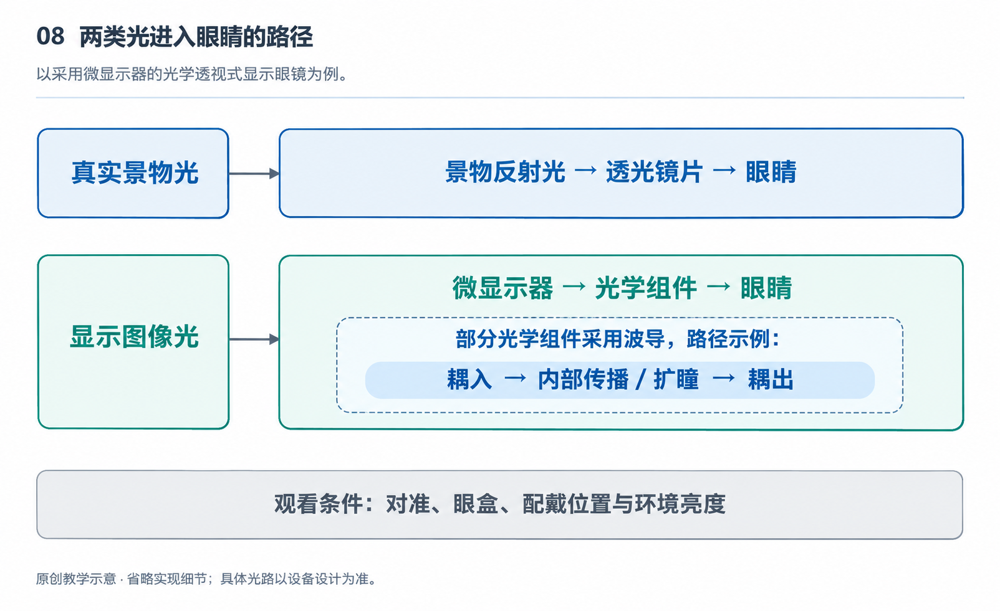

# 8.1 光如何成像：反射、折射与虚像

戴上一副显示眼镜，眼前可能出现一行字幕，或一块仿佛悬在远处的屏幕。取下眼镜，却找不到那块屏幕所在的实体。这并不是图像脱离了设备，而是眼镜改变了光进入眼睛的方式。要理解这种现象，可以从一个问题出发：眼睛接收到的光，怎样使我们判断“那里有一个东西”？

先看窗边的一本书。环境光照到书页上，向许多方向散射，其中一部分进入瞳孔，再由眼睛的光学结构汇聚到视网膜上。我们看见文字，依靠的是不同位置送来的光在视网膜上形成了有区别的分布。显示眼镜也必须提供这种有组织的光，而不只是把镜片照亮。它要让某些方向对应文字笔画，另一些方向对应背景，才能使眼睛辨认内容。

{width=95%}

显示光是附加路径，不代表眼镜直接读取视网膜或替代真实视野。 原创教学示意，不按比例，不代表某一产品的实测或拆解。

描述光的传播时，人们常画出一条条带箭头的线，称为光线。光线是表示传播方向的工具，不是说光在任何情况下都是细小的直线。在尺寸远大于光波波长、衍射影响不显著的条件下，这种方法能清楚解释许多成像现象。反射、折射和虚像，便可以先沿着光线来理解。

光遇到表面后，一部分可能返回原来的介质，这就是反射。对平整表面而言，入射光线与表面法线之间的夹角，等于反射光线与法线之间的夹角。法线是垂直于表面的假想直线。这里比较的角度不是光线与镜面的夹角，这一点在理解光路转弯时很重要。

照镜子时，脸上各点发出的光经过镜面反射进入眼睛。眼睛接收到的光线，仿佛来自镜子后方对应的位置；如果把反射光线向后延长，它们会在那里相交。这就形成了虚像。“虚”不表示看不清或不真实，而是指光并没有实际在那个像点会聚。把一张白纸放到镜子后方，不能直接承接出这个镜中像。

与之相对，若来自同一物点的光经过光学系统后实际会聚，就可以形成实像。投影设备把画面投到幕布上，是容易理解的例子。实像和虚像的区别，在于光是否实际会聚于像的位置，而不是图像属于现实内容还是数字内容。显示眼镜呈现的文字虽然由电子系统生成，仍然可以通过光学系统形成虚像。

光从空气进入玻璃或其他透明材料时，传播速度发生变化，斜着穿过界面时通常也会改变方向，这叫折射。方向变化取决于两侧材料的折射率以及入射角。折射率描述光在介质中的传播特性，不能简单理解为材料“有多透明”。两块都很透明的材料，也可能以不同程度改变光的方向。

透镜利用表面形状，让不同位置的光线受到不同的偏折。以凸透镜为例，在适当条件下，近似平行的入射光能够会聚到焦点附近。但不能因此认为凸透镜总会形成实像：物体放在不同位置，出射光的状态也会不同。物体位于焦点以内时，出射光仍然发散，眼睛沿这些光线反向判断，就可能看见放大的虚像。普通放大镜便利用了这一关系。

这也解释了显示眼镜为什么不能只是把一块小屏幕贴在眼前。屏幕离眼睛太近，通常难以直接舒适地看清；屏幕本身的尺寸也限制了直接观看的效果。近眼光学系统通过透镜或其他组件，重新安排来自屏幕各点的光，使它们以合适的方向进入眼睛，让图像看起来位于另一个距离。小屏幕仍在镜架附近，但它的虚像可以被设计在更远处。

这里需要区分三个位置：屏幕的实体位置、光学系统形成的虚像位置，以及画面所表达的物体位置。一幅画面可以把远山画得很远，却不意味着远山对应的光就来自那个距离。对于常见的固定焦面显示，画面中的近物与远物可能共享同一个光学像面。画面内容的远近线索，与眼睛实际需要对焦的距离，并不是同一件事。

如果系统使同一像点的出射光近似平行，虚像可以被描述为位于光学无穷远附近；如果这些光仍以一定角度发散，虚像就在有限距离。不能把所有显示眼镜都说成“把图像投到两米处”，也不能把有限像距的出射光一概称为平行光。具体像距取决于设计，且不等于显示画面中某个物体标注的距离。

在部分透明显示眼镜中，真实景物的光与显示系统送来的光会共同进入眼睛。光学组件既要保留一定的透视能力，又要把显示光引向瞳孔。有的方案利用部分反射的表面折转光路；有的采用波导，让光在薄片内部传播，再通过特定结构导出。波导可以采用不同方式控制光，不能仅凭镜片薄，就认定内部使用了某一种路线。

真实组件也不是理想的光线图。光可能被吸收、散射或在不希望的位置反射，不同颜色还可能发生不同程度的偏折。于是，亮度损失、杂散光、重影和色差，都可能成为工程上需要处理的问题。光学设计既要把光送到正确方向，也要减少不该进入眼睛的光。

理解成像后，再看眼前那块“悬浮屏幕”，就能分清它的几个层次：电子屏提供图案，光学组件重组传播方向，眼睛接收光并形成视觉。所谓虚像，不是空中出现了一块实体屏幕，而是一组经过安排的光，让我们看见了有位置的图像。
