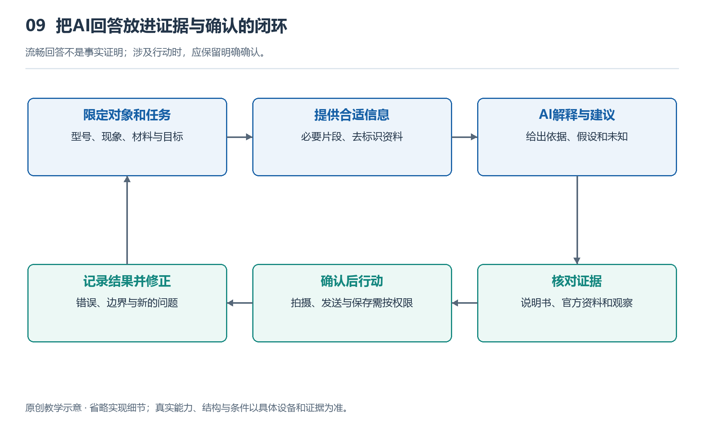

# 9.1 AI接入系统：本地、手机与云端怎样分工

你戴着眼镜整理书架，指着一本外文书问：“这个书名是什么意思？”几秒后，耳边传来中文解释。这个过程看起来像眼镜独自完成了一次理解，实际上，摄像头采集、声音处理、文字识别和回答生成，可能分散在眼镜、手机与云端。要理解AI怎样接入智能眼镜，首先要把“谁在采集”和“谁在计算”分开。

这里的“本地”需要说清范围。本节把眼镜自身的处理称为眼镜本地处理，把配对手机承担的计算称为手机端处理；云端则是经网络访问的远程计算系统。有些资料把眼镜和手机都归入“端侧”，因为它们靠近使用者。但对实际体验而言，手机是否在身边、连接是否正常，仍然是重要区别。

{width=95%}

流畅回答不是事实证明；涉及行动时，应保留明确确认。 原创教学示意，不按比例，不代表某一产品的实测或拆解。

AI不是装进镜腿后便能包办一切的单一部件。识别一句唤醒词、从图像中读出文字、结合问题组织答案，是规模和资源需求不同的任务。它们可以由不同程序或模型承担，也不一定每次都经过三个位置。合理分工的核心，是让任务所需的计算、数据和反馈，在资源约束下找到合适的落点。

眼镜最适合先处理那些紧贴采集、要求及时响应的环节。例如，麦克风接收到的声音可以先经过降噪，再判断是否出现唤醒词；摄像头取得图像后，可以进行基本处理，再把需要的画面交给后续程序。部分设备还可在本地完成有限的语音指令或识别任务。这样既可能缩短等待，也能避免把所有原始数据持续送出。不过，具备麦克风不等于始终上传声音，具体采集、保存和传输方式仍取决于产品实现与权限。

为什么不把所有AI都放在眼镜里？因为镜架上的计算要同时受电池、散热、重量和空间限制。较复杂的模型不仅需要执行运算，还需要存放模型参数，并在运行时占用工作内存。持续计算带来的耗电和发热，最终都会影响佩戴体验。因此，“能运行某个模型”与“能舒适、连续地运行它”，是两种不同的工程判断。

手机通常处在中间位置。它可以提供比轻量眼镜更充裕的计算与存储资源，也可能负责联网、账户管理、定位和应用调用。眼镜把语音或图像交给手机后，手机可以直接处理，也可以决定是否请求远程服务。特定平台采用眼镜与手机或电脑主机分担任务的分布式设计，正体现了这种思路[R1]；但这不意味着所有眼镜都依赖同一种架构。

手机也不是没有代价的“免费算力”。它需要维持连接、处理传来的数据，并消耗自身电量。手机放在口袋、背包或远处，连接条件可能不同；后台运行限制也可能影响服务连续性。如果任务必须先到手机再上传，链路中便增加了需要协调的环节。因此，判断一项功能是否好用，不能只看眼镜是否支持，还要看配套手机、系统版本和应用权限是否满足要求。

云端的优势，是能够集中提供较大规模的计算资源，运行复杂模型，并按服务设计接入更新的信息。面对需要综合图像、语音和上下文的问题，远程服务可能比眼镜单独处理更有能力。但“在云端”并不自动等于准确、实时或拥有最新知识。模型能力、数据来源和服务配置，仍然决定回答的质量。

回到书名翻译的场景，可以设想这样一条处理链：眼镜接收提问并取得一幅图像，手机接收数据，完成文字识别或整理请求，再由云端生成解释，最后把结果送回眼镜播放。这只是教学示例，不是所有产品的固定流程。另一种实现可能在手机上完成识别和翻译；还有的设备只把选定图像传给云端，而不持续传送视频。流程不同，等待时间、耗电和隐私影响也会不同。

这种分工首先要考虑时间。一次回答的等待，不只是模型计算时间，还包含数据整理、无线传输、网络往返和结果播放。如果网络不稳定，云端计算再快，也可能让人等得很久。反过来，简单指令若能在眼镜或手机完成，就没有必要绕远路。因此，即时控制与复杂问答常有不同安排，不能用一个速度指标概括全部AI体验。

其次要考虑传什么。传送一段音频、一幅图像，还是已经识别出的文字，会改变通信量，也会改变远端能够接触的信息。例如，只上传书名文字，通常比上传整个书架画面暴露的现场内容少；但文字识别若已出错，后续解释也可能沿着错误继续。减少数据不等于可以不顾任务需要，而是应在信息足够与暴露范围之间作出明确选择。

最后还要考虑失去某一环后怎么办。断网时，眼镜也许仍能执行本地指令，却无法完成依赖云端的问答；手机离开后，某些服务也可能中断。无显示音频摄像眼镜通常通过声音反馈结果，显示眼镜可在相应能力支持下呈现文字，但AI接入本身不会让它自动获得空间AR能力。具体功能还会因型号、地区和服务条件而异。看清这三处计算位置及其连接关系，才能理解：所谓“眼镜里的AI”，其实是一套共同工作的系统。
