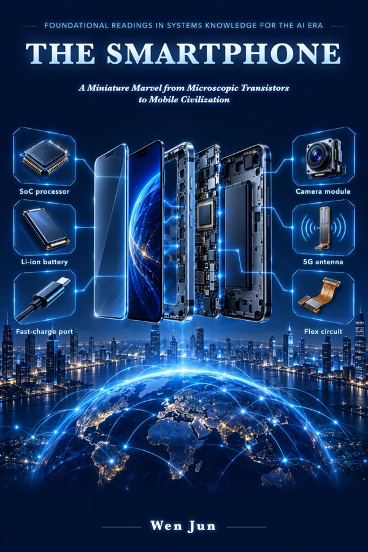

# About This Book

**The Smartphone** — A Miniature Marvel from Microscopic Transistors to Mobile Civilization

Part of the series *Foundational Readings in Systems Knowledge for the AI Era*, by Wen Jun.

## How to read this book

The book follows a "book + real object + AI" approach: the book gives you a stable framework of knowledge, the device in your hand is the real object, and whenever you want to go deeper you can take the book's questions straight to an AI and let it carry on from there.

The book is organised as a nine-level ladder of understanding: object → structure → function → relationships → flows → mechanisms → key technologies → principles → working with AI.

## Comments

The comment box at the bottom of each page is provided by Giscus. Comments are stored in the Discussions of this book's GitHub repository; you need a GitHub account to comment.

## Copyright

© Wen Jun. All rights reserved.
