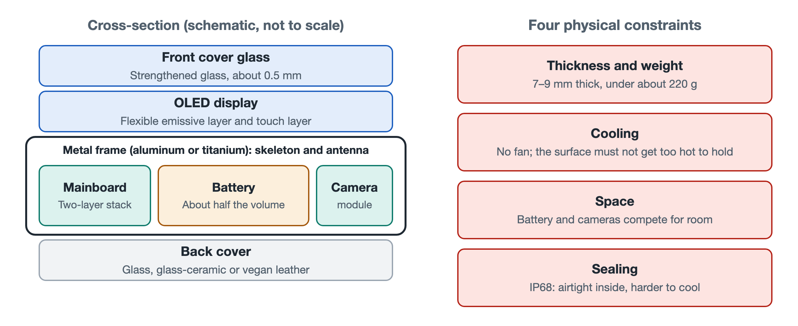

# 1.1 The Physical Form of the Smartphone and Its System Trade-offs

Lay a phone flat on a table, and the most immediate impression is of a glowing rectangular slab of glass. It looks simple, yet it is the product of a long evolution in industrial design and mechanical engineering. Its thickness, weight, materials, and the placement of its openings are all compromises reached after repeated balancing within an extremely small space. Understanding these compromises is the first step toward developing "systems X-ray vision."

## 1.1.1 The Classic Sandwich: Three Layers, Each with Its Own Job

Pick up the phone and run a fingernail gently around its edge. You can feel the subtle seams between the front glass, the metal side frame, and the back material. The vast majority of mainstream phones use this layered structure of "cover glass + metal midframe + back cover," which engineers often call the "sandwich architecture."

| Layer | Common Materials | Primary Role |
|---|---|---|
| Front cover glass | Strengthened aluminosilicate glass; leading makers include Corning of the U.S. (Gorilla Glass) and Schott of Germany | Protects the display against scratches and drops |
| Structural midframe | Aerospace-grade 6000/7000-series aluminum alloy or titanium | Load-bearing skeleton that doubles as the antenna radiator |
| Back cover | Glass, glass-ceramic, or vegan leather | Lets electromagnetic waves for wireless charging pass through, while balancing heat dissipation and grip |

**The front cover** is about 0.5 millimeters thick, thinner than a bank card. It undergoes chemical strengthening and crystallization hardening, which creates a layer of compressive stress on the surface. It is like stretching a pre-tensioned layer of "armor" over the glass, making it harder for cracks to spread.

**The midframe** is the load-bearing skeleton of the whole device. The display, mainboard, and battery are all fixed to it directly or indirectly, and it also absorbs and distributes most of the impact force during a drop. It has another, less noticed side job: the thin plastic gaps along its edges are insulating material injected using nano-molding technology, cutting the continuous metal ring into several segments, each of which becomes an antenna. Merging skeleton and antenna into one is a classic approach when space is at an extreme premium, and Chapter 4 will discuss it in detail.

**Why are back covers less and less often made of solid metal?** Because metal shields electromagnetic fields, so the energy from a wireless charging coil cannot pass through. Glass, ceramic, and vegan leather are "transparent" to electromagnetic waves, and different surface treatments can improve their feel and appearance. Behind the choice of material lies a trade-off among three needs: charging, heat dissipation, and grip.

## 1.1.2 Foldables: Teaching the Screen to Bend

Foldable phones, which have become popular in recent years, break away from the rigid rectangular box. A screen that must fold repeatedly introduces entirely new material and mechanical challenges.

- **Ultra-Thin Glass (UTG)**: Only about 30 micrometers thick, roughly half the width of a human hair. Once glass gets this thin, it can bend like paper. After chemical strengthening, it can be folded hundreds of thousands of times without mechanical fatigue. Some models instead use Colorless Polyimide (CPI) film as a flexible cover.
- **Waterdrop hinge**: If a screen were forcibly folded flat into a straight line, the crease would undergo plastic deformation and leave a permanent fold mark. When closed, a waterdrop hinge leaves a teardrop-shaped cavity to house the screen, enlarging the bending radius and easing the stress. Inside, the hinge integrates over a hundred tiny gears and cam structures, made using Metal Injection Molding (MIM): metal powder is mixed with a binder, injection-molded like plastic, and then sintered to full density, a process well suited to mass-producing small parts with complex shapes.

The folding form factor also changes the internal layout. With the body split into two halves, a common approach is to use dual mainboards and separate dual battery cells, placed on either side of the hinge and connected by flexible circuits that span it. A foldable phone is effectively two thin phones "stitched" together with precision mechanics.

## 1.1.3 Four Physical Boundaries That Lock In the Form

Whether a bar phone or a foldable, the phone's form is constrained by several strict physical boundaries. They pull against one another, and relaxing any one of them squeezes the others.

1. **Thickness and weight**: Overall thickness is usually held between 7.0 and 9.0 millimeters, and weight is generally kept under 220 grams. The industry often regards around 200 grams as the "ergonomic comfort line." Beyond it, holding the phone in one hand for long periods or slipping it into a pants pocket becomes noticeably harder.
2. **Fanless cooling**: A laptop can have a fan; a phone cannot. There is neither room inside nor any way to cut air vents, so all heat must be removed by passive conduction—from the chip to the midframe, display, and back cover, and then out into the air and the user's hand. Because the body is in direct contact with skin, safety standards limit the temperature of touchable surfaces (with limits tiered by material and contact duration), and manufacturers typically keep surfaces held for long periods in the low-to-mid 40s °C.
3. **The battle for space between battery and camera**: The battery occupies nearly half the volume of the device. In the remaining space, ever-larger camera modules are the "greediest" tenants. One extra millimeter for the battery may mean one less millimeter for the lens, which is why battery life and imaging are often hard to have at the same time.
4. **IP68 sealing**: IP68 is an internationally recognized dust and water protection rating. The "6" means fully dust-tight, and the "8" means it can withstand continuous immersion in water. To achieve it, the body's seams are sealed layer upon layer with adhesive strips and gaskets. The cost is an airtight interior, making an environment that already relies only on passive cooling even stuffier.

Put these four together, and phone design looks like a "four-way tug-of-war":

| What You Want | The Price You Pay |
|---|---|
| Thinner and lighter | Smaller battery, less heat-dissipation area |
| Bigger battery | Thicker, heavier body |
| Better camera | Takes battery space, creates a rear bump |
| Better water resistance | Sealed interior, harder cooling |

## 1.1.4 Summary: The Ledger of Trade-offs Inside a Slab of Glass

Every detail of the phone's exterior in your hand is not an arbitrary aesthetic choice. The gaps in the midframe are antennas, the back cover material serves wireless charging, the camera bump is the result of insufficient space, and the spots that feel hot hint at the path the heat takes. Once you understand these trade-offs, you will see why the chips, RF, fast charging, and thermal management covered in later chapters all have to budget carefully down to the millimeter and the milliwatt. In the next section, we turn our gaze from the device to society and look at the place this slab of glass occupies in modern life.
