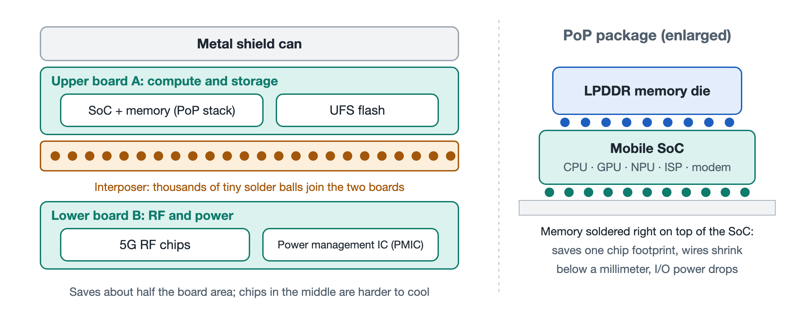

# 2.1 The Double-Stacked Logic Board and Miniaturized Packaging Technology

Remove the screws at the bottom, pry open the back cover, and lift off the metal shields over the circuitry, and the phone's most important component comes into view: an irregularly shaped board with a winding, jagged outline. This is the phone's mainboard, usually called the Logic Board. Unlike a computer motherboard, it is not a neat rectangle. The battery, camera modules, and speakers squeeze it into whatever gaps remain. More notably, the board often has more than one layer. It is stacked top and bottom like a hamburger.



## 2.1.1 From "Spreading Out" to "Building Up"

Think of the logic board as a city. In the old feature-phone era, board space was plentiful. Chips sat side by side on a single circuit board like single-story houses, with wide roads between them and plenty of room. In the smartphone era, bodies have grown thinner, batteries larger, and cameras more numerous. The territory left for the logic board keeps shrinking, yet the number of chips it must hold grows every year: processor, memory, flash storage, 5G RF, power management, and more. Laying them all out flat no longer works.

Engineers responded the way urban planners do: when land runs out, build upward. The result was the Stacked Logic Board, which the industry often calls the "hamburger board" or "sandwich board." Its basic structure can be understood from the following cross-section diagram:

```
┌────────────────────────────────────────────────────────┐
│     Cross-section of a modern two-layer mainboard      │
├────────────────────────────────────────────────────────┤
│ Upper board A (compute and storage)                    │
│  [Mobile SoC + stacked memory]    [UFS flash package]  │
│ ══════════════════════════════════════════════════════ │
│        ▼              ▼              ▼                 │
│   ●●● Interposer (frame between the boards) ●●●        │
│ Thousands of tiny solder balls around the edge;        │
│ a sealed cavity in the middle                          │
│        ▲              ▲              ▲                 │
│ ══════════════════════════════════════════════════════ │
│ Lower board B (RF and power)                           │
│  [5G RF front-end chips]          [PMIC power chip]    │
└────────────────────────────────────────────────────────┘
```

Each of the three layers has its own role:

- **Upper board (Board A)**: Holds the computing and storage core: the mobile System on Chip (SoC) with memory stacked on top of it, plus the UFS (Universal Flash Storage) chips that store photos and apps.
- **Lower board (Board B)**: Carries the 5G RF front-end chipset and the Power Management IC (PMIC). Both types of chips generate considerable heat in operation.
- **Middle connecting frame (Interposer)**: A ring-shaped frame sandwiched between the upper and lower boards. Its top and bottom surfaces are covered with thousands of tiny solder balls that weld the two boards directly together into a single unit. Electrical signals travel between the layers through these solder balls.

This structure uses Ball Grid Array (BGA) connections. Instead of long, thin pins, it uses arrays of tiny solder balls for dense interconnection. Once soldered, the ring-shaped interposer leaves a sealed cavity in the middle, and the chips on the inward-facing sides of both boards are "hidden" inside that cavity.

## 2.1.2 SLP: Drawing Circuits as Fine as a Chip

Stacking alone is not enough; each board must also be denser. The traces on an ordinary Printed Circuit Board (PCB) are relatively thick and take up too much room in a modern phone. Phone logic boards therefore widely use Substrate-like PCB (SLP) technology.

"Substrate-like" means its precision approaches that of the substrates used in chip packaging. With this process, trace widths and spacing are reduced to below 30 micrometers. For comparison, a human hair is a few dozen micrometers across. The copper traces on the board are thinner than a hair, and they run side by side with equally narrow gaps between them.

The board is also dense vertically. A logic board ranging from fingernail to business-card size can contain more than 10 stacked conductive layers, connected by tiny holes to form a three-dimensional high-density interconnect network. If an ordinary circuit board is a flat city map, an SLP board is a three-dimensional city with multiple levels of underground tunnels and elevated highways.

## 2.1.3 Half the Footprint, at the Cost of Heat

The benefit of dual-layer stacking is simple. Compared with laying all the chips out flat, it saves roughly half the board area. The freed space can go to the battery for longer battery life, to a larger camera module, or to a thinner body.

But engineering has no free lunch. Look back at the cross-section and you will see that the cavity between the two boards is almost completely sealed. The chips inside are surrounded by the solder ring on all sides and the circuit boards above and below, so their heat has no easy way to escape. And the lower board happens to hold the RF and power management chips, which already run hot. It is like stacking two heated rooms on top of each other and sealing the windows between them. The building saves land, but the rooms get stuffier.

This trade of space for heat is a central thread in understanding phone design. Readers will see it again and again in later discussions of thermal shielding, temperature walls, and thermal throttling. The following table summarizes the pros and cons of the dual-layer board:

| Dimension | Dual-layer stacked board approach | Result |
|---|---|---|
| Area | Two boards stacked top and bottom | Saves roughly half the board area |
| Routing density | SLP process, trace width/spacing below 30 μm | More than 10 layers of high-density interconnect in a small area |
| Interlayer connection | Ring-shaped interposer with thousands of micron-scale solder balls | Upper and lower boards electrically connected and structurally robust |
| Functional partitioning | Board A for computing and storage, Board B for RF and power | Clear modules, easier layout |
| Cost | A sealed cavity forms in the middle | Sandwiched chips are hard to cool; repair becomes more difficult |

## 2.1.4 Who Builds This "Chip City"

A board this precise depends on a specialized supply chain. The main manufacturers of high-end substrate-like PCBs include Unimicron, Compeq, and Avary Holding (Zhen Ding) of Taiwan, China; AT&S of Austria; and Shennan Circuits of mainland China. They build up the hair-thin circuitry layer by layer.

After the board is made and the chips are soldered on, it must be assembled with the display, battery, cameras, and other components into a finished phone. This step is handled by precision contract manufacturers such as Foxconn, Luxshare Precision, BYD Electronics, and Pegatron. A logic board that fits in your palm therefore often reflects a division of labor across many countries and regions. We will explore this further in the supply chain overview in the final section of this chapter.

## 2.1.5 Summary

The phone's logic board took the shape of a hamburger because space pressure forced it to. The SLP process makes each layer denser, and the interposer's solder ring joins the two layers into one. Together they pack the phone's entire computing, storage, communication, and power core into a tiny area, but they also leave behind the problem of heat. The most important chip on the board, the SoC, is stacked with its memory in a similar "human pyramid" fashion. That is what the next section takes apart.
