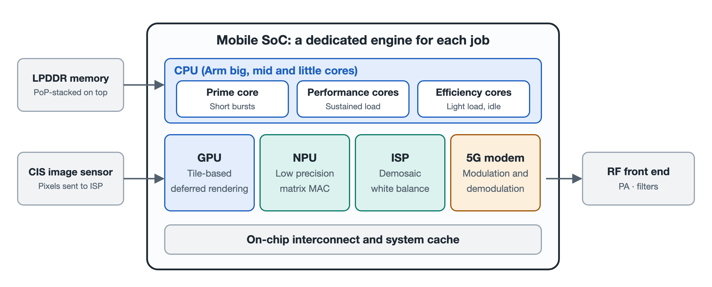

# 3.1 The Heterogeneous Compute Matrix of the Mobile SoC: The Efficiency Philosophy of Dedicated Silicon

You unlock your phone, open the camera, aim it out the window, press the shutter, and then idly flick through a couple of short videos. During those few seconds, you might imagine a single "processor" inside your phone working away on its own. In reality, inside a System on Chip (SoC) no bigger than a fingernail, there is no all-purpose "do-everything processor." The real work is done by a team with clearly divided roles: one member handles sudden sprints, another runs the long distances, one specializes in drawing graphics, one specializes in crunching matrices, and one specializes in processing light signals. The operating system's scheduler acts like a dispatcher, assigning each task to the most suitable engine based on its nature, so the job gets done using as little power as possible.

This approach, in which different types of computing units work together, is called Heterogeneous Computing. In this section, we will get to know the four core members of this team: the CPU, GPU, NPU, and ISP.

## 3.1.1 Why Not Build a Single "Super All-Purpose Chip"?

Let's start with an everyday analogy. A hospital does not hire a single "miracle general practitioner" to treat every patient. Instead, it sets up an emergency department, internal medicine, radiology, and a laboratory. Emergency doctors react quickly, the laboratory's instruments can run tests in bulk, and radiology's equipment only takes scans, but does so quickly and accurately. When each department does its own job, the hospital as a whole runs at peak efficiency.

A phone faces even harsher constraints than a hospital: battery capacity is limited, the sealed body makes heat dissipation difficult, and users expect instant responsiveness at all times. A general-purpose processor can compute anything, but when it handles specialized tasks, it is often overkill: it must execute large numbers of instructions and shuttle data back and forth constantly, which is both slow and power-hungry. Dedicated circuits, by contrast, "etch" a particular class of fixed operations directly into hardware, doing the same work with far less energy. The design philosophy of mobile SoCs can therefore be summed up in one phrase: **the right silicon for the right job**.

## 3.1.2 CPU: A Relay Race of Large, Medium, and Small Cores

The Central Processing Unit (CPU) is the "commander-in-chief" of the entire system, responsible for running the operating system and the core logic of applications. Modern phone CPUs typically combine cores of differing capabilities into three tiers:

- **Prime cores** (such as Arm's Cortex-X series): handle instantaneous bursts. The moment you tap an app and it loads from scratch (known as a "cold start"), the prime core sprints at full power to get the interface on screen as quickly as possible. It is the most powerful and also the most power-hungry, appearing only briefly at critical moments.
- **Performance cores** (such as the A7xx series): handle sustained heavy loads. A gaming session requires steady computing output for tens of minutes at a stretch, and these "endurance" tasks fall to the performance cores.
- **Efficiency cores** (such as the A5xx series): handle all-day light workloads. Receiving messages with the screen off, background syncing, and playing music are light chores assigned to the efficiency cores, which consume only a few tens of milliwatts.

It's like a relay race: the sprinter handles the start, the middle-distance runner maintains the pace, and the support staff watch over the camp all day. The scheduler adjusts the lineup at any moment according to the weight of the task, so heavy jobs aren't slowed down and light jobs don't waste energy. The fact that phones can go "one charge a day" rather than "one charge every half day" owes a great deal to this division of labor among large, medium, and small cores.

## 3.1.3 GPU: Cutting the Screen into Tiles Before Drawing

The Graphics Processing Unit (GPU) is responsible for drawing game scenes and interface animations onto the screen. It excels at processing thousands upon thousands of pixels simultaneously, making it a classic "strength in numbers" computing unit.

But mobile GPUs face a thorny problem: image data must be shuttled back and forth between the chip and memory, and that movement itself consumes a great deal of power and generates heat. To address this, mobile GPUs commonly adopt **Tile-Based Deferred Rendering** (TBDR), which works in two steps:

1. **Tiling**: The entire screen is divided into many tiny "tiles," and only one small tile is processed at a time. The data for that tile can be kept in the chip's internal high-speed cache, avoiding repeated access to external memory.
2. **Deferred shading**: Before "coloring" any pixels, the GPU first determines which objects are hidden behind others, culls the invisible pixels in advance, and performs shading calculations only on the pixels that will ultimately be visible.

Here's an analogy: before painting a wall, you confirm that a large bookcase will stand in front of it, so the part hidden by the bookcase doesn't need painting. This saves a large chunk of memory bandwidth and heat.

## 3.1.4 NPU: A Neural Network Engine Dedicated to Matrices

The Neural Processing Unit (NPU) is the SoC member that has drawn the most attention in recent years. Face recognition, voice wake-up, image segmentation, and even on-device large models all essentially boil down to massive amounts of matrix multiplication and accumulation.

The defining feature of the NPU is that it specializes in **low-precision matrix multiply-accumulate operations**, such as General Matrix Multiply (GEMM) at INT8 or INT4 precision. INT8 and INT4 mean representing values with 8-bit or 4-bit integers. These are somewhat "coarser" than conventional high-precision floating-point numbers, but neural networks are often insensitive to this coarseness, and in exchange the circuits become smaller, faster, and more power-efficient.

Precisely because of this, the NPU can perform feature matching for face unlock locally within milliseconds at extremely high energy efficiency, and can also support on-device large-model inference. Processing data on the phone is both fast and reduces the privacy concerns that come with uploading to the cloud.

## 3.1.5 ISP: A Hardware Pipeline for Light Signals

The Image Signal Processor (ISP) is the "darkroom" behind the camera. The raw data output by the image sensor is not yet the photo we see; it must go through a series of processing steps. The ISP uses a fixed hardware pipeline to complete them in sequence at nanosecond-level speed:

- **Demosaicing**: Each sensor pixel records only one color, so the full color must be inferred and reconstructed;
- **Defective pixel correction**: Repairing individual malfunctioning pixels;
- **Auto white balance**: Ensuring white still appears white under different light sources;
- **Lens distortion correction**: Straightening lines that curve at the edges.

Building on this, the ISP also works with the NPU to perform **multi-frame HDR fusion** in computational photography, blending several photos taken at different exposures into a single image whose highlights aren't blown out and whose shadows retain detail. In the instant you press the shutter, this pipeline has already run through an entire sequence of steps.

## 3.1.6 The Four Engines at a Glance

| Computing Unit | Abbreviation | Strengths | Key Mechanism | Energy-Efficiency Approach |
|---|---|---|---|---|
| Central Processing Unit | CPU | System logic, running applications | Prime/performance/efficiency core tiers | Assigns light and heavy tasks to different cores |
| Graphics Processing Unit | GPU | Game graphics, interface rendering | Tile-Based Deferred Rendering (TBDR) | Reduces memory traffic, culls invisible pixels |
| Neural Processing Unit | NPU | Face recognition, on-device large models | INT8/INT4 matrix multiply-accumulate | Trades precision for high efficiency |
| Image Signal Processor | ISP | Photo and video processing | Hardware pipeline | Hardwires fixed steps, works with NPU |

## 3.1.7 Summary

The power of a mobile SoC lies not in any single unit being able to do everything, but in "letting the right unit do the right job." The CPU runs a tiered relay, the GPU economizes carefully, the NPU specializes in matrices, and the ISP works as an assembly line, all coordinated by the operating system's scheduler. Together they deliver a smooth experience within limited battery capacity and cramped space. Once you understand this team, the next time you see specs like "AI performance" or "graphics performance" at a product launch, you'll know which "team member" each one refers to. In the next section, we will follow light into the camera module and see how photons are transformed, step by step, into digital pixels.
