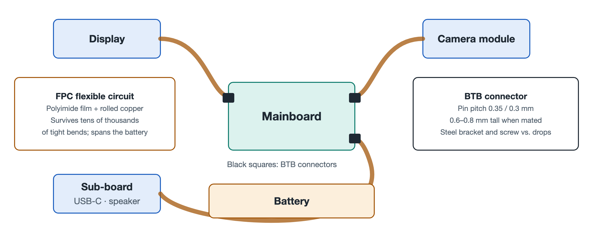

# 4.2 Flexible Printed Circuits (FPC): Three-Dimensional Nerves and Vessels in the Body's Crevices

Turn your phone over and picture its interior through the back cover. The mainboard is a rigid "city center." The camera crouches in an upper corner of the body. The buttons cling to the side frame, and the speaker hides at the bottom. The display covers the entire front, while the battery lies across the middle like a thick brick. These components are scattered all over, separated by differences in height, corners, and gaps. What ties them together into a single whole? The answer is a set of paper-thin ribbons, golden or orange-brown in color: the Flexible Printed Circuit (FPC), commonly called a "flex board."

If the mainboard is the brain and heart of the phone, the FPC is the network of nerves and blood vessels running throughout its body. It carries both signals and power, and it has to turn, fold, and detour through narrow crevices to do so.

## 4.2.1 Why Rigid Boards Won't Work

An ordinary circuit board, or rigid board, is built on a substrate of glass fiber and resin. It is sturdy but cannot bend. In a phone less than a centimeter thick, the modules do not sit at the same height or on the same plane. The display is on the top layer, the mainboard in the middle, and the battery off to the side, while the camera even protrudes from the body. Connecting them with only rigid boards and wires would either take up a great deal of space or lead to breakage from repeated tugging during assembly and use.

The idea behind the FPC is to "print" the circuit onto a soft, thin film, so that the traces themselves can bend like fabric. A single flex board can then leave the mainboard, cross over the edge of the battery, and climb along the inner wall of the midframe to reach the back of the camera. It conforms to the structure the whole way and takes up almost no extra volume.

## 4.2.2 Two Key Materials: Polyimide and Rolled Copper

A good phone flex board depends on two materials working together.

### 4.2.2.1 Polyimide Film (PI Film)

PI film serves as the FPC's "skin" and skeleton, acting as the insulating substrate. It has two standout properties. First, it resists heat, withstanding temperatures of around 300°C. This means it will not warp or blister during reflow soldering, the high-temperature process that solders components onto the board. Second, it is extremely tough: even a thin layer can be bent again and again without cracking. In everyday life it is hard to find a plastic that is both "unafraid of heat" and "impossible to fold to death," and that combination is exactly why PI was chosen.

### 4.2.2.2 Rolled Annealed Copper (RA Copper)

The copper used for the traces matters too. Copper foil is commonly made in one of two ways. In electrodeposition, copper atoms pile up layer by layer like falling snow, forming vertical, columnar grains. In rolling, a copper ingot is repeatedly rolled and then annealed (heated and slowly cooled to relieve internal stress), which stretches the grains out horizontally.

An analogy makes the difference clear. The grains of electrodeposited copper are like rows of chopsticks standing upright: bend them sideways and cracks easily open between them. The grains of rolled annealed copper are like noodles laid flat in one direction: when bent, they stretch along together. RA copper is therefore better suited to areas that must flex repeatedly. Paired with PI film, it can survive tens of thousands of tight-radius bends without breaking.

| Comparison | Ordinary Rigid Board | FPC Flex Board |
|---|---|---|
| Substrate | Glass fiber + resin | Polyimide film (PI film) |
| Conductor | Conventional copper foil | Rolled annealed copper (RA copper) |
| Flexibility | Essentially cannot bend | Withstands tens of thousands of tight-radius bends |
| Typical use | Mainboard carrying the chips | Cross-region links to display, camera, buttons, battery, etc. |

## 4.2.3 Spanning the Battery: Linking the Mainboard and Sub-board

Many phones use a "mainboard + sub-board" layout. The mainboard sits in the upper part of the body and carries the SoC and other core chips. The sub-board sits at the bottom and handles the charging port, speaker, microphone, and so on. A bulky battery pack lies between them.

The job of linking the upper and lower boards falls to a long FPC. It runs past the battery along the frame or passes beneath it, delivering charging current, audio signals, RF signals, and more. This flex board must be thin enough not to eat into the battery's space. It must also be reliable enough to survive the folds of assembly and the slight flexing of the body in everyday use. Anyone who has taken a phone apart will often notice that this "ribbon cable" is one of the first parts to disconnect and one of the last to reconnect, which shows how central it is to the system.

## 4.2.4 Holding Up a Floating Lens: The Flex Board in a Periscope Telephoto

One of the most ingenious uses of FPC is found in periscope telephoto cameras. For focusing and stabilization, the lens group is driven by micro-motors and floats in a magnetic field, making tiny, rapid movements. The catch is that the lens module itself needs power and signals, so it must stay wired.

If the connection were too stiff, it would act like a string tethering a balloon, pulling on the lens and disturbing the motor's precise positioning. The FPC here must have extremely low mechanical springback: once bent, it produces almost no restoring force. As the motor pushes the lens, the flex board simply follows along compliantly without adding any extra pull. This lets the lens stay suspended and stable with microsecond-level response. In other words, the flex board here is more than a wire. It is part of the mechanical system, and its softness directly affects whether your photos come out sharp.

## 4.2.5 Invisible Design Constraints

Designing an FPC is not as simple as "making it softer." Engineers must balance several factors at once:

- **Bend radius**: The tighter the bend, the more stress the copper traces endure, forcing a trade-off between space and lifespan;
- **Fixation and routing**: Flex boards must be held in place with adhesive and clips to prevent friction and wear during drops or vibration;
- **Signal integrity**: When carrying high-speed data for the display, camera, and other components, trace width, spacing, and shielding layers must be carefully designed to prevent interference;
- **Assembly sequence**: Flex boards often need to be folded before being snapped into place, which shapes the assembly process of the entire phone.

## 4.2.6 Summary

With a body of heat-resistant, extremely tough polyimide film and traces of rolled annealed copper whose grains stretch out horizontally, the FPC gave circuits a "bendable" form for the first time. It spans the battery to link the main and sub-boards, wraps around the frame to reach the camera and buttons, and even supports a floating lens with almost no resistance, stitching the modules scattered throughout the body into one whole. Yet every flex board must eventually "plug in" to the mainboard, and that connection point has to be both tiny and secure. The next section takes a close look at this physical checkpoint: the miniature board-to-board (BTB) connector.
