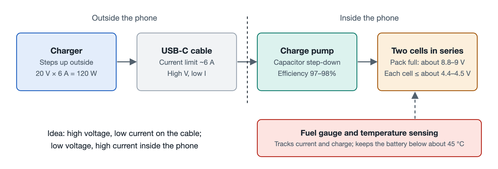

# 5.2 The Ultimate Energy Ladder: 100-Watt-Class Super Fast Charging and Charge-Pump Direct Charging

Pick up your charger and look at it. The casing usually carries a row of tiny output ratings, such as "5V⎓3A", "10V⎓…", and "20V⎓6A". Now look at the small Type-C port at the bottom of your phone. It is barely as wide as a fingernail, and the metal contacts inside are as fine as strands of hair. To pour a hundred watts of energy into a battery within a few dozen minutes, that power first has to squeeze through this port and then travel along a length of cable. This section follows electrical energy along its path, from the wall outlet all the way into the battery cell, to see how this step-by-step "energy staircase" is designed.

## 5.2.1 Where Is the Bottleneck? The Port Can't Handle High Current

Electrical power equals voltage multiplied by current (P = U × I). To get 120W, you could use 5V with 24A, or 20V with 6A. Both pairs multiply to the same result, yet they put very different demands on the cable and the port.

The reason is heat in the conductors. When current flows through wires and contacts that have resistance, the heat produced is proportional to the square of the current (Q ∝ I²R). Double the current, and the heat becomes four times as great. The contact area in a Type-C port and a standard cable is limited, and according to the specification, the maximum current it can safely carry is about **6A**. Beyond that, the port and cable heat up noticeably, and the contacts may oxidize or even burn.

So the first design principle is: **outside the phone, transmit power at high voltage and low current.**

## 5.2.2 The First Step: The Charger Raises the Voltage to 20V

Think of electrical energy as flowing water. Voltage is like water pressure, and current is like flow rate. When the pipe diameter is fixed, the way to deliver more water is to increase the pressure, not to widen the pipe.

The charger is the "pump" that applies this pressure. It converts mains electricity into direct current at **20V/6A**, which works out to exactly 120W. The current in the cable and port is thus kept within the 6A specification limit, so heating along the transmission path stays under control.

However, the battery cannot accept 20V directly. Lithium batteries have strict requirements for charging voltage, and exceeding them even slightly can create safety risks. Once the high voltage reaches the phone, it has to be brought down inside the device.

## 5.2.3 The Second Step: The Charge Pump "Folds" the Voltage in Half

The traditional approach is to place an inductor-based buck converter chip inside the phone. These chips are fairly efficient, but whatever energy they lose turns entirely into heat, trapped inside an already crowded phone body. At power levels around 100 watts, losing even a few percent is enough to make a sizable "hand warmer."

Fast-charging solutions therefore use a **charge pump** chip instead. It works on the **switched capacitor** principle, which can be understood through an everyday scenario:

> Imagine two identical buckets. First, stack them one on top of the other like building blocks, connected in series, and fill them from up high. Then set them side by side, connected in parallel, and pour them out together. The "height" of the water is halved, while the total flow pouring out is doubled.

The switches inside the chip repeat this action at very high frequency, flipping the capacitors back and forth between "charging in series" and "discharging in parallel," to achieve a **2:1** voltage conversion:

| Location | Voltage | Current | Power |
|---|---|---|---|
| Cable and port (charge pump input) | 20V | 6A | 120W |
| Charge pump output (into the battery) | 10V | 12A | About 120W |

The key here is efficiency. A charge pump moves charge mainly through capacitors and switches, without relying on magnetic energy conversion in an inductor, so its conversion efficiency can exceed **97%–98%**. The smaller the loss, the less heat stays inside the phone. The high current flows only along a very short path between the charge pump and the battery, and this copper trace is short and wide with very low resistance, so its heating is kept in check as well.

This approach, in which the voltage is only scaled by a fixed ratio and delivered almost directly into the battery, is often called **direct charging**.

## 5.2.4 The Third Step: Dual Cells in Series Share the Voltage

10V is still higher than what a single lithium cell can withstand. The solution is to split the battery into two cells connected **in series** to form a battery pack.

In a series circuit, the same current flows through both cells, and the pack voltage is the sum of the two cell voltages. With two cells in series, the fully charged pack sits at about 8.8–9V, while each cell stays within its own charging limit (about 4.4–4.5V). The charge pump's output voltage also adjusts to follow the pack's present voltage rather than being fixed at 10V. Put another way, a load too heavy for one person to carry becomes steady when two people carry it on a pole, one in front and one behind.

Compared with a single-cell design, dual cells in series bring another benefit: at the same charging power, each cell bears less of the burden, and internal heating is more evenly distributed. The cost is more complex battery management. The two cells must be kept in balance; one cannot be full while the other is still empty.

## 5.2.5 The Invisible Gatekeepers: The Coulomb Counter and the Shunt Resistor

During high-speed charging, the system needs to know at all times "how much charge has gone in and how hot the battery is right now." This job is done by two components working together:

- **Coulomb counter chip**: The coulomb is the unit of electric charge. This chip continuously tallies the current flowing into and out of the battery, like fitting the battery with a precise "water meter." From this it calculates the remaining charge, which is the percentage shown on your screen.
- **Bidirectional shunt resistor**: A precision resistor with extremely low resistance, placed in series in the battery circuit. When current flows through it, a tiny voltage difference forms across it, and by measuring that voltage difference the chip can calculate the current. "Bidirectional" means it can measure current in both directions, charging and discharging.

This data is fed back to the charging management system in real time. As soon as the temperature approaches the set limit, the system actively reduces charging power. The goal of the entire design is to keep battery temperature within an upper limit of about **45°C** (the exact figure varies by manufacturer). This is also one reason many phones charge noticeably more slowly once the battery level is high: the system is actively letting the battery and the phone body cool down.

## 5.2.6 Summary: A Four-Step Energy Staircase

Put the whole process together and you get a clear chain:

1. **The charger steps up the voltage**: 20V/6A, sidestepping the port's current bottleneck;
2. **The charge pump folds it in half**: high-efficiency conversion to 10V/12A, keeping heat loss to a minimum;
3. **Dual cells in series**: each cell stays within its charging limit of about 4.4–4.5V, ensuring electrochemical safety;
4. **Metering and thermal control**: the coulomb counter and shunt resistor monitor in real time, holding the battery temperature under its limit of about 45°C.

Behind the "100-watt flash charging" announced at product launches lies a chain of trade-offs among voltage, current, and heat. While energy surges through the phone, photons are being converted at high speed along another path. In the next section, we turn to the instant you press the shutter.
