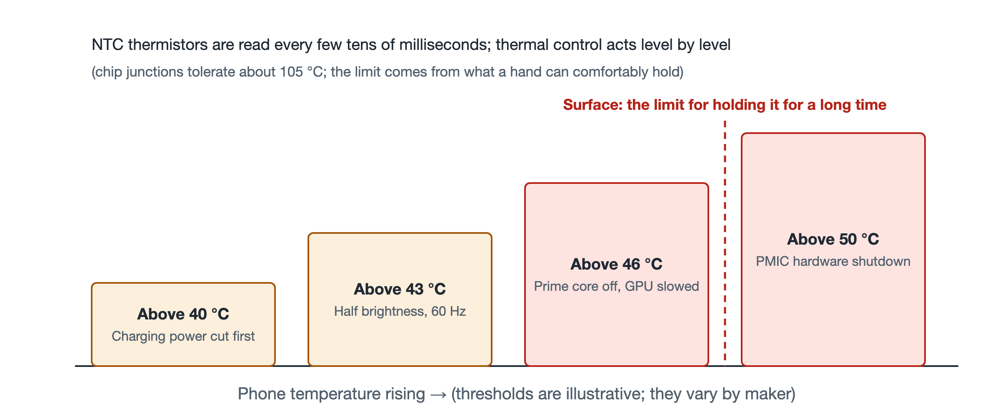

# 6.2 Thermal Walls and Thermal Throttling: The Art of Self-Preservation in a Sealed Space

On a summer day, open your navigation app in direct sunlight with the charging cable plugged in, then start a demanding game. Before long you will notice a series of changes: charging slows down noticeably, the screen dims on its own, the picture is no longer as smooth as it was at first, and in severe cases a "Phone temperature too high" warning even pops up. None of this is a malfunction. The phone is protecting itself according to rules written in advance. Engineers call this set of rules thermal throttling, and the temperature thresholds that trigger it are known as "thermal walls."

## 6.2.1 Two Red Lines: How Hot the Chip Can Get, and How Hot the Hand Can Bear

To understand thermal control, you first need to distinguish between two temperatures.

The first is the **chip junction temperature**, the temperature of the region inside the chip where the transistors sit. Silicon chips tolerate heat better than people tend to assume; the internal junction temperature can reach around 105°C. Judged by the chip alone, there is still plenty of headroom.

The second is the **skin-contact temperature**, the temperature of the phone's casing where it rests against your palm or cheek. A smartphone is held in the hand and pressed to the ear for long periods, and prolonged skin contact with an overly hot surface can cause low-temperature burns. Safety standards therefore limit the temperature of touchable surfaces, with limits tiered by material and contact time; manufacturers typically keep surfaces that are held for long periods in the low-to-mid 40s °C.

Nearly 60°C separates these two red lines. What actually caps a phone's performance is often not the chip's limit but the limit of the human hand. Consider an analogy: a car engine can withstand very high internal temperatures, but the cabin must stay comfortable for passengers. A phone has no fan and no air intake. It is a sealed box of glass and metal, and heat can only escape slowly through thermally conductive materials and the casing. Once the chip runs at full load for a sustained period, the casing temperature will sooner or later approach the human red line, and the system has no choice but to actively reduce heat generation.

## 6.2.2 "Temperature Sentinels" Across the Motherboard

To control temperature, you first have to know what it is. A set of **NTC thermistors** is distributed across the phone's motherboard. NTC stands for Negative Temperature Coefficient: the higher the temperature, the lower the thermistor's resistance. By measuring that resistance, a circuit can calculate the temperature at the thermistor's location.

There is never just one of these thermistors. They form an array, placed near the main heat sources such as the SoC, the battery, the charging chip, and the camera module. The system reads the temperature at each point **every few tens of milliseconds**, which amounts to posting a ring of sentinels throughout the device, constantly reporting where things are heating up and how fast.

The component that aggregates this data and makes decisions is the operating system's **thermal control daemon**. A "daemon" is a system program that runs continuously in the background without interacting directly with the user. It does not process photos or load games; it simply watches the thermometers and issues cooling orders according to its rules.

## 6.2.3 A Four-Step Ladder: Cut What Hurts the Experience Least First

The thermal control daemon does not slow everything down the moment it detects a temperature rise. Instead, it works through a **fixed cascade of tiers**, step by step, each one more severe than the last:

| Temperature threshold | Action taken | What you notice |
|---|---|---|
| Above 40°C (illustrative) | Reduce charging power first | Charging slows; battery percentage rises more slowly |
| Above 43°C | Screen brightness forcibly halved, refresh rate locked at 60Hz | Screen dims; scrolling is less smooth than at high refresh rates |
| Above 46°C | Prime cores shut off, GPU downclocked | Games drop frames; apps respond more slowly |
| Above 50°C | PMIC triggers a hardware power cut and shutdown | The phone simply shuts off |

This ordering reflects a trade-off: **sacrifice what the user is least likely to notice first, and what the user feels most strongly last.**

**Tier one: cut charging.** During charging, both the chemical reactions inside the battery and the energy conversion in the charging chip generate heat, especially with fast charging. Lowering charging power only means it takes longer to reach full; it does not interrupt what you are doing, so the cost is minimal. Batteries are also sensitive to heat, and charging at high current in high temperatures accelerates aging, so this step protects the battery at the same time.

**Tier two: rein in the screen.** The screen is one of the largest and most continuously power-hungry components in a phone, and both high brightness and high refresh rates mean more power draw. With brightness halved and the refresh rate locked to 60Hz, the screen will feel dimmer and less silky, but content remains visible and the phone remains usable.

**Tier three: touch the computing power.** At 46°C, the first two steps can no longer hold the line, and the system begins limiting the compute cores directly: it shuts down the prime cores, which generate the most heat, and lowers the frequency of the GPU (graphics processing unit). Gamers notice this step most, as frame rates fall and stuttering appears. The EAS scheduling discussed in the previous section works in concert with this step, migrating tasks to more power-efficient cores.

**Tier four: cut the power.** If the temperature still breaks past 50°C, the software measures have failed, possibly because of an extreme environment or some abnormality. At this point the **PMIC** (Power Management IC) cuts the power supply directly at the hardware level and forces a shutdown. This step does not depend on the operating system; even if the software has frozen, the hardware protection can still act. It is the last line of defense.

## 6.2.4 Why "Tiered" Rather Than "One Size Fits All"

If designers took the lazy route and set a single threshold, throttling everything once it was crossed, users would experience abrupt jumps between "full power" and "crippled," which makes for a poor experience. The advantages of a tiered ladder are:

- **Gradual**: when the temperature rises slightly, only minor adjustments are made, and most of the time users don't notice;
- **Targeted**: loads that can afford to give way, such as charging and the screen, are dealt with first, preserving core tasks as much as possible;
- **Backstopped**: after software has retreated step by step, a hardware power cut remains as the final protection.

This also explains a common phenomenon: the same phone posts high benchmark scores in launch reviews, yet its frame rate drops after extended gaming. The peak performance shown at a launch event is a short burst beneath the thermal wall; how long it can be sustained depends on thermal design and thermal control strategy. Once you understand this, you can take marketing claims like "max frame rate" and "sustained performance" with a more critical eye.

## 6.2.5 Summary

Thermal throttling is not a performance defect but an engineering choice a phone makes inside a fanless, sealed space: the chip can tolerate 105°C, but it must defer to the upper temperature limit that a human hand can touch for long periods. NTC thermistors handle sensing, the thermal control daemon handles decision-making, and the (illustrative) four-step ladder of 40°C, 43°C, 46°C, and 50°C retreats from charging to the screen to computing power, and finally to a hardware power cut. The next time your phone dims or slows down, you can tell which tier it is on. Temperature is only one of the physical quantities a phone senses. In the next section, we will see how the system fuses signals from multiple sensors, measuring acceleration, angular velocity, magnetic fields, and more, to arrive at reliable results.
