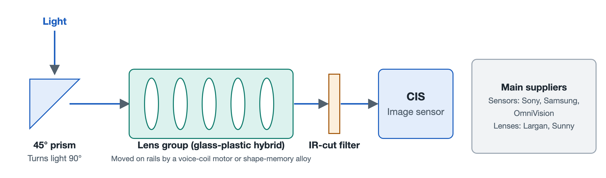

# 7.2 A Hands-On Dissection of Camera Modules and Their Industry Map

Turn a phone over, and the raised camera bump on the back is often the most conspicuous feature of the entire device. Several round lenses sit side by side, sometimes joined by a square "window." They look like nothing more than a few pieces of glass, yet once taken apart, each one turns out to be connected to an entire chain of precision optics and semiconductors. This section first takes apart a periscope telephoto module by following the path light travels through it, then looks at the companies behind the image sensors and lenses.

## 7.2.1 The Secret Behind the Square Window: The Four Stages of a Periscope Telephoto Module

To "bring distant scenes closer," a telephoto lens needs a long focal length. Focal length can be roughly understood as the optical distance required between the lens and the light-sensitive surface. A phone body is less than a centimeter thick, so if the lens elements were stacked straight inward, there would simply be no room. Engineers solved this by making the light turn a corner, which is where the periscope structure comes from. It works on the same principle as a submarine periscope: a reflective element redirects the optical path.

From the moment a beam of light enters the square window to the moment it becomes an electrical signal, it passes through four components in sequence:

1. **45° folding prism**: Light enters perpendicular to the back of the phone, strikes a prism angled at 45°, and is bent 90° so that it travels sideways along the long axis of the body. The length that would otherwise have to be occupied "vertically" is thus laid flat along a roomier direction inside the phone.
2. **Floating lens group**: The light, now traveling sideways, passes through a group of lens elements that perform focusing. This group is not fixed; it is mounted on miniature rails and moved back and forth by a motor. There are two common drive methods. One is the **voice coil motor** (VCM), which pushes the lenses using the force a current-carrying coil experiences in a magnetic field, similar to how a loudspeaker diaphragm produces sound. The other is **shape memory alloy** (SMA), a metal wire that contracts back to a preset length when heated; by controlling the current that heats it, the lenses can be pulled with great precision.
3. **IR-cut filter**: Image sensors also respond to infrared light, which the human eye cannot see. Without filtering, photos would show color casts and look washed out. This thin piece of glass lets only visible light pass through.
4. **CMOS image sensor** (CIS): The end of the optical path. The surface of this chip is covered with tens of millions of pixels, which convert photons into electric charge and then into digital signals that are passed on to the image signal processor.

The cooperation among these four components can be summarized as "capture—redirect—focus—filter—record":

| Component | Role in the Optical Path | Everyday Analogy |
|---|---|---|
| 45° folding prism | Bends vertically incoming light by 90° | The convex mirror at a stairwell corner |
| SMA / VCM floating lens group | Moves lenses for focusing and stabilization | The focus knob on a telescope |
| IR-cut filter | Removes infrared light to ensure accurate color | Sunglasses blocking the glare |
| CIS image sensor | Converts light signals into electrical signals | The film in a film camera |

## 7.2.2 The Big Three of Image Sensors: Each Betting on a Different Technology Path

The core component that sets the ceiling on image quality is the CIS. Three representative manufacturers currently dominate this field, each having chosen a different technical direction.

**Sony Semiconductor (LYTIA brand)** is represented by the 1-inch LYT-900. It is a stacked sensor, and its large light-sensitive area gathers more light. One of Sony's signature technologies for stacked sensors is the **two-layer transistor pixel**, announced in 2021. In a conventional sensor, the photodiodes that collect light and the transistors that read out the signal are crammed onto the same layer of silicon, competing for area. Sony fabricates the two on separate wafers and then bonds them vertically, one on top of the other. Think of it as a building: the shops and the warehouse used to be squeezed onto the same floor, but now the warehouse has moved downstairs, and the entire upper floor is devoted to "catching light." With more room, the photodiode can hold more charge; according to Sony, the saturation signal level roughly doubles, and dynamic range expands accordingly. Dynamic range is the ability to capture detail in both the bright and dark areas of the same scene. When you photograph someone against the light and their face isn't dark while the sky isn't blown out, dynamic range is what makes it possible.

**Samsung Semiconductor (ISOCELL brand)** follows an ultra-high-resolution path, represented by the 200-megapixel HP2. With so many pixels, each individual pixel is necessarily small, and in dim light each one receives very little light. Samsung's answer is **16-in-1 pixel binning**: when light is insufficient, 16 adjacent small pixels are merged and used as one large pixel, trading resolution for light intake; when light is plentiful, they are separated again to output full-resolution detail. The approach resembles a sports team: normally each of the 16 players covers their own zone, but against a strong opponent they huddle together into a concentrated defense.

**OmniVision**, represented by the OV50H and OV50K, pioneered **LOFIC ultra-high dynamic range technology**. LOFIC stands for Lateral Overflow Integration Capacitor. Under strong light, a photodiode quickly becomes "flooded" with charge, and the excess charge is lost, turning the bright parts of the image into a flat white. LOFIC adds a capacitor next to each pixel specifically to catch the overflowing charge, like placing an overflow basin next to a cup so that the water spilling over isn't wasted. In this way, detail in the highlights can be preserved as well.

| Manufacturer | Brand / Representative Product | Core Technology | Main Problem Addressed |
|---|---|---|---|
| Sony Semiconductor | LYTIA / 1-inch LYT-900 | 1-inch stacked sensor; Sony also has two-layer transistor pixel technology | Light intake and dynamic range |
| Samsung Semiconductor | ISOCELL / 200 MP HP2 | 16-in-1 pixel binning | Balancing high resolution with low-light intake |
| OmniVision | OmniVision / OV50H, OV50K | LOFIC lateral overflow capacitor | Preventing blown-out highlights under strong light |

When reading spec sheets at product launches, the three kinds of claims—"1-inch large sensor," "200 megapixels," and "ultra-high dynamic range"—usually correspond to these three paths respectively. There is no simple ranking among them; each makes different trade-offs among sensor area, pixel count, and charge capacity.

## 7.2.3 "Glass + Plastic" in the Lens: 1G+6P Hybrid Lenses

The lens in front of the sensor is made of multiple tiny elements stacked together. Most phone lens elements are precision injection-molded plastic (Plastic, abbreviated P), which is light, inexpensive, and can be shaped into complex aspherical forms. Glass (Glass, abbreviated G) offers better light transmission and is less affected by temperature, but it is harder to process. **1G+6P** means a lens assembled from 1 glass element and 6 plastic elements: the single glass element compensates for plastic's weaknesses in dispersion and stability, while retaining plastic's advantage of thinness and light weight.

The manufacture of these glass-plastic hybrid lenses, only a few millimeters in diameter and demanding extreme precision, is firmly in the hands of **Largan Precision** and **Sunny Optical**. The surface-form error of each element and the alignment accuracy among the multiple elements directly determine whether a photo is sharp, which is precisely why only a handful of manufacturers have been able to hold this link of the chain for so long.

## 7.2.4 Summary

A single camera module, from outside to inside, ties together optical design, precision mechanics, materials science, and semiconductor processing: the prism solves the space problem, the motor solves the focusing problem, the filter solves the color problem, the CIS solves photoelectric conversion, and the glass-plastic lens solves imaging sharpness. Behind every link stands a specialized manufacturer. The next section turns to the largest component on the front of the phone, to see what standards the flexible display and cover glass follow.
