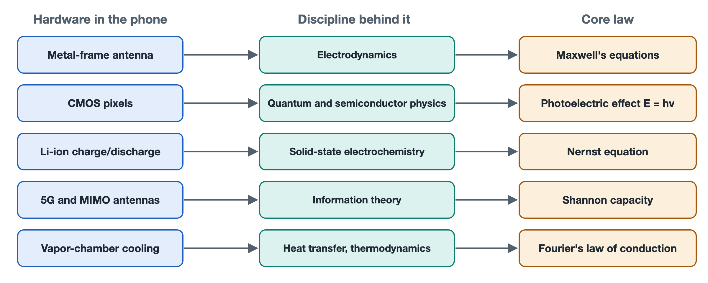

# 8.5 A Panoramic Map Linking the Smartphone to Foundational Scientific Theory

Turn your phone over and lay it face down on the table. You can see and touch a number of parts. There are the thin plastic seams in the metal frame. Inside the camera module sits an image sensor about the size of a fingernail. Beneath the glass back lies a flat battery. On the mainboard is a baseband chip that handles 5G. Pressed against the processor is a thin metal heat spreader. The first four sections of this chapter each followed one of these threads all the way back to the equations in the textbooks. This section gathers those four threads together, adds a fifth on heat dissipation, and assembles them into a complete map. From now on, whenever you notice some phenomenon on your phone, you will be able to locate the discipline, the theorem, and the founding figures behind it.

## 8.5.1 One Table: From Components to Laws

The table below has four columns: "Component or Phenomenon — Discipline — Core Theorem or Model — Representative Figures." Read each row as a path leading from the inside of the phone to fundamental science.

| Physical Component / Key Phenomenon Inside the Phone | Underlying Discipline | Core Physical Theorem / Mathematical Model | Most Representative Founding Scientists |
|---|---|---|---|
| Metal-frame antennas, high-frequency RF transmission | Classical electrodynamics / RF engineering | Maxwell's equations (electromagnetic radiation), the wave equation | James Clerk Maxwell, Heinrich Hertz |
| CMOS photodiodes, noise in night shots | Quantum mechanics / semiconductor physics | Einstein's photoelectric effect (E=hν), Poisson shot noise | Max Planck, Albert Einstein, William Shockley |
| Lithium-ion charging and discharging, lithium plating during fast charging | Physical chemistry / solid-state electrochemistry | Nernst equation (equilibrium potential), Arrhenius law of diffusion | Walther Nernst, Svante Arrhenius, John Goodenough |
| High-speed 5G communication, MIMO multi-antenna systems | Information theory / matrix algebra and statistics | Shannon's channel capacity formula, singular value decomposition of the spatial channel matrix | Claude Shannon, Harry Nyquist |
| Vapor-chamber phase-change cooling, chip junction temperature | Heat transfer / classical thermodynamics | Fourier's law of heat conduction, thermodynamic equilibrium equations for latent heat of phase change | Joseph Fourier, Rudolf Clausius |

The rows in this table were not chosen at random. The five rows correspond to the five most basic kinds of "flow" in a phone. Electromagnetic waves flow outward. Photons flow inward. Lithium ions flow between the positive and negative electrodes. Information flows through the spatial channel. Heat flows from the chip to the casing. Chapter 5, on the "pulse of the system," described what these flows look like in engineering terms. This chapter has explained why they must flow the way they do.

## 8.5.2 Revisiting the Five Paths One by One

**Path one: frame seams and electromagnetic waves.** The breaks in the frame divide the metal ring into several segments. Each segment is an antenna whose dimensions have been carefully calculated. Maxwell's equations show that a changing current produces a changing magnetic field, and a changing magnetic field in turn produces an electric field. As the two keep generating each other, an electromagnetic wave propagates outward. The wave equation fixes the relationship between wavelength and frequency, so each antenna's length has to match its operating band. Higher frequencies mean shorter wavelengths, which walls and hands weaken more easily. Engineers therefore place multiple antennas around the body of the phone so they can take turns handling the signal like runners in a relay.

**Path two: pixels and photons.** When a photon strikes a CMOS photodiode, it carries energy E=hν. If that energy is high enough, it knocks loose an electron. This is the photoelectric effect that Einstein explained. Photons also arrive at random, following a Poisson distribution: when N photons arrive on average, the fluctuation is roughly √N. At night there is little light, so N is small, the fluctuation is relatively larger, and noise shows up in the image. A "large sensor" and a "wide aperture" both collect more photons, which makes the statistical fluctuation relatively small.

**Path three: the battery and ions in the lattice.** A lithium battery's voltage is set by the difference in electrochemical potential between the positive and negative electrode materials. The Nernst equation describes how this potential changes with concentration and temperature. The rate at which lithium ions diffuse through the electrode lattice follows the Arrhenius law, so when the temperature drops, diffusion slows down exponentially. This explains why a phone can shut down suddenly in winter while the battery indicator still shows charge remaining. It also explains why fast charging has to limit the current to keep lithium from plating onto the surface of the negative electrode. Research on cathode materials by Goodenough and others laid the foundation for today's phone batteries.

**Path four: multiple antennas and channel capacity.** Shannon's formula sets an upper limit on how much information a channel can carry for a given bandwidth and signal-to-noise ratio. 5G raises speeds in two ways. It widens the bandwidth, and it uses MIMO (multiple-input multiple-output) technology, in which several antennas transmit and receive at the same time. Mathematically, the spatial channel can be written as a matrix. Performing a singular value decomposition on that matrix splits one congested channel into several roughly parallel "sub-channels." Nyquist's work on sampling and symbol rate set the rules for the timing of digital communication.

**Path five: the vapor chamber and junction temperature.** The earlier sections did not treat this path on its own, so it is covered here. A working chip produces heat as its transistors switch. Fourier's law states that heat flow is proportional to the temperature gradient and to the material's thermal conductivity. That is why highly conductive materials such as copper and graphite are used to spread heat out quickly. A vapor chamber contains a small amount of sealed liquid. The liquid absorbs heat at the hot end and evaporates. The vapor travels to the cool end, where it releases heat and condenses. The condensed liquid then flows back through a capillary structure. Because of latent heat, even a very thin metal plate can move a large amount of heat. The laws of thermodynamics that Clausius formulated also remind us that heat only flows from hot to cold. In the end, the limit on a phone's cooling depends on the temperature difference between the phone's body and the surrounding air.

## 8.5.3 Why Draw This Panoramic Map

A single component on its own is easy to mistake for an isolated technical detail. Placed in this table, it reveals three layers of relationship:

1. **The limits come from the laws of nature, not from manufacturers.** Signals weakening through walls, noise in night shots, battery drain in the cold, and throttling under heat are each constrained by one of the laws in the table above. Engineering can only maneuver within the room those laws allow.
2. **A single phone draws on many disciplines.** One video call uses electrodynamics, semiconductor physics, electrochemistry, information theory, and heat transfer all at once. This is what "high integration" means.
3. **Behind every specification lies a physical quantity.** The "bigger sensor," "faster charging," "stronger 5G," and "better cooling" announced at product launches can all be translated back into photon counts, ion diffusion, channel capacity, and heat flow.

## 8.5.4 AI Collaboration Interface: Tracing a Physical Phenomenon Back to Its Source

This table also works in reverse. You can start from a phenomenon you have observed and ask which row it belongs to. The prompt below can be given directly to an AI assistant. Replace the text in square brackets with the phenomenon you observed.

> I am reading the material on tracing principles to their source in Chapter 8 of *Foundational Systems Knowledge for the AI Era: The Smartphone*. I have observed a specific physical phenomenon while using my phone: [enter your specific phenomenon, for example: Why does my phone suddenly shut itself off outdoors in winter when the battery still shows 30%? / Why does a 5G signal weaken so much more than 4G after passing through a load-bearing wall? / Why does a larger lens aperture and a larger sensor mean less noise in night shots?].
> Using this chapter's framework for tracing disciplines to their source, please help me reconstruct the underlying scientific mechanism:
> 1. [Core scientific law]: Which theorem from physics, chemistry, or information theory governs this phenomenon (for example, the Arrhenius equation, Maxwell's equations, the Nernst equation, or the Poisson distribution)?
> 2. [Microscopic physical reasoning]: Using a microscopic physical account that is accessible yet rigorous, explain what changes occur in the temperature / lattice / photons / electromagnetic waves at that moment.
> 3. [Engineering compromises]: What methods do modern phone engineers and algorithm scientists use, in hardware design or at the operating-system level, to counter this physical limit?

Once you have the answer, compare it against the table above to check whether the AI assigned the right discipline. Then go back to the relevant subsection of this chapter and review its reasoning. This way the AI acts as a sparring partner, and you still make the final judgment yourself.

## 8.5.5 Summary

This chapter began with four equations and ended with this five-row table. The table links the visible components inside a phone to centuries of accumulated achievements in physics, chemistry, and information theory. The next chapter explains in a systematic way how to use AI to turn this habit of asking how an object connects to its underlying principles into part of everyday life.
