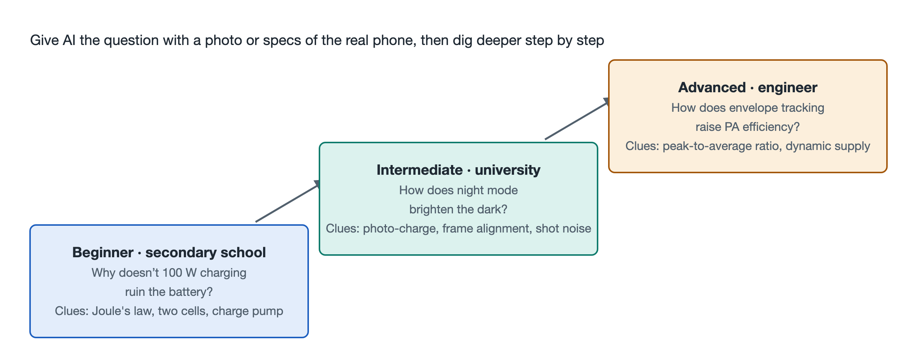

# 9.2 Three Stages of Cognitive Progression: A Question Ladder from Secondary School Student to Engineer

In the previous section, we had AI identify every chip in a teardown photo. But "identifying" is only the beginning. Learning that truly pays off means bringing a good question and letting AI follow up with you, step by step, until you reach the underlying principles. Ask a shallow question, and the AI's answer stays on the surface. Ask a precise one, and it can lead you through a complete system pathway.

This section lays out a three-step ladder of questions, corresponding to three knowledge backgrounds: middle schooler, university student, and engineer. All three questions come from the most common phenomena in everyday phone use: charging, night photography, and 5G calls. The higher the step, the deeper the physics and engineering concepts involved. You can start from whichever step matches your background, or read all three questions together to see how the same phone looks at different depths.

## 9.2.1 Ladder Overview: Three Depths of the Same Phone

| Step | Reader Perspective | Core Question | Knowledge Required | Corresponding Book Sections |
|---|---|---|---|---|
| Beginner | Middle schooler | Why doesn't 100-watt fast charging make the battery explode? | Joule's law from middle school, voltage division in series circuits | 5.2, 8.3 |
| Intermediate | University student | How can night mode turn night into day? | Photoelectric effect, probability and statistics, image alignment | 5.3, 8.2 |
| Advanced | Engineer | How does 5G envelope tracking improve power amplifier efficiency? | Modulation theory, power supply design, signal bandwidth | 5.1, 8.4 |

There is one principle to follow: **don't ask for the answer all at once; let the AI guide you step by step.** For example, add this before your question: "Please don't tell me the conclusion directly. First ask what I already know, then give me hints one step at a time." This turns the AI into a sparring partner rather than just a talking encyclopedia.

## 9.2.2 Beginner: Why Doesn't 100-Watt Fast Charging Make the Battery Explode?

**Starting scenario**: You see "100W fast charging" at a product launch, and your first reaction may be worry: with that much power, won't the battery overheat and catch fire?

**Recommended line of questioning**:

1. **Start with Joule's law.** Middle school physics tells us that the heat produced by current flowing through a conductor is Q = I²Rt. Heat is proportional to the square of the current. So the main factor in heating is current; power itself is secondary. You can ask the AI: "If power stays the same, and I double the voltage while halving the current, how does the heating change?" The answer: with resistance unchanged, heating drops to one quarter of the original.
2. **Next, look at voltage division with dual series cells.** Many fast-charging phones build the battery as two cells in series. In series, the total voltage doubles, so for the same charging power, the current through the battery circuit can be reduced. This is the "raise voltage, lower current" idea applied to the battery. You can follow up with the AI: "Why not just use one large cell? What's the cost of putting two in series?" This leads into the topics of cell consistency and balancing management.
3. **Finally, look at charge pump direct charging.** The voltage delivered by the charger must be converted inside the phone before it enters the battery. Traditional inductor-based step-down circuits have considerable losses, which turn into heat left in the phone body. A charge pump uses capacitors switched in fixed ratios to convert voltage, reaching conversion efficiency of around 98%. In other words, the vast majority of the energy goes into the battery, and only a small fraction becomes heat.

**What you gain at this step**: The safety of fast charging comes from a whole set of combined designs; it can't be achieved simply by "a tougher battery." Lowering current reduces heat at the source, efficient conversion reduces intermediate losses, and together with the temperature monitoring discussed in Chapter 6, heat always stays within a controllable range. A single middle school formula is enough to explain the most eye-catching spec at a product launch.

## 9.2.3 Intermediate: How Can Night Mode Turn Night into Day?

**Starting scenario**: You press the shutter late at night, the screen says "Hold steady," and a second or two later, the photo is as bright as dusk. There was so little light, so where did the brightness come from?

**Recommended line of questioning**:

1. **Start from photo-generated charge.** Each pixel is essentially a photodiode. Photons strike the silicon and, through the photoelectric effect, excite electrons; these electrons are the photo-generated charge. In the dark, there are few photons, so each pixel collects little charge and the signal is weak. You can ask the AI: "What is the relationship between the number of charges a pixel collects and the final brightness?"
2. **Understand Poisson shot noise.** Photons arrive at a pixel as random events that follow a Poisson distribution. This fluctuation, caused by the particle nature of light, is called shot noise. One important property: the weaker the signal, the more noticeable the noise is relatively. This is the root cause of the colorful noise speckling night photos. Ask the AI to explain: "Why does the signal-to-noise ratio improve by √N when N photos are stacked?" This step is a direct application of probability and statistics in the camera.
3. **Understand optical flow alignment in the RAW domain.** Stacking multiple frames has a prerequisite: each one must be aligned precisely. Your hands shake when shooting handheld, and people and cars in the scene are moving. The phone works in the RAW domain, that is, the raw sensor data before any color processing, using optical flow algorithms to estimate the displacement of each block of pixels, aligning multiple frames block by block before fusing them. It operates in the RAW domain because this data is closest to the true photon statistics, and its noise characteristics have not yet been distorted by later processing.

**What you gain at this step**: "Turning night into day" doesn't add light out of nowhere; it simply accumulates the photons scattered across multiple photos according to statistical laws and averages out the random noise. The whole process ties together the millisecond-level computational photography relay from Chapter 5 and the semiconductor imaging physics from Chapter 8.

## 9.2.4 Advanced: How Does 5G Envelope Tracking Improve Power Amplifier Efficiency?

**Starting scenario**: A 5G phone noticeably heats up and drains its battery quickly when the signal is weak, and one of the biggest culprits is the radio frequency power amplifier (PA). How does engineering make it waste less power?

**Recommended line of questioning**:

1. **Understand the challenge of high peak-to-average ratio.** 5G uses high-order modulation, such as 1024-QAM (quadrature amplitude modulation). It packs more bits into each symbol, and the signal amplitude fluctuates sharply as a result, with peak power far above average power. This is the high peak-to-average power ratio (PAPR). The PA must be supplied with voltage sized for the peak, but most of the time the signal hovers near the average level, and the excess voltage turns into heat.
2. **Understand the idea behind envelope tracking.** Envelope tracking (ET) makes the PA's supply voltage change in real time with the signal envelope: high voltage when the signal is large, low voltage when it is small. As an analogy, a fixed supply is like leaving a big faucet wide open the whole time, while ET opens and closes the valve as needed. You can ask the AI to draw a comparison of the voltage curve against the signal envelope under "fixed supply" and "ET supply."
3. **Dig into the speed requirements of dynamic power supply.** 5G signal bandwidth can reach 100 MHz, so the envelope changes extremely fast. The ET power supply chip must have a high enough slew rate to complete voltage tuning on microsecond or even shorter timescales, while staying strictly synchronized with the RF signal. Once the timing is misaligned, distortion is introduced, which actually degrades communication quality. Here you can follow up with the AI: "When the ET modulator's bandwidth is insufficient, what problems appear in the spectrum?"

**What you gain at this step**: The efficiency problem ultimately comes down to coordination among the modulation scheme, power supply response speed, and signal synchronization. It connects the RF electromagnetic flow from Chapter 5 with the cost, behind Shannon's theorem in Chapter 8, of "trading more complex modulation for higher data rates."

## 9.2.5 Summary: The Value of the Ladder Lies in Connection

The three questions seem to belong to three separate fields: batteries, cameras, and RF. Yet the underlying logic is remarkably consistent: under physical constraints, use system design to minimize losses of energy and information. The middle schooler starts from Joule's law, the university student draws on probability and statistics, and the engineer masters the dynamic coordination between signal and power supply. All three are looking at the same phone in their hands, just at different depths.

Following a phenomenon down to its principles, then returning from the principles to verify against the real object: this round trip is how you train your "system X-ray vision." In the next section, we will put this questioning ability into a complete real-world scenario, starting from a single real operation and tracing the full-chain operation of the entire phone.
