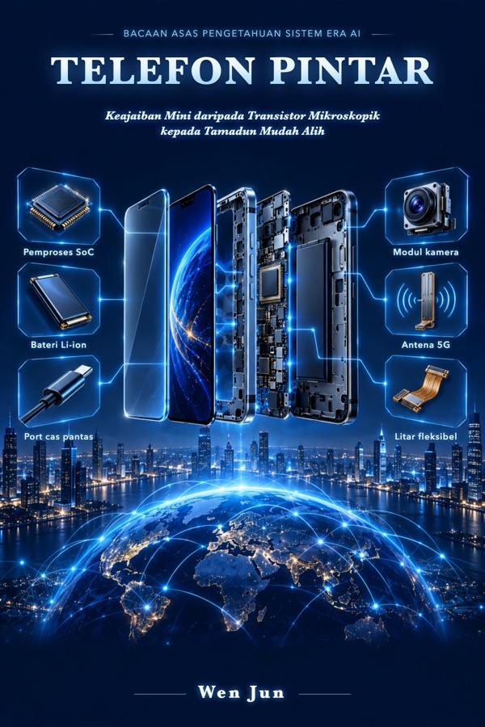

# Tentang Buku Ini

**Telefon Pintar** — Keajaiban Mini daripada Transistor Mikroskopik kepada Tamadun Mudah Alih

Sebahagian daripada siri *Bacaan Asas Pengetahuan Sistem Era AI*, oleh Wen Jun.

## Cara membaca buku ini

Buku ini menggunakan pendekatan "buku + objek sebenar + AI": buku memberikan kerangka pengetahuan yang kukuh, peranti di tangan anda ialah objek sebenar, dan apabila anda ingin mendalami sesuatu, bawa soalan dalam buku terus kepada AI dan biarkan ia meneruskan penerangan.

Buku ini disusun mengikut tangga pemahaman sembilan peringkat: objek → struktur → fungsi → hubungan → aliran → mekanisme → teknologi utama → prinsip → bekerjasama dengan AI.

## Komen

Ruang komen di bahagian bawah setiap halaman disediakan oleh Giscus. Komen disimpan dalam Discussions repositori GitHub buku ini; anda memerlukan akaun GitHub untuk memberi komen.

## Hak cipta

© Wen Jun. Hak cipta terpelihara.
