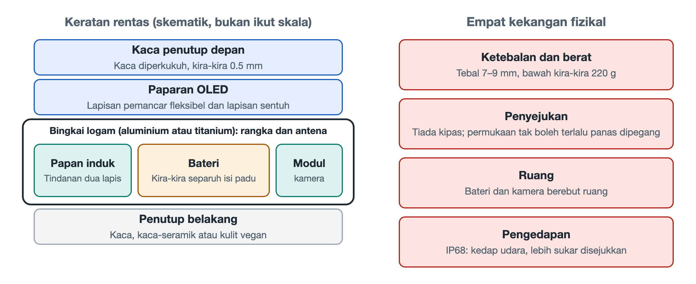

# 1.1 Bentuk Fizikal Telefon Pintar dan Kompromi Sistemnya

Letakkan telefon rata di atas meja. Kesan pertama yang terlintas ialah sekeping kaca segi empat tepat yang boleh bercahaya. Kepingan ini kelihatan ringkas, tetapi ia lahir daripada evolusi panjang reka bentuk perindustrian dan kejuruteraan mekanikal. Ketebalan, berat, bahan dan kedudukan lubangnya merupakan kompromi yang ditimbang berulang kali dalam ruang yang amat sempit. Memahami kompromi ini ialah langkah pertama untuk membina "pandangan tembus sistem".

## 1.1.1 Sandwic Klasik: Tiga Lapisan Bahan dengan Tugas Masing-masing

Ambil telefon dan gariskan kuku perlahan-lahan di sepanjang sisinya. Anda dapat merasai sambungan halus antara kaca hadapan, bingkai logam sisi dan bahan penutup belakang. Kebanyakan telefon arus perdana menggunakan struktur berlapis "kaca penutup skrin + bingkai tengah logam + penutup belakang", yang sering digelar jurutera sebagai "seni bina sandwic".

| Lapisan | Bahan lazim | Tugas utama |
|---|---|---|
| Kaca penutup hadapan | Kaca diperkukuh aluminosilikat, pengeluar utama ialah Corning dari Amerika Syarikat (Gorilla Glass) dan SCHOTT dari Jerman | Melindungi skrin daripada calar dan hentakan jatuh |
| Bingkai tengah struktur | Aloi aluminium siri 6000/7000 gred aeroangkasa atau titanium | Rangka penanggung beban, juga berfungsi sebagai pemancar antena |
| Penutup belakang | Kaca, seramik mikrohablur atau kulit vegan | Membenarkan gelombang elektromagnet pengecasan tanpa wayar menembusinya, di samping menyeimbangkan pelesapan haba dan keselesaan genggaman |

**Kaca penutup hadapan** setebal kira-kira 0.5 milimeter, lebih nipis daripada sekeping kad bank. Ia melalui proses pengukuhan kimia dan pengerasan mikrohablur sehingga terbentuk lapisan tegasan mampatan pada permukaannya, seolah-olah kaca itu dipakaikan "baju besi" yang telah ditegangkan lebih awal, menyebabkan retakan sukar merebak.

**Bingkai tengah** ialah rangka penanggung beban bagi keseluruhan peranti. Skrin, papan induk dan bateri semuanya dipasang secara langsung atau tidak langsung padanya, dan daya hentaman semasa jatuh kebanyakannya diagihkan olehnya. Ia juga mempunyai satu tugas sampingan yang jarang disedari: beberapa celah plastik halus di sisi ialah bahan penebat yang diisi melalui proses pengacuan suntikan nano, memotong gelang logam itu kepada beberapa segmen, dan setiap segmen menjadi sebatang antena. Penyatuan rangka dan antena ialah pendekatan tipikal apabila ruang amat terhad, dan perkara ini akan dibincangkan secara khusus dalam Bab 4.

**Penutup belakang** — mengapakah logam sepenuhnya semakin jarang digunakan? Ini kerana logam menghalang medan elektromagnet, maka tenaga daripada gegelung pengecasan tanpa wayar tidak dapat menembusinya. Kaca, seramik dan kulit vegan "lut sinar" terhadap gelombang elektromagnet, dan pada masa yang sama boleh diperbaiki rasa sentuhan serta rupanya melalui pelbagai kemasan permukaan. Di sebalik pemilihan bahan ini sebenarnya terdapat kompromi antara tiga keperluan: pengecasan, pelesapan haba dan genggaman.

## 1.1.2 Skrin Lipat: Mengajar Skrin untuk Membongkok

Telefon skrin lipat yang semakin meluas sejak beberapa tahun kebelakangan ini telah memecahkan bentuk kuboid tegar. Skrin perlu dilipat berulang kali, lalu membawa cabaran bahan dan mekanikal yang baharu sama sekali.

- **Kaca fleksibel ultranipis (Ultra-Thin Glass, UTG)**: Ketebalannya hanya kira-kira 30 mikrometer, hampir separuh daripada sehelai rambut. Apabila kaca menjadi senipis ini, ia boleh dilentur seperti kertas. Selepas pengukuhan kimia, ia mampu dilipat ratusan ribu kali tanpa mengalami kelesuan mekanikal. Sesetengah model juga menggunakan filem poliimida lutsinar (Colorless Polyimide, CPI) sebagai penutup fleksibel.
- **Engsel titisan air**: Jika skrin dilipat secara paksa sehingga rata menjadi satu garisan, kawasan lipatan akan mengalami ubah bentuk plastik dan meninggalkan kesan lipatan kekal. Engsel titisan air menyediakan ruang berbentuk titisan air untuk skrin apabila ditutup, menjadikan jejari lenturan lebih besar dan tegasan lebih lembut. Engsel ini mengandungi ratusan gear mikro dan struktur sesondol, dan komponennya dihasilkan melalui proses pengacuan suntikan logam (Metal Injection Molding, MIM): serbuk logam dicampur dengan bahan pengikat lalu disuntik dan dibentuk seperti plastik, kemudian disinter hingga padat. Proses ini sesuai untuk pengeluaran besar-besaran komponen kecil yang berbentuk kompleks.

Bentuk lipat juga mengubah susun atur dalaman. Badan peranti terbahagi kepada dua bahagian, dan amalan lazim ialah menggunakan dua papan induk serta dua sel bateri berasingan yang diletakkan di kedua-dua belah engsel, kemudian disambungkan dengan litar fleksibel yang merentasi engsel. Sebuah telefon skrin lipat ibarat dua buah telefon nipis yang "dijahit" bersama menggunakan mekanik jitu.

## 1.1.3 Empat Sempadan Fizikal yang Mengunci Bentuk

Sama ada telefon bar atau lipat, bentuk telefon dibatasi oleh beberapa sempadan fizikal yang ketat. Sempadan-sempadan ini saling mengekang; melonggarkan mana-mana satu akan menghimpit yang lain.

1. **Ketebalan dan berat**: Ketebalan keseluruhan peranti biasanya ditekan dalam julat 7.0–9.0 milimeter, dan beratnya lazimnya dikawal di bawah 220 gram. Industri sering menganggap sekitar 200 gram sebagai "garis keselesaan ergonomik". Melepasi garis ini, genggaman sebelah tangan untuk tempoh lama dan memasukkannya ke dalam poket seluar akan terasa jelas lebih sukar.
2. **Pelesapan haba tanpa kipas**: Komputer riba boleh dipasang kipas, tetapi telefon tidak. Tiada ruang di dalam badan peranti dan lubang udara juga tidak boleh dibuat, maka semua haba hanya bergantung pada konduksi pasif, dipindahkan daripada cip ke bingkai tengah, skrin dan penutup belakang, kemudian dilesapkan ke udara dan tapak tangan. Oleh sebab badan peranti bersentuhan terus dengan kulit, piawaian keselamatan mengehadkan suhu permukaan yang boleh disentuh (had ditetapkan mengikut tahap bahan dan tempoh sentuhan), dan pengeluar lazimnya mengawal suhu permukaan untuk pegangan jangka panjang pada sekitar 40-an darjah Celsius.
3. **Perebutan ruang antara bateri dan kamera**: Bateri menduduki hampir separuh isi padu badan peranti. Dalam ruang yang tinggal, modul kamera yang semakin besar ialah "penghuni" yang paling "rakus". Memberi satu milimeter lebih kepada bateri mungkin bermakna satu milimeter kurang untuk kanta; inilah sebabnya hayat bateri dan keupayaan pengimejan sering sukar dicapai serentak.
4. **Kedap IP68**: IP68 ialah penanda tahap kalis habuk dan kalis air yang digunakan di peringkat antarabangsa. "6" bermaksud kalis habuk sepenuhnya, dan "8" bermaksud mampu bertahan apabila direndam dalam air secara berterusan. Untuk mencapainya, sambungan badan peranti ditutup rapat lapis demi lapis dengan jalur gam dan gelang kedap. Harganya, bahagian dalam menjadi kedap udara sepenuhnya, menjadikan persekitaran yang sememangnya hanya bergantung pada pelesapan haba pasif semakin panas dan pengap.

Apabila keempat-empat perkara ini dilihat bersama, kita akan mendapati reka bentuk telefon ibarat "tarik tali empat penjuru":

| Yang diingini | Harga yang perlu dibayar |
|---|---|
| Lebih nipis dan ringan | Bateri menjadi kecil, keluasan pelesapan haba berkurang |
| Bateri lebih besar | Badan peranti menjadi lebih tebal dan berat |
| Pengimejan lebih hebat | Menghimpit ruang bateri, bahagian belakang menonjol |
| Kalis air lebih baik | Bahagian dalam tertutup rapat, pelesapan haba lebih sukar |

## 1.1.4 Ringkasan: Buku Akaun Kompromi dalam Sekeping Kaca

Setiap butiran luaran telefon di tangan anda bukanlah pilihan estetik sesuka hati. Celah pada bingkai tengah ialah antena, bahan penutup belakang berkhidmat untuk pengecasan tanpa wayar, bonjolan kamera ialah akibat kekurangan ruang, dan kedudukan yang terasa panas apabila disentuh membayangkan arah aliran haba. Setelah memahami kompromi ini, apabila meneliti cip, frekuensi radio, pengecasan pantas dan kawalan suhu dalam bab-bab seterusnya, anda akan faham mengapa semuanya perlu diperhitungkan dengan teliti antara milimeter dan miliwatt. Dalam bahagian seterusnya, kita akan mengalihkan pandangan daripada badan peranti kepada masyarakat, dan melihat kedudukan yang diduduki oleh kepingan kaca ini dalam kehidupan moden.
