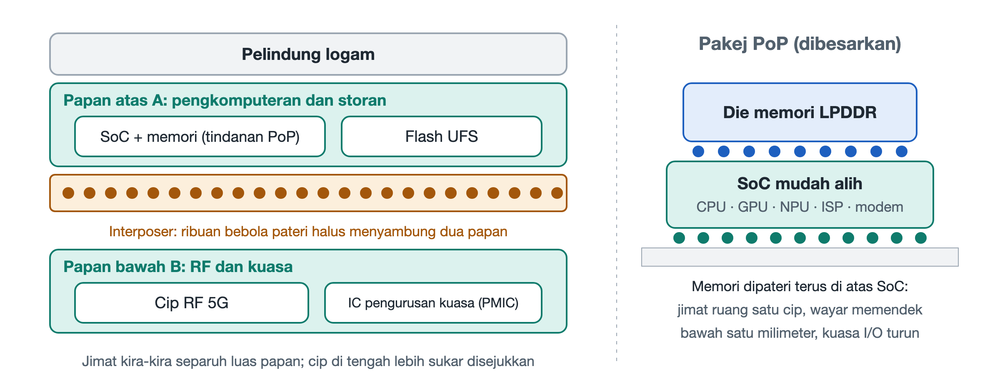

# 2.1 Papan Induk Bertindan Dua Lapisan (Logic Board) dan Teknologi Pembungkusan Pengecilan

Selepas skru di bahagian bawah dibuka, penutup belakang diumpil dan beberapa keping penutup logam yang melindungi litar ditanggalkan, komponen paling teras di dalam telefon pun terdedah. Komponen itu ialah sekeping papan yang garis luarnya berliku-liku dan bentuknya sangat tidak sekata. Inilah papan induk telefon, yang dalam bahasa Inggeris lazim dipanggil Logic Board (papan logik). Bentuknya tidak segi empat tepat dan kemas seperti papan induk komputer. Sebaliknya, ia dihimpit oleh bateri, modul kamera dan pembesar suara sehingga terpaksa "menyelit di mana-mana ruang yang ada". Yang lebih menarik, papan ini sering kali bukan satu lapis sahaja. Ia bertindan atas dan bawah seperti burger.



## 2.1.1 Daripada "Membentang Lempeng" kepada "Membina Bangunan Tinggi"

Kita boleh membayangkan papan induk sebagai sebuah bandar. Pada zaman telefon ciri dahulu, keluasan papan induk masih lapang. Cip-cip disusun mendatar di atas satu papan litar seperti rumah setingkat. Jalannya luas dan antara satu sama lain tidak bersesak. Apabila tiba era telefon pintar, badan telefon semakin nipis, bateri semakin besar dan kamera semakin banyak. Ruang untuk papan induk terus dihimpit, sedangkan cip yang perlu ditempatkan bertambah dari tahun ke tahun: pemproses, memori, storan kilat, frekuensi radio 5G, pengurusan kuasa dan sebagainya. Susunan mendatar sudah tidak mencukupi lagi.

Penyelesaian jurutera sama seperti perancang bandar: apabila tanah tidak cukup, binalah ke atas. Maka lahirlah papan induk bertindan dua lapis (Stacked Logic Board), yang dalam industri sering digelar secara kiasan sebagai "papan induk burger" atau "papan induk sandwic". Struktur asasnya boleh difahami melalui gambaran keratan rentas berikut:

```
┌────────────────────────────────────────────────────────┐
│    Keratan rentas papan induk dua lapis telefon moden  │
├────────────────────────────────────────────────────────┤
│ Papan atas A (pengkomputeran dan storan)               │
│  [SoC mudah alih + memori bertindan]  [Cip flash UFS]  │
│ ══════════════════════════════════════════════════════ │
│        ▼              ▼              ▼                 │
│   ●●● Interposer (bingkai di antara papan) ●●●         │
│ Ribuan bebola pateri halus di sekeliling tepi;         │
│ rongga tertutup di bahagian tengah                     │
│        ▲              ▲              ▲                 │
│ ══════════════════════════════════════════════════════ │
│ Papan bawah B (RF dan kuasa)                           │
│  [Cip hujung depan RF 5G]        [Cip kuasa PMIC]      │
└────────────────────────────────────────────────────────┘
```

Ketiga-tiga lapisan ini mempunyai peranan masing-masing:

- **Papan induk atas (papan A)**: menempatkan teras pengkomputeran dan storan, iaitu cip sistem mudah alih (SoC, System on Chip) serta memori yang ditindan di atasnya. Papan ini juga memuatkan cip storan kilat UFS (Universal Flash Storage) yang menyimpan foto dan aplikasi.
- **Papan induk bawah (papan B)**: membawa kumpulan cip hujung hadapan frekuensi radio 5G dan unit pengurusan kuasa (PMIC, Power Management IC). Kedua-dua jenis cip ini menghasilkan haba yang agak banyak semasa beroperasi.
- **Bingkai penyambung tengah (Interposer, lapisan perantara)**: sebuah "bingkai" berbentuk gelang yang diapit di antara papan atas dan papan bawah. Permukaan atas dan bawah bingkai ini dipenuhi ribuan bebola pateri yang amat kecil. Bebola ini mematerikan kedua-dua papan secara langsung sehingga bercantum menjadi satu unit. Isyarat elektrik bergerak di antara lapisan atas dan bawah melalui bebola pateri tersebut.

Struktur ini tergolong dalam sambungan jenis tatasusunan grid bebola (BGA, Ball Grid Array). Ia tidak lagi menggunakan pin yang panjang dan halus. Sebaliknya, bebola timah kecil yang disusun dalam tatasusunan digunakan untuk menghasilkan sambungan yang padat. Selepas dipateri, bahagian tengah lapisan perantara berbentuk gelang itu meninggalkan satu rongga tertutup. Cip pada sisi dalam papan atas dan papan bawah "tersembunyi" di dalam rongga ini.

## 2.1.2 SLP: "Melukis" Litar Sehalus Cip

Kebolehan menindan sahaja belum memadai. Setiap lapisan papan itu sendiri juga mesti lebih padat. Papan litar biasa (PCB, Printed Circuit Board) mempunyai laluan konduktor yang agak kasar dan terlalu "memakan ruang" untuk telefon masa kini. Oleh itu, papan induk telefon lazimnya menggunakan proses papan seakan-substrat (SLP, Substrate-like PCB).

"Seakan-substrat" bermaksud tahap kehalusannya hampir menyamai substrat yang digunakan dalam pembungkusan cip. Dengan proses ini, lebar laluan konduktor dan jarak antara laluan dimampatkan hingga kurang daripada 30 mikrometer. Sebagai perbandingan, diameter sehelai rambut ialah kira-kira beberapa puluh mikrometer. Ini bermakna wayar kuprum pada papan induk lebih halus daripada sehelai rambut. Wayar-wayar itu pula tersusun rapat antara satu sama lain dengan celah yang sama sempitnya.

Kepadatannya bukan sahaja melintang, malah menegak juga dalam. Sekeping papan induk yang saiznya antara kuku jari hingga kad nama boleh menindan lebih daripada 10 lapisan litar konduktif di dalamnya. Setiap lapisan disambungkan oleh lubang-lubang kecil sehingga membentuk rangkaian sambung tumpat tinggi tiga dimensi. Jika papan litar biasa ialah peta bandar yang rata, papan induk SLP lebih mirip sebuah bandar tiga dimensi yang mempunyai beberapa lapis terowong bawah tanah dan jejambat.

## 2.1.3 Jimat Separuh Ruang, Bayarannya Ialah Penyejukan

Faedah tindanan dua lapis sangat jelas. Berbanding menyusun semua cip secara mendatar, kaedah ini menjimatkan kira-kira separuh keluasan papan induk. Ruang yang dijimatkan boleh diberikan kepada bateri untuk hayat penggunaan yang lebih panjang. Ruang itu juga boleh digunakan untuk modul kamera yang lebih besar atau untuk menjadikan badan telefon lebih nipis.

Namun dalam kejuruteraan, tiada makan tengah hari percuma. Jika dilihat semula rajah keratan rentas, rongga yang diapit oleh papan atas dan bawah itu hampir tertutup sepenuhnya. Cip di dalamnya dikelilingi gelang pateri di sekeliling serta papan litar di atas dan di bawah, jadi haba sukar dilepaskan terus ke luar. Kebetulan pula, lapisan bawah menempatkan cip frekuensi radio dan cip pengurusan kuasa yang memang menghasilkan banyak haba. Keadaannya seperti dua bilik yang pemanasnya dihidupkan lalu ditindan atas dan bawah, dengan tingkap di antaranya pula ditutup. Bangunan memang jimat tanah, tetapi bilik di dalamnya menjadi lebih panas dan pengap.

Pertukaran "ruang dengan haba" ini merupakan satu benang merah untuk memahami reka bentuk telefon. Apabila kita membincangkan pelindung penyejukan, dinding suhu dan pendikitan terma kelak, pembaca akan berulang kali melihat kesannya. Jadual di bawah meringkaskan kebaikan dan keburukan papan induk dua lapis:

| Dimensi | Pendekatan papan induk bertindan dua lapis | Kesan yang terhasil |
|---|---|---|
| Keluasan | Papan atas dan bawah ditindan | Menjimatkan kira-kira separuh keluasan papan induk |
| Kepadatan pendawaian | Proses SLP, lebar/jarak laluan di bawah 30 μm | Lebih 10 lapisan sambung tumpat tinggi dalam keluasan kecil |
| Sambungan antara lapisan | Lapisan perantara berbentuk gelang, ribuan bebola pateri bersaiz mikrometer | Papan atas dan bawah bersambung secara elektrik dan strukturnya kukuh |
| Pembahagian fungsi | Papan A untuk pengkomputeran dan storan, papan B untuk frekuensi radio dan kuasa | Modul jelas, memudahkan susun atur |
| Bayaran | Rongga tertutup terbentuk di bahagian tengah | Cip di lapisan tengah sukar disejukkan, pembaikan lebih sukar |

## 2.1.4 Siapa yang Membina "Bandar Cip" Ini

Papan sejitu ini disokong oleh rantaian industri yang khusus. Pengeluar utama papan seakan-substrat mewah termasuk Unimicron, Compeq dan Avary Holding dari Taiwan, China, AT&S dari Austria, serta Shennan Circuits dari tanah besar China. Mereka bertanggungjawab membina litar sehalus rambut itu lapis demi lapis.

Selepas papan siap dan cip dipateri, papan itu masih perlu dipasang bersama skrin, bateri, kamera dan komponen lain menjadi telefon yang lengkap. Peringkat ini dikendalikan oleh syarikat pembuatan kontrak jitu seperti Foxconn, Luxshare Precision, BYD Electronic dan Pegatron. Oleh itu, sekeping papan induk yang muat di tapak tangan sering kali merupakan hasil kerjasama dan pembahagian kerja yang merentasi banyak negara dan wilayah. Perkara ini akan kita huraikan dalam gambaran keseluruhan rantaian bekalan pada bahagian terakhir bab ini.

## 2.1.5 Ringkasan

Papan induk telefon berbentuk "burger" kerana didesak oleh kekangan ruang. Proses SLP menjadikan setiap lapisan lebih padat, manakala gelang pateri lapisan perantara menyatukan dua lapisan menjadi satu. Hasilnya, teras pengkomputeran, storan, komunikasi dan bekalan kuasa seluruh telefon dapat dimuatkan dalam keluasan yang amat kecil, walaupun cabaran penyejukan turut ditinggalkan. Cip paling teras pada papan induk, iaitu SoC, pula ditindan bersama memori dengan cara "bertindih-tindih" yang serupa. Inilah perkara yang akan dibongkar dalam bahagian seterusnya.
