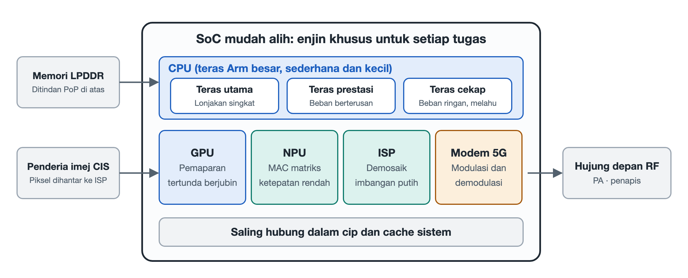

# 3.1 Matriks Kuasa Pengkomputeran Heterogen SoC Mudah Alih: Falsafah Kecekapan Tenaga Cip Khusus untuk Tugas Khusus

Anda membuka telefon, menekan ikon kamera, menghalakannya ke luar tingkap lalu menekan butang pengatup, kemudian sempat pula menatal beberapa video pendek. Dalam beberapa saat itu, anda mungkin menyangka ada sebuah "pemproses" di dalam telefon yang bertungkus-lumus melakukan segalanya. Hakikatnya, di dalam cip sistem (System on Chip, SoC) yang sebesar kuku itu, tidak wujud satu "pemproses serba boleh" yang memikul semua kerja. Yang benar-benar bekerja ialah sebuah pasukan dengan pembahagian tugas yang jelas: ada yang bertugas memecut sekelip mata, ada yang berlari jarak jauh, ada yang khusus melukis grafik, ada yang khusus mengira matriks, dan ada yang khusus memproses isyarat cahaya. Penjadual sistem pengendalian bertindak seperti seorang penyelia operasi: berdasarkan sifat setiap tugas, ia menyerahkan tugas itu kepada enjin yang paling sesuai, supaya kerja dapat diselesaikan dengan penggunaan tenaga yang paling sedikit.

Pendekatan "pelbagai jenis unit pengkomputeran bekerja secara bersepadu" ini dikenali sebagai pengkomputeran heterogen (Heterogeneous Computing). Bahagian ini akan memperkenalkan empat tonggak utama pasukan tersebut: CPU, GPU, NPU dan ISP.

## 3.1.1 Mengapa Tidak Membina Satu "Cip Super Serba Boleh"?

Mari kita fikirkan satu analogi daripada kehidupan seharian. Sebuah hospital tidak akan mengupah hanya seorang "doktor ajaib serba boleh" untuk merawat semua pesakit. Sebaliknya, hospital mempunyai jabatan kecemasan, perubatan am, radiologi dan makmal. Doktor kecemasan bertindak pantas, peralatan makmal dapat menjalankan ujian secara pukal, manakala peralatan radiologi hanya mengambil imej tetapi melakukannya dengan cepat dan tepat. Apabila setiap jabatan menjalankan peranan masing-masing, kecekapan keseluruhan hospital justeru menjadi paling tinggi.

Kekangan yang dihadapi oleh telefon bimbit lebih ketat daripada hospital: kapasiti bateri terhad, badan telefon yang tertutup rapat menyukarkan penyebaran haba, dan pengguna pula menuntut respons pada bila-bila masa. Pemproses am mampu mengira apa sahaja, tetapi apabila melakukan tugas khusus ia sering "membazir kebolehan" kerana perlu melaksanakan banyak arahan dan kerap memindahkan data, lalu menjadi perlahan dan boros tenaga. Litar khusus pula "mengukir" sejenis operasi tetap terus ke dalam perkakasan, maka kerja yang sama menggunakan tenaga yang jauh lebih sedikit. Oleh itu, falsafah reka bentuk SoC mudah alih boleh dirumuskan dalam satu ungkapan: **cip khusus untuk tugas khusus**.

## 3.1.2 CPU: Lari Berganti-ganti Teras Besar, Sederhana dan Kecil

Unit Pemprosesan Pusat (Central Processing Unit, CPU) ialah "ketua komander" seluruh sistem, yang bertanggungjawab menjalankan sistem pengendalian dan logik utama aplikasi. CPU telefon moden lazimnya menggabungkan teras dengan keupayaan berbeza, membentuk tiga peringkat:

- **Teras super besar** (seperti siri Cortex-X daripada Arm): bertanggungjawab untuk ledakan prestasi seketika. Pada saat anda membuka sesebuah aplikasi dan ia dimuatkan dari awal (dikenali sebagai "permulaan sejuk"), teras super besar memecut sepenuh tenaga supaya antara muka muncul secepat mungkin. Prestasinya paling tinggi dan penggunaan tenaganya juga paling besar, jadi ia hanya tampil sebentar pada saat genting.
- **Teras prestasi besar** (seperti siri A7xx): bertanggungjawab untuk beban tinggi yang berterusan. Bermain satu pusingan permainan memerlukan kuasa pengkomputeran yang stabil selama puluhan minit, dan tugas jenis "ketahanan" ini dipikul oleh teras besar.
- **Teras kecil cekap tenaga** (seperti siri A5xx): bertanggungjawab untuk kerja beban rendah sepanjang hari. Menerima mesej ketika skrin dimatikan, penyegerakan di latar belakang dan memainkan muzik, semua kerja ringan ini diserahkan kepada teras kecil, dengan penggunaan kuasa hanya beberapa puluh miliwatt.

Ia ibarat sebuah perlumbaan lari berganti-ganti: pelari pecut bertanggungjawab memecut di garisan permulaan, pelari jarak sederhana dan jauh mengekalkan rentak, manakala kakitangan logistik menjaga kem sepanjang hari. Penjadual akan menukar "pemain" pada bila-bila masa mengikut berat ringannya tugas, supaya kerja berat tidak menjadi perlahan dan kerja ringan tidak membazir. Telefon dapat "dicas sekali sehari" dan bukannya "dicas setiap setengah hari" sebahagian besarnya berkat pembahagian tugas antara teras besar, sederhana dan kecil ini.

## 3.1.3 GPU: Memotong Skrin kepada Jubin Sebelum Melukis

Unit Pemprosesan Grafik (Graphics Processing Unit, GPU) bertanggungjawab melukis adegan permainan dan animasi antara muka ke atas skrin. Ia mahir memproses ribuan piksel secara serentak, dan merupakan unit pengkomputeran jenis "ramai tangan meringankan kerja" yang tipikal.

Namun GPU telefon berdepan satu masalah rumit: data imej perlu dipindahkan berulang kali antara cip dan memori, dan proses pemindahan itu sendiri sangat menggunakan tenaga serta menghasilkan haba. Oleh itu, GPU mudah alih lazimnya menggunakan mekanisme **pemaparan tertunda berasaskan jubin** (Tile-Based Deferred Rendering, TBDR), yang dilaksanakan dalam dua langkah:

1. **Pembahagian jubin**: Seluruh skrin dipotong kepada banyak "jubin" (Tile) kecil, dan setiap kali hanya satu jubin kecil diproses. Data bagi jubin kecil itu boleh disimpan dalam cache berkelajuan tinggi di dalam cip, tanpa perlu berulang kali mengakses memori luaran.
2. **Pewarnaan tertunda**: Sebelum "mewarnakan" piksel, GPU terlebih dahulu menentukan objek mana yang terlindung oleh objek di hadapannya, lalu membuang piksel yang tidak kelihatan lebih awal, dan hanya melakukan pengiraan pewarnaan bagi piksel yang akhirnya kelihatan.

Sebagai perbandingan: sebelum mengecat sebuah dinding, pastikan dahulu bahawa sebuah almari buku besar akan diletakkan di hadapannya, maka bahagian yang terlindung oleh almari itu tidak perlu dicat. Dengan cara ini, lebar jalur memori grafik dan penghasilan haba dapat dijimatkan dengan ketara.

## 3.1.4 NPU: Enjin Rangkaian Neural yang Pakar dalam Matriks

Unit Pemprosesan Neural (Neural Processing Unit, NPU) ialah ahli SoC yang paling mendapat perhatian sejak beberapa tahun kebelakangan ini. Pengecaman wajah, pengaktifan suara, segmentasi imej, malah model besar pada peranti, pada dasarnya semuanya melakukan pendaraban dan penambahan matriks dalam jumlah yang sangat besar.

Ciri NPU ialah ia khusus melaksanakan **operasi darab-tambah matriks berketepatan rendah**, contohnya pendaraban matriks am (General Matrix Multiply, GEMM) pada ketepatan INT8 dan INT4. INT8 dan INT4 bermaksud nilai diwakili menggunakan integer 8 bit atau 4 bit, yang sedikit "kasar" berbanding nombor titik terapung berketepatan tinggi yang biasa. Namun rangkaian neural lazimnya tidak begitu sensitif terhadap kekasaran ini, dan sebagai balasannya litar menjadi lebih kecil, lebih pantas dan lebih jimat tenaga.

Oleh sebab itulah NPU mampu, dengan nisbah kecekapan tenaga yang sangat tinggi, menyelesaikan perbandingan ciri ketika membuka kunci dengan wajah secara setempat dalam tempoh milisaat, dan juga menyokong inferens model besar pada peranti. Data diproses di dalam telefon sendiri, jadi ia bukan sahaja pantas, malah mengurangkan kebimbangan privasi akibat memuat naik data ke awan.

## 3.1.5 ISP: Talian Paip Perkakasan untuk Isyarat Cahaya

Pemproses Isyarat Imej (Image Signal Processor, ISP) ialah "bilik gelap" di sebalik kamera. Data mentah yang dikeluarkan oleh penderia imej belum lagi menjadi foto yang kita lihat, dan perlu melalui beberapa siri pemprosesan. ISP menggunakan talian paip perkakasan yang tetap untuk menyelesaikan langkah-langkah berikut secara berturutan pada kelajuan tahap nanosaat:

- **Nyahmozek**: Setiap piksel penderia hanya merekod satu warna, maka warna penuh perlu dianggarkan dan dipulihkan;
- **Pembetulan piksel rosak**: Membaiki piksel tertentu yang tidak berfungsi;
- **Imbangan putih automatik**: Memastikan warna putih kekal kelihatan putih di bawah sumber cahaya yang berbeza;
- **Pembetulan herotan kanta**: Meluruskan garisan yang melengkung di bahagian tepi.

Di atas asas ini, ISP juga bekerjasama dengan NPU untuk melaksanakan **gabungan HDR berbilang bingkai** dalam fotografi pengkomputeran, iaitu menggabungkan beberapa foto dengan dedahan berbeza menjadi satu imej akhir yang bahagian terangnya tidak terlebih dedah dan bahagian gelapnya masih memaparkan perincian. Pada saat butang pengatup ditekan, talian paip ini telah pun menyelesaikan satu set proses yang lengkap.

## 3.1.6 Gambaran Keseluruhan Empat Jenis Enjin

| Unit Pengkomputeran | Singkatan Inggeris | Tugas yang Dikuasai | Mekanisme Utama | Pendekatan Kecekapan Tenaga |
|---|---|---|---|---|
| Unit Pemprosesan Pusat | CPU | Logik sistem, menjalankan aplikasi | Peringkat teras super besar/besar/kecil | Mengagihkan tugas berat dan ringan kepada teras berbeza |
| Unit Pemprosesan Grafik | GPU | Grafik permainan, pemaparan antara muka | Pemaparan tertunda berasaskan jubin (TBDR) | Mengurangkan pemindahan memori grafik, membuang piksel tidak kelihatan |
| Unit Pemprosesan Neural | NPU | Pengecaman wajah, model besar pada peranti | Darab-tambah matriks INT8/INT4 | Menukar ketepatan rendah dengan kecekapan tenaga tinggi |
| Pemproses Isyarat Imej | ISP | Pemprosesan foto dan video | Talian paip perkakasan | Proses tetap dijadikan perkakasan, bekerjasama dengan NPU |

## 3.1.7 Rumusan

Kehebatan SoC mudah alih bukan terletak pada satu unit yang mampu melakukan segalanya, tetapi pada prinsip "membiarkan unit yang sesuai melakukan kerja yang sesuai". CPU berlari berganti-ganti mengikut peringkat, GPU berjimat cermat dengan teliti, NPU pakar dalam matriks, ISP bekerja secara talian paip, dan semuanya diarah secara bersepadu oleh penjadual sistem pengendalian. Hanya dengan cara ini pengalaman yang lancar dapat dicapai dalam had tenaga bateri dan ruang yang sempit. Setelah memahami pasukan ini, apabila anda melihat parameter seperti "kuasa pengkomputeran AI" dan "prestasi grafik" dalam majlis pelancaran produk, anda akan tahu "ahli pasukan" mana yang diwakili oleh setiap satunya. Dalam bahagian seterusnya, kita akan mengikuti cahaya memasuki modul kamera dan melihat bagaimana foton berubah langkah demi langkah menjadi piksel digital.
