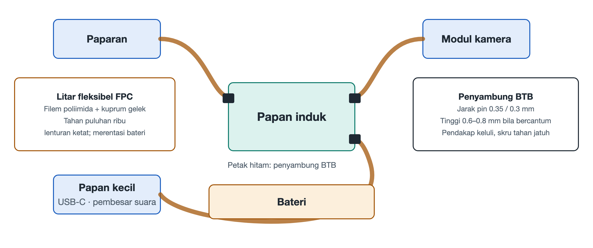

# 4.2 Papan Litar Fleksibel (FPC): Saraf dan Salur Darah Tiga Dimensi di Celah-Celah Badan Telefon

Terbalikkan telefon anda dan bayangkan bahagian dalamnya di sebalik penutup belakang: papan induk ialah sebuah "pusat bandar" yang keras, manakala kamera bertenggek di penjuru atas badan telefon, butang melekat pada bingkai sisi, pembesar suara tersembunyi di bahagian bawah, skrin menutupi seluruh bahagian hadapan, dan bateri pula terbentang di tengah-tengah seperti seketul bata yang tebal. Komponen-komponen ini bertaburan di merata tempat, dipisahkan oleh perbezaan ketinggian, sudut dan celah. Siapakah yang menyambungkan semuanya menjadi satu kesatuan? Jawapannya ialah jalur-jalur lembut setipis kertas yang berwarna keemasan atau perang jingga, iaitu papan litar bercetak fleksibel (Flexible Printed Circuit, atau ringkasnya FPC, juga dikenali sebagai "papan lembut").

Jika papan induk ialah otak dan jantung telefon, maka FPC ialah saraf dan pembuluh darah yang merentasi seluruh tubuh. Ia menghantar isyarat dan juga membekalkan tenaga elektrik, malah perlu membelok, melipat dan melencong di celah-celah yang sempit.

## 4.2.1 Mengapa Papan Keras Tidak Berfungsi

Papan litar biasa (papan keras) menggunakan gentian kaca dan resin sebagai bahan asas; ia kukuh tetapi tidak boleh dibengkokkan. Dalam telefon yang ketebalannya kurang daripada satu sentimeter, ketinggian dan kedudukan setiap modul tidak berada pada satah yang sama: skrin di lapisan paling atas, papan induk di lapisan tengah, bateri di sisi, dan kamera pula menonjol keluar dari badan telefon. Jika hanya papan keras dan wayar digunakan untuk menyambung, sama ada banyak ruang akan digunakan, atau sambungan akan putus akibat ditarik berulang kali semasa pemasangan dan penggunaan.

Idea FPC ialah "mencetak" litar pada selapis filem nipis yang lembut, supaya laluan litar itu sendiri boleh dilipat seperti kain. Dengan cara ini, sejalur papan lembut boleh bermula dari papan induk, melintasi tepi bateri, merayap di sepanjang dinding dalam bingkai tengah hingga ke belakang kamera, sentiasa mengikut bentuk struktur sepanjang laluan, dan hampir tidak memerlukan isi padu tambahan.

## 4.2.2 Dua Bahan Utama: Poliimida dan Kuprum Gelek

Teras sejalur papan lembut telefon yang berkualiti terletak pada gabungan dua bahan.

### 4.2.2.1 Filem Poliimida (Polyimide Film, atau ringkasnya Filem PI)

Filem PI ialah "kulit" dan rangka FPC, berfungsi sebagai bahan asas penebat. Ia mempunyai dua ciri yang menonjol: pertama, tahan suhu tinggi, mampu menahan suhu sekitar 300℃, yang bermakna ia tidak akan berubah bentuk atau melepuh semasa pematerian alir semula (proses bersuhu tinggi untuk memateri komponen pada papan litar); kedua, sangat liat, selapis nipis sahaja sudah boleh dilipat berulang kali tanpa retak. Dalam kehidupan seharian, sukar untuk mencari sejenis plastik yang sekali gus "tidak takut panas" dan "tidak rosak apabila dilipat"; inilah sebabnya PI dipilih.

### 4.2.2.2 Kuprum Gelek Sepuh Lindap (Rolled Annealed Copper, atau ringkasnya Kuprum RA)

Kuprum yang digunakan sebagai pengalir juga mempunyai keistimewaannya. Terdapat dua kaedah biasa untuk menghasilkan kerajang kuprum: satu ialah pemendapan elektrolitik, iaitu atom kuprum berlonggok lapis demi lapis seperti salji yang turun, menghasilkan butiran berbentuk tiang menegak; satu lagi ialah penggelekan, iaitu jongkong kuprum digelek berulang kali, kemudian disepuh lindap (dipanaskan lalu disejukkan perlahan-lahan untuk menghapuskan tegasan dalaman), supaya butirannya memanjang dan terbentang secara melintang.

Perbezaan kedua-duanya boleh difahami melalui satu analogi: butiran kuprum elektrolitik seperti barisan penyepit yang dicucuk tegak; apabila dibengkokkan secara melintang, celah antara penyepit mudah retak. Butiran kuprum gelek sepuh lindap pula seperti mi yang dihamparkan rata mengikut satu arah; apabila dilipat, ia boleh meregang bersama-sama secara menyeluruh. Oleh itu, kuprum RA lebih sesuai untuk bahagian yang perlu dilipat berulang kali, dan apabila digabungkan dengan filem PI, ia mampu menahan puluhan ribu lipatan berjejari kecil tanpa putus.

| Perbandingan | Papan Keras Biasa | Papan Lembut FPC |
|---|---|---|
| Bahan asas | Gentian kaca + resin | Filem poliimida (filem PI) |
| Pengalir | Kerajang kuprum biasa | Kuprum gelek sepuh lindap (kuprum RA) |
| Kebolehlipatan | Pada asasnya tidak boleh dibengkokkan | Mampu menahan puluhan ribu lipatan berjejari kecil |
| Kegunaan biasa | Papan induk yang membawa cip | Sambungan merentas kawasan bagi skrin, kamera, butang, bateri dan lain-lain |

## 4.2.3 Merentasi Bateri: Menyambungkan Papan Induk dan Papan Sekunder

Banyak telefon menggunakan susun atur "papan induk + papan sekunder": papan induk terletak di bahagian atas badan telefon dan membawa cip teras seperti SoC; papan sekunder terletak di bahagian bawah dan bertanggungjawab bagi port pengecasan, pembesar suara, mikrofon dan sebagainya. Di antara kedua-duanya terbentang sebuah pek bateri yang tebal dan berat.

Tugas menyambungkan kedua-dua papan litar atas dan bawah ini diserahkan kepada sejalur FPC yang panjang. Ia melintas di sisi bateri dengan rapat pada bingkai, atau melalui bawah bateri, lalu menghantar arus pengecasan, isyarat audio, isyarat frekuensi radio dan lain-lain sekali gus. Papan lembut ini mesti cukup nipis supaya tidak mengambil ruang bateri, dan juga cukup boleh dipercayai untuk menahan lipatan semasa pemasangan serta ubah bentuk kecil badan telefon dalam penggunaan harian. Orang yang pernah membuka telefon sering perasan bahawa "kabel reben" ini ialah antara komponen yang mesti diputuskan dahulu atau disambung paling akhir, membuktikan kedudukannya sebagai hab dalam sistem.

## 4.2.4 Menampung Kanta yang Terapung: Papan Lembut dalam Kamera Telefoto Periskop

Salah satu penggunaan FPC yang paling halus terdapat dalam kamera telefoto periskop. Untuk mencapai fokus dan penstabilan imej, kumpulan kanta perlu digerakkan oleh motor mikro, terapung dalam medan magnet sambil membuat pergerakan yang halus dan pantas. Masalahnya: modul kanta itu sendiri juga perlu dibekalkan elektrik dan menghantar isyarat, jadi ia mesti disambungkan dengan wayar.

Jika sambungannya terlalu keras, ia akan menjadi seperti tali yang menarik belon, menahan kanta dan mengganggu kedudukan tepat motor. Keperluan FPC di sini ialah daya lantunan mekanikal yang sangat rendah — selepas dibengkokkan, ia hampir tidak menghasilkan daya balas yang "melantun kembali". Dengan itu, apabila motor menolak kanta, papan lembut hanya mengikut dengan lentur tanpa mengenakan tarikan berlebihan, sekali gus memastikan kanta dapat kekal terapung dan stabil dengan tindak balas pada tahap mikrosaat. Dengan kata lain, papan lembut di sini bukan sekadar pengalir, malah sebahagian daripada sistem mekanikal; tahap kelembutannya secara langsung mempengaruhi kejelasan gambar.

## 4.2.5 Kekangan Reka Bentuk yang Tidak Kelihatan

Reka bentuk FPC tidaklah semudah "menjadikannya lebih lembut"; jurutera perlu menimbang beberapa perkara serentak:

- **Jejari lipatan**: semakin tajam lipatan, semakin besar tegasan yang ditanggung oleh laluan kuprum; perlu ada pertimbangan antara ruang dan jangka hayat;
- **Penetapan dan laluan**: papan lembut perlu ditetapkan kedudukannya dengan pelekat dan klip, bagi mengelakkan geseran dan haus semasa jatuh atau getaran;
- **Integriti isyarat**: semasa menghantar data berkelajuan tinggi seperti bagi skrin dan kamera, lebar laluan, jarak dan lapisan perisai perlu direka dengan teliti untuk mencegah gangguan;
- **Urutan pemasangan**: papan lembut selalunya perlu dilipat dahulu sebelum dipasang, dan ini menentukan aliran pemasangan keseluruhan telefon.

## 4.2.6 Ringkasan

FPC menggunakan filem poliimida yang tahan suhu tinggi dan sangat liat sebagai badannya, serta kuprum gelek sepuh lindap yang butirannya terbentang secara melintang sebagai pengalirnya, menjadikan litar buat pertama kalinya mempunyai bentuk yang "boleh dilipat". Ia merentasi bateri untuk menyambungkan papan induk dan papan sekunder, melencong di sekeliling bingkai untuk sampai ke kamera dan butang, malah menampung kanta yang terapung dengan kelenturan yang hampir tanpa rintangan, menjahit modul-modul yang bertaburan di seluruh badan telefon menjadi satu kesatuan. Namun, papan lembut akhirnya perlu "dipasang" pada papan induk, dan titik sambungan ini mestilah sangat kecil tetapi kukuh. Bahagian seterusnya akan mendekati sempadan fizikal ini — penyambung papan-ke-papan (BTB) mikro.
