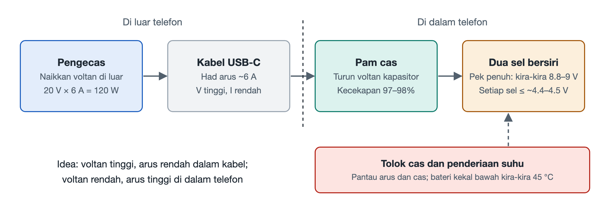

# 5.2 Tangga Tenaga Ekstrem: Pengecasan Super Kilat Ratusan Watt dan Pengecasan Terus Pam Cas

Ambil pengecas anda dan perhatikan. Pada bekasnya biasanya tercetak sebaris parameter output yang kecil, seperti "5V⎓3A", "10V⎓…" dan "20V⎓6A". Kemudian lihat pula port Type-C yang kecil di bahagian bawah telefon. Lebarnya hanya selebar kuku, dan sesentuh logam di dalamnya halus seperti rambut. Untuk memasukkan tenaga beratus-ratus watt ke dalam bateri dalam masa beberapa puluh minit, tenaga itu mesti terlebih dahulu menembusi port ini dan kemudian melalui sepanjang kabel. Bahagian ini menjejaki laluan tenaga elektrik, dari soket dinding hingga ke dalam sel bateri, untuk melihat bagaimana "tangga tenaga" ini direka anak tangga demi anak tangga.

## 5.2.1 Di Mana Kesesakannya: Port Tidak Mampu Menanggung Arus Besar

Kuasa elektrik sama dengan voltan didarab arus (P = U × I). Untuk mendapatkan 120W, kita boleh menggunakan 5V dengan 24A, atau 20V dengan 6A. Hasil darab kedua-dua pasangan nombor ini sama, tetapi bebannya terhadap kabel dan port sangat berbeza.

Puncanya ialah pemanasan konduktor. Apabila arus mengalir melalui wayar dan sesentuh yang mempunyai rintangan, haba yang terhasil berkadar dengan kuasa dua arus (Q ∝ I²R). Jika arus digandakan, haba menjadi empat kali ganda. Luas sesentuh port Type-C dan kabel biasa adalah terhad. Mengikut spesifikasi, had atas arus yang boleh dibawa dengan selamat ialah kira-kira **6A**. Melebihi nilai ini, port dan kabel akan menjadi panas dengan ketara, malah sesentuh mungkin teroksida atau terbakar.

Oleh itu, prinsip reka bentuk pertama ialah: **di luar badan telefon, hantar tenaga menggunakan voltan tinggi dan arus kecil.**

## 5.2.2 Anak Tangga Pertama: Pengecas Menaikkan Voltan kepada 20V

Bayangkan tenaga elektrik sebagai aliran air. Voltan ibarat tekanan air, manakala arus ibarat kadar aliran. Apabila saiz paip tetap, untuk menghantar lebih banyak air, kita menaikkan tekanan air dan tidak perlu membesarkan paip.

Pengecas ialah "pam air" yang bertugas menaikkan tekanan. Ia menukar bekalan elektrik utama kepada arus terus **20V/6A**, iaitu tepat 120W. Pada masa ini, arus dalam kabel dan port dikekalkan dalam garis merah spesifikasi 6A, jadi pemanasan di bahagian penghantaran dapat dikawal.

Namun, bateri tidak boleh menerima 20V secara terus. Bateri litium sangat ketat dalam keperluan voltan pengecasan; melebihi sedikit sahaja boleh menimbulkan risiko keselamatan. Voltan tinggi yang telah dihantar ke dalam telefon perlu diturunkan di dalam badan telefon.

## 5.2.3 Anak Tangga Kedua: Pam Cas "Melipat Dua" Voltan

Cara tradisional ialah meletakkan cip penurun voltan jenis induktor di dalam telefon. Kecekapan penukaran cip jenis ini tidaklah rendah, tetapi tenaga yang hilang akan bertukar sepenuhnya menjadi haba dan terperangkap di dalam badan telefon yang sudah sedia sesak. Pada kuasa ratusan watt, kehilangan beberapa peratus sahaja pun sudah menjadi "pemanas tangan" yang ketara.

Oleh itu, penyelesaian pengecasan pantas beralih kepada cip **pam cas (Charge Pump)**. Ia berasaskan prinsip **kapasitor bersuis (Switched Capacitor)**, yang boleh difahami melalui satu situasi harian:

> Terdapat dua baldi yang sama. Mula-mula susun kedua-duanya bertindih atas bawah seperti blok mainan secara bersiri, lalu isi air sehingga penuh dari tempat tinggi; kemudian letakkan kedua-duanya bersebelahan secara selari dan tuang serentak. "Ketinggian" air menjadi separuh, manakala jumlah aliran yang dituang menjadi dua kali ganda.

Suis di dalam cip mengulangi tindakan ini pada frekuensi yang sangat tinggi, menukar kapasitor berulang-alik antara "pengecasan bersiri" dan "nyahcas selari", sekali gus menghasilkan penukaran voltan **2:1**:

| Kedudukan | Voltan | Arus | Kuasa |
|---|---|---|---|
| Kabel dan port (input pam cas) | 20V | 6A | 120W |
| Output pam cas (masuk ke bateri) | 10V | 12A | kira-kira 120W |

Kuncinya di sini ialah kecekapan. Pam cas memindahkan cas terutamanya melalui kapasitor dan suis, tanpa bergantung pada penukaran tenaga magnet induktor, jadi kecekapan penukarannya boleh melebihi **97%~98%**. Semakin kecil kehilangan, semakin sedikit haba yang tertinggal di dalam badan telefon. Arus besar hanya mengalir pada laluan yang sangat pendek antara pam cas dan bateri. Surihan kerajang kuprum di bahagian ini pendek dan lebar dengan rintangan yang sangat kecil, maka pemanasannya turut dapat dikawal.

Kaedah yang hanya melakukan penukaran voltan secara nisbah dan hampir terus memasukkan tenaga ke dalam bateri ini sering dipanggil **pengecasan terus**.

## 5.2.4 Anak Tangga Ketiga: Dua Sel Bersiri Berkongsi Voltan

10V masih melebihi julat yang mampu ditanggung oleh satu sel litium. Penyelesaiannya ialah membahagikan bateri kepada dua sel dan menyambungkannya secara **bersiri** menjadi satu pek bateri.

Dalam litar bersiri, arus yang sama mengalir melalui kedua-dua sel, dan voltan pek bateri ialah jumlah voltan kedua-dua sel. Selepas disambung bersiri, pek bateri berada pada kira-kira 8.8～9V apabila penuh, dan setiap sel masih tidak melebihi had atas pengecasan masing-masing (kira-kira 4.4～4.5V); voltan output pam cas juga akan dilaraskan mengikut voltan semasa pek bateri, bukannya ditetapkan mati pada 10V. Sebagai perumpamaan, beban yang tidak terpikul oleh seorang, apabila diusung oleh dua orang di depan dan di belakang, menjadi stabil.

Berbanding penyelesaian sel tunggal, dua sel bersiri mempunyai satu lagi kelebihan: pada kuasa pengecasan yang sama, beban setiap sel berkurangan dan haba dalaman juga lebih sekata. Harganya ialah pengurusan bateri menjadi lebih rumit, kerana kedua-dua sel mesti kekal seimbang; tidak boleh satu sel sudah penuh sedangkan yang satu lagi masih kosong.

## 5.2.5 Penjaga Pintu yang Tidak Kelihatan: Kaunter Coulomb dan Perintang Pirau

Semasa pengecasan berkelajuan tinggi, sistem perlu sentiasa tahu "berapa banyak tenaga sudah dimasukkan dan berapa panas bateri sekarang". Tugas ini dilaksanakan oleh dua komponen yang bekerjasama:

- **Cip kaunter Coulomb (Coulomb Counter)**: Coulomb ialah unit cas elektrik. Cip ini mengumpul secara berterusan arus yang mengalir masuk dan keluar dari bateri, ibarat memasang "meter air" yang tepat pada bateri, lalu menganggarkan baki kapasiti, iaitu peratusan yang dipaparkan pada skrin.
- **Perintang pirau dwiarah (Shunt Resistor)**: Sebuah perintang jitu dengan nilai rintangan yang sangat kecil, disambung secara bersiri dalam litar bateri. Apabila arus mengalir, beza voltan yang kecil terbentuk di kedua-dua hujungnya; cip mengukur beza voltan ini untuk menukarkannya kepada nilai arus. "Dwiarah" bermaksud ia boleh mengukur kedua-dua arah, iaitu pengecasan dan nyahcas.

Data ini disuap balik secara masa nyata kepada sistem pengurusan pengecasan. Sebaik sahaja suhu menghampiri had yang ditetapkan, sistem akan menurunkan kuasa pengecasan secara aktif. Matlamat keseluruhan penyelesaian ini ialah mengawal suhu bateri dalam had atas kira-kira **45℃** (nilai sebenar berbeza mengikut pengeluar). Inilah juga salah satu sebab mengapa banyak telefon menjadi jelas lebih perlahan apabila bateri dicas ke paras yang tinggi: sistem sedang menyejukkan bateri dan badan telefon secara aktif.

## 5.2.6 Ringkasan: Tangga Tenaga Empat Anak Tangga

Apabila keseluruhan proses dirangkaikan, terbentuklah satu rantaian yang jelas:

1. **Pengecas menaikkan voltan**: 20V/6A, mengelak kesesakan arus pada port;
2. **Pam cas melipat dua**: menukar dengan cekap kepada 10V/12A, menekan kehilangan haba ke tahap paling rendah;
3. **Dua sel bersiri**: setiap sel tidak melebihi had atas pengecasan kira-kira 4.4～4.5V, menjamin keselamatan elektrokimia;
4. **Pengukuran dan kawalan suhu**: kaunter Coulomb dan perintang pirau memantau secara masa nyata, mempertahankan had atas suhu bateri kira-kira 45℃.

Di sebalik "pengecasan super pantas ratusan watt" di majlis pelancaran produk, terdapat serangkaian keseimbangan antara voltan, arus dan haba. Ketika tenaga mengalir deras di dalam badan telefon, foton juga sedang ditukar dengan pantas melalui laluan yang lain. Dalam bahagian seterusnya, kita akan beralih kepada detik apabila butang pengatup ditekan.
