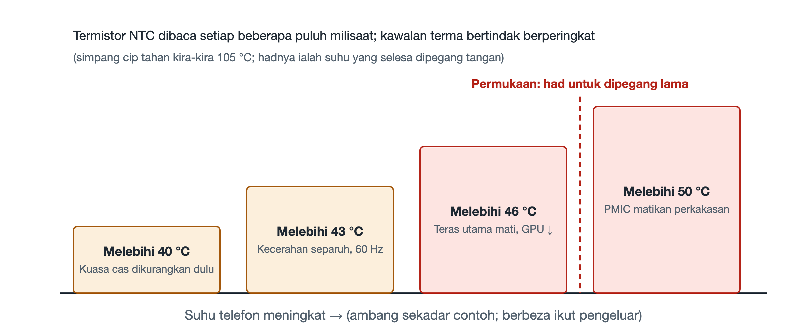

# 6.2 Dinding Suhu dan Pendikitan Terma (Thermal Throttling): Seni Perlindungan Diri dalam Ruang Tertutup

Pada musim panas, apabila anda membuka aplikasi navigasi di bawah cahaya matahari sambil mengecas telefon, kemudian bermain permainan berat, tidak lama selepas itu anda akan perasan beberapa perubahan berturut-turut: kelajuan pengecasan menjadi jauh lebih perlahan, skrin malap dengan sendirinya, paparan tidak lagi selancar pada awalnya, dan dalam keadaan serius, muncul amaran "Suhu telefon terlalu tinggi". Perubahan ini bukan kerosakan, sebaliknya telefon sedang melindungi dirinya mengikut peraturan yang telah ditetapkan terlebih dahulu. Dalam bidang kejuruteraan, set peraturan ini dipanggil pendikitan terma (Thermal Throttling), manakala ambang suhu yang mencetuskannya dipanggil "dinding suhu".

## 6.2.1 Dua Garisan Merah: Sepanas Mana Cip Mampu Bertahan, Sepanas Mana Tangan Mampu Memegang

Untuk memahami kawalan suhu, kita perlu terlebih dahulu membezakan dua jenis suhu.

Yang pertama ialah **suhu simpang cip**, iaitu suhu di kawasan dalaman cip tempat transistor berada. Keupayaan cip silikon menahan haba lebih tinggi daripada sangkaan ramai; suhu simpang dalamannya boleh bertahan sehingga kira-kira 105℃. Jika dilihat dari sudut cip itu sendiri, masih banyak ruang yang berbaki.

Yang kedua ialah **suhu sentuhan badan manusia**, iaitu suhu cangkerang telefon ketika bersentuhan dengan tapak tangan atau pipi. Telefon pintar dipegang lama di tangan dan dirapatkan ke telinga, dan sentuhan kulit yang berpanjangan dengan permukaan terlalu panas boleh menyebabkan lecur suhu rendah. Oleh itu, piawaian keselamatan mengehadkan suhu permukaan yang boleh disentuh, dengan had dibahagikan mengikut bahan dan tempoh sentuhan; pengeluar lazimnya mengawal suhu permukaan untuk pegangan jangka panjang pada sekitar 40-an darjah Celsius.

Kedua-dua garisan merah ini dipisahkan oleh hampir 60℃. Yang benar-benar menyekat prestasi telefon selalunya bukan had ketahanan cip, tetapi had ketahanan tangan manusia. Sebagai perbandingan: bahagian dalam enjin kereta mampu menahan suhu yang sangat tinggi, tetapi kabin pemandu mesti selesa untuk penumpang. Telefon tidak mempunyai kipas atau lubang udara masuk; ia sebuah kotak kaca dan logam yang tertutup rapat, dan haba hanya dapat dilepaskan perlahan-lahan melalui bahan pengalir haba dan cangkerang. Apabila cip terus berjalan pada beban penuh, suhu cangkerang lambat-laun akan menghampiri garisan merah badan manusia, dan sistem tiada pilihan selain mengurangkan penjanaan haba secara proaktif.

## 6.2.2 "Pengawal Suhu" yang Tersebar di Seluruh Papan Induk

Untuk mengawal suhu, kita perlu tahu suhunya terlebih dahulu. Papan induk telefon dilengkapi sekumpulan **termistor NTC**. NTC ialah singkatan bagi Negative Temperature Coefficient, bermaksud "pekali suhu negatif": semakin tinggi suhu, semakin rendah nilai rintangannya. Dengan mengukur rintangannya, litar dapat menukarkannya kepada suhu di lokasi tersebut.

Termistor ini bukan dipasang sebiji sahaja, sebaliknya membentuk satu tatasusunan yang diletakkan berhampiran sumber haba utama seperti SoC, bateri, cip pengecasan dan modul kamera. Sistem membaca suhu setiap titik **setiap beberapa puluh milisaat**, seolah-olah menempatkan barisan pengawal di dalam badan telefon yang sentiasa melaporkan bahagian mana yang semakin panas dan seberapa pantas kenaikannya.

Yang bertanggungjawab mengumpulkan data ini dan membuat keputusan ialah **daemon kawalan suhu** dalam sistem pengendalian. "Daemon" merujuk kepada program sistem yang berjalan berterusan di latar belakang tanpa berinteraksi secara langsung dengan pengguna. Ia tidak memproses foto atau memuatkan permainan; ia hanya memerhati bacaan suhu dan mengeluarkan arahan penyejukan mengikut peraturan.

## 6.2.3 Tangga Empat Peringkat: Korbankan Dahulu yang Paling Kurang Menjejaskan Pengalaman

Daemon kawalan suhu tidak terus memperlahankan segala-galanya sebaik sahaja suhu meningkat, sebaliknya melaksanakan satu set **peringkat berlata yang tetap** secara berperingkat, dengan tindakan menjadi semakin tegas di peringkat lebih tinggi:

| Ambang suhu | Langkah yang diambil | Perubahan yang anda rasai |
|---|---|---|
| Melebihi 40℃ (ilustrasi) | Utamakan pengurangan kuasa pengecasan | Pengecasan menjadi perlahan, peratusan bateri naik lebih lambat |
| Melebihi 43℃ | Kecerahan skrin dipaksa separuh, kadar segar semula dikunci pada 60Hz | Skrin malap, leretan tidak selancar kadar segar semula tinggi |
| Melebihi 46℃ | Teras super besar dimatikan, frekuensi GPU diturunkan | Kadar bingkai permainan jatuh, aplikasi lambat bertindak balas |
| Melebihi 50℃ | PMIC mencetuskan pemutusan kuasa perkakasan dan penutupan | Telefon terus dimatikan |

Urutan ini mencerminkan satu bentuk pertukaran: **korbankan dahulu perkara yang paling sukar disedari pengguna, kemudian barulah yang paling ketara dirasai.**

**Peringkat pertama, potong pengecasan.** Semasa mengecas, tindak balas kimia dalam bateri dan penukaran tenaga oleh cip pengecasan kedua-duanya menjana haba, lebih-lebih lagi semasa pengecasan pantas. Mengurangkan kuasa pengecasan hanya memanjangkan masa untuk penuh tanpa mengganggu apa yang sedang anda lakukan, jadi kosnya paling kecil. Tambahan pula, bateri sendiri tidak tahan panas, dan pengecasan arus besar pada suhu tinggi mempercepat penuaan bateri; langkah ini sekali gus melindungi bateri.

**Peringkat kedua, tekan skrin.** Skrin ialah salah satu komponen paling luas dalam telefon dan menggunakan kuasa secara berterusan; kecerahan tinggi dan kadar segar semula tinggi kedua-duanya bermakna penggunaan kuasa yang lebih besar. Apabila kecerahan diturunkan separuh dan kadar segar semula dikunci pada 60Hz, anda akan rasa skrin lebih malap dan kurang licin, tetapi kandungan masih boleh dilihat dan operasi masih boleh dilakukan.

**Peringkat ketiga, sentuh kuasa pengkomputeran.** Pada 46℃, dua langkah sebelumnya sudah tidak mampu menahan kenaikan suhu, lalu sistem mula mengehadkan teras pengkomputeran secara langsung: mematikan teras super besar yang paling banyak menjana haba dan menurunkan frekuensi GPU (unit pemprosesan grafik). Langkah ini paling ketara bagi pemain permainan, dengan kadar bingkai menurun dan berlaku sendatan. Penjadualan EAS yang dibincangkan dalam bahagian sebelum ini akan bekerjasama dengan langkah ini dengan memindahkan tugas ke teras yang lebih jimat kuasa.

**Peringkat keempat, putuskan kuasa.** Jika suhu masih melepasi 50℃, ini bermakna kaedah perisian sudah gagal, mungkin kerana persekitaran yang melampau atau wujud keabnormalan. Pada ketika ini, **PMIC** (Power Management IC, cip pengurusan kuasa) memutuskan bekalan kuasa terus pada peringkat perkakasan dan memaksa telefon dimatikan. Langkah ini tidak bergantung pada sistem pengendalian; walaupun perisian tergantung, perlindungan perkakasan tetap boleh bertindak. Inilah lapisan keselamatan terakhir.

## 6.2.4 Mengapa "Berperingkat" dan Bukan "Sekali Potong"

Jika pereka bentuk mengambil jalan mudah dengan hanya menetapkan satu ambang dan memperlahankan segala-galanya sebaik sahaja ia dilepasi, pengguna akan mengalami pertukaran mendadak antara "prestasi penuh" dan "prestasi lemah", dan pengalamannya sangat buruk. Kelebihan tangga berperingkat ialah:

- **Beransur-ansur**: apabila suhu naik sedikit, hanya pelarasan kecil dibuat, dan kebanyakan masa pengguna tidak menyedarinya;
- **Tepat sasaran**: beban yang boleh dikompromi seperti pengecasan dan skrin ditangani dahulu, supaya tugas teras dapat dipertahankan sedaya mungkin;
- **Jaring keselamatan**: selepas perisian berundur lapis demi lapis, masih ada pemutusan kuasa perkakasan sebagai perlindungan muktamad.

Ini juga menjelaskan satu fenomena biasa: telefon model yang sama mencatat skor penanda aras tinggi dalam ulasan telefon baharu, tetapi kadar bingkainya merosot selepas bermain permainan untuk tempoh yang lama. Prestasi puncak yang ditunjukkan pada majlis pelancaran ialah prestasi jangka pendek di bawah dinding suhu; berapa lama ia dapat dikekalkan bergantung pada reka bentuk penyejukan dan strategi kawalan suhu. Dengan memahami perkara ini, anda dapat menilai promosi seperti "kadar bingkai penuh" dan "prestasi berterusan" dengan lebih rasional.

## 6.2.5 Ringkasan

Pendikitan terma bukan kecacatan prestasi, tetapi pilihan kejuruteraan yang dibuat oleh telefon dalam ruang tertutup tanpa kipas: cip mampu bertahan pada 105℃, tetapi mesti akur kepada had suhu yang boleh disentuh tangan manusia untuk tempoh lama. Termistor NTC bertanggungjawab untuk mengesan, daemon kawalan suhu bertanggungjawab untuk membuat keputusan, dan tangga empat peringkat (sebagai ilustrasi) 40℃, 43℃, 46℃ dan 50℃ berundur daripada pengecasan, skrin, kuasa pengkomputeran hinggalah kepada pemutusan kuasa perkakasan. Lain kali telefon anda menjadi malap atau perlahan, anda boleh menilai di peringkat mana ia sedang berada. Suhu hanyalah salah satu kuantiti fizikal yang dikesan oleh telefon; dalam bahagian seterusnya, kita akan melihat bagaimana sistem menggabungkan isyarat daripada pelbagai penderia seperti pecutan, halaju sudut dan medan magnet untuk menghasilkan keputusan yang boleh dipercayai.
