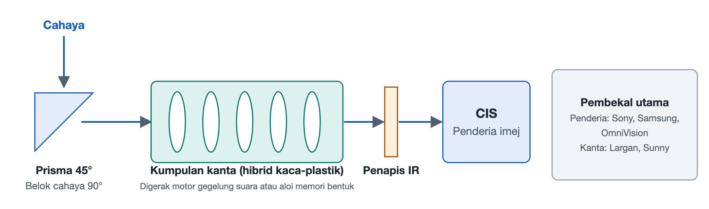

# 7.2 Pembedahan Objek Sebenar Modul Kamera dan Peta Industri

Apabila telefon diterbalikkan, kawasan kamera yang menonjol di bahagian belakang selalunya merupakan bahagian paling ketara pada keseluruhan peranti. Beberapa kanta bulat tersusun bersama, dan ada yang disertai sebuah "tingkap" berbentuk segi empat di sebelahnya. Ia kelihatan seperti beberapa keping kaca sahaja, tetapi apabila dibuka, setiap satunya dihubungkan dengan rantaian optik dan semikonduktor yang serba jitu. Bahagian ini mula-mula membedah sebuah modul telefoto periskop mengikut laluan yang dilalui cahaya, kemudian meninjau syarikat-syarikat yang menyokong cip penderia cahaya dan kanta di sebaliknya.

## 7.2.1 Rahsia di Sebalik Tingkap Segi Empat: Empat Peringkat Laluan Optik Modul Telefoto Periskop

Kanta telefoto perlu "mendekatkan" pemandangan yang jauh, dan untuk itu ia memerlukan panjang fokus yang lebih panjang. Panjang fokus boleh difahami secara kasar sebagai jarak optik yang diperlukan antara kanta dengan permukaan penderia cahaya. Ketebalan badan telefon kurang daripada satu sentimeter, jadi jika kanta disusun lurus ke dalam, ia langsung tidak muat. Penyelesaian jurutera ialah membelokkan cahaya, dan inilah asal-usul struktur periskop (Periscope). Prinsipnya sama seperti periskop kapal selam, iaitu menggunakan satu elemen pemantul untuk menukar arah laluan cahaya.

Sebelum sinar cahaya yang memasuki tingkap segi empat itu bertukar menjadi isyarat elektrik, ia perlu melalui empat komponen secara berturutan:

1. **Prisma pembelok 45°**: Cahaya masuk secara menegak dari belakang badan telefon, mengenai prisma yang dicondongkan 45°, lalu dibelokkan 90° dan bergerak secara melintang di sepanjang sisi panjang badan telefon. Dengan cara ini, panjang yang asalnya perlu digunakan secara "menegak" kini dibaringkan ke arah yang lebih lapang di dalam badan telefon.
2. **Kumpulan kanta terapung**: Cahaya yang bergerak melintang melalui satu kumpulan kanta untuk melengkapkan pemfokusan. Kumpulan kanta ini tidak tetap, sebaliknya dipasang pada landasan gelongsor mikro dan ditolak ke depan dan ke belakang oleh motor. Terdapat dua kaedah pemacu yang lazim: satu ialah **motor gegelung suara** (Voice Coil Motor, VCM), yang menolak kanta berdasarkan prinsip daya yang terhasil apabila gegelung beraliran elektrik berada dalam medan magnet, serupa dengan prinsip diafragma pembesar suara menghasilkan bunyi; satu lagi ialah **aloi ingatan bentuk** (Shape Memory Alloy, SMA), sejenis wayar logam yang akan mengecut kembali ke panjang pratetapnya apabila dipanaskan. Dengan mengawal arus untuk memanaskannya, kanta dapat ditarik dengan tepat.
3. **Penapis potong inframerah** (IR-cut Filter): Cip penderia cahaya turut bertindak balas terhadap cahaya inframerah yang tidak dapat dilihat oleh mata manusia. Jika tidak ditapis, gambar akan mengalami herotan warna dan kelihatan kelabu. Fungsi kepingan kaca nipis ini ialah membenarkan hanya cahaya nampak melaluinya.
4. **Penderia imej CMOS** (CMOS Image Sensor, CIS): Destinasi akhir laluan optik. Permukaan cip ini disusun dengan berpuluh-puluh juta piksel yang bertanggungjawab menukar foton kepada cas, kemudian kepada isyarat digital, lalu diserahkan kepada pemproses isyarat imej seterusnya.

Kerjasama keempat-empat komponen ini boleh diringkaskan sebagai "bingkai pandangan—belok—fokus—tapis—rakam":

| Komponen | Peranan dalam laluan optik | Analogi harian |
|---|---|---|
| Prisma pembelok 45° | Membelokkan cahaya masuk menegak sebanyak 90° | Cermin pemantul di selekoh koridor |
| Kumpulan kanta terapung SMA / VCM | Menggerakkan kanta untuk fokus dan penstabilan | Tombol pelaras fokus pada teleskop |
| Penapis potong inframerah | Menapis cahaya inframerah untuk memastikan warna tepat | Cermin mata hitam menyekat komponen yang menyilaukan |
| Penderia imej CIS | Menukar isyarat cahaya kepada isyarat elektrik | Filem dalam kamera filem |

## 7.2.2 Tiga Gergasi Cip Penderia Cahaya: Laluan Teknologi Pertaruhan Masing-masing

Teras yang menentukan had atas kualiti imej ialah CIS. Kini terdapat tiga pengeluar utama dalam bidang ini, dan masing-masing memilih hala tuju teknologi yang berbeza.

Karya perwakilan **Sony Semiconductor (jenama LYTIA)** ialah LYT-900 bersaiz 1 inci. Ia merupakan penderia bertindan, dan kawasan penderia yang besar membawa lebih banyak cahaya masuk. Salah satu teknologi perwakilan Sony dalam penderia bertindan ialah **piksel transistor dua lapisan** yang diumumkan pada tahun 2021. Dalam penderia tradisional, fotodiod yang menerima cahaya dan transistor yang membaca isyarat berhimpit pada lapisan silikon yang sama, saling berebut ruang. Sony menghasilkan kedua-duanya pada dua wafer berasingan, kemudian mengikatnya secara menegak atas dan bawah. Bayangkan sebuah bangunan: dahulu kedai dan gudang berhimpit di tingkat yang sama, kini gudang dipindahkan ke tingkat bawah dan seluruh tingkat atas digunakan untuk "menerima cahaya". Fotodiod mendapat ruang yang lebih besar dan dapat menampung lebih banyak cas; menurut Sony, jumlah isyarat tepu meningkat kira-kira dua kali ganda, dan julat dinamik turut meluas. Julat dinamik merujuk kepada keupayaan merakam butiran kawasan terang dan gelap dalam imej yang sama secara serentak; apabila memotret orang melawan cahaya, wajah tidak menjadi gelap dan langit tidak terlebih dedah berkat keupayaan inilah.

**Samsung Semiconductor (jenama ISOCELL)** menempuh laluan piksel ultra tinggi, dengan produk perwakilannya HP2 200 megapiksel. Apabila bilangan piksel banyak, saiz setiap piksel pasti kecil, dan dalam cahaya malap setiap piksel menerima sangat sedikit cahaya. Penyelesaian Samsung ialah **penyusunan semula piksel enam belas-dalam-satu**: apabila cahaya tidak mencukupi, 16 piksel kecil yang bersebelahan digabungkan dan digunakan sebagai satu piksel besar, mengorbankan resolusi demi cahaya masuk; apabila cahaya mencukupi, ia dipisahkan semula untuk menghasilkan butiran definisi tinggi piksel penuh. Kaedah ini seperti sebuah pasukan bola: biasanya 16 orang menjaga kedudukan masing-masing, tetapi apabila berdepan lawan yang kuat, mereka berkumpul untuk bertahan secara bersepadu.

Produk perwakilan **OmniVision** ialah OV50H dan OV50K, yang mempelopori **teknologi julat dinamik ultra tinggi LOFIC**. Nama penuh LOFIC ialah Lateral Overflow Integration Capacitor, iaitu kapasitor kamiran limpahan sisi. Di bawah cahaya kuat, fotodiod cepat "dipenuhi" cas, dan cas berlebihan akan hilang, menyebabkan kawasan terang imej menjadi putih mati. LOFIC menambah sebuah kapasitor di sebelah piksel khusus untuk menadah cas yang melimpah, seperti meletakkan besen di sebelah cawan supaya air yang melimpah tidak terbuang begitu sahaja. Dengan ini, butiran kawasan terang juga dapat dikekalkan.

| Pengeluar | Jenama / Produk perwakilan | Teknologi teras | Masalah utama yang diselesaikan |
|---|---|---|---|
| Sony Semiconductor | LYTIA / LYT-900 1 inci | Bertindan 1 inci; Sony turut memiliki teknologi piksel transistor dua lapisan | Cahaya masuk dan julat dinamik |
| Samsung Semiconductor | ISOCELL / HP2 200 megapiksel | Penyusunan semula piksel enam belas-dalam-satu | Mengimbangi piksel tinggi dan cahaya masuk dalam keadaan malap |
| OmniVision | OmniVision / OV50H, OV50K | Kapasitor limpahan sisi LOFIC | Kawasan terang tidak terlebih dedah di bawah cahaya kuat |

Semasa membaca parameter di majlis pelancaran, tiga jenis ungkapan iaitu "penderia besar 1 inci", "200 megapiksel" dan "julat dinamik ultra tinggi" selalunya masing-masing merujuk kepada tiga laluan di atas. Tiada perbandingan baik-buruk yang mudah antara ketiganya; setiap satu membuat pertukaran yang berbeza dari segi keluasan, bilangan piksel dan kapasiti cas.

## 7.2.3 "Kaca + Plastik" dalam Kanta: Hibrid Kaca-Plastik 1G+6P

Kanta di hadapan penderia terdiri daripada beberapa keping kanta mikro yang disusun bertindan. Kebanyakan kanta telefon diperbuat daripada plastik (Plastic, singkatan P) yang dibentuk melalui pengacuan suntikan jitu; ia ringan, murah dan boleh dibuat dalam bentuk asfera yang kompleks. Kaca (Glass, singkatan G) pula mempunyai ketelusan cahaya yang baik dan kurang dipengaruhi suhu, tetapi sukar diproses. **1G+6P** bermaksud menggabungkan 1 kanta kaca dengan 6 kanta plastik untuk membentuk sebuah kanta, menggunakan sekeping kaca untuk menampung kelemahan plastik dari segi serakan warna dan kestabilan, sambil mengekalkan kelebihan plastik yang ringan dan nipis.

Pembuatan kanta hibrid kaca-plastik yang berdiameter hanya beberapa milimeter dan menuntut ketepatan sangat tinggi ini dikuasai kukuh oleh **Largan Precision** dan **Sunny Optical**. Ralat bentuk permukaan kanta dan ketepatan penjajaran antara kepingan kanta menentukan secara langsung sama ada gambar tajam atau tidak, dan inilah sebabnya hanya segelintir pengeluar dapat menguasai peringkat ini dalam jangka panjang.

## 7.2.4 Rumusan

Sebuah modul kamera, dari luar ke dalam, menghubungkan reka bentuk optik, mekanik jitu, sains bahan dan proses semikonduktor: prisma menyelesaikan masalah ruang, motor menyelesaikan masalah fokus, penapis menyelesaikan masalah warna, CIS menyelesaikan masalah penukaran foto-elektrik, dan kanta kaca-plastik menyelesaikan masalah ketajaman imej. Di sebalik setiap peringkat terdapat pengeluar khusus. Bahagian seterusnya akan beralih kepada komponen terbesar di bahagian hadapan telefon, untuk melihat piawaian yang dipatuhi oleh skrin fleksibel dan kaca penutup.
