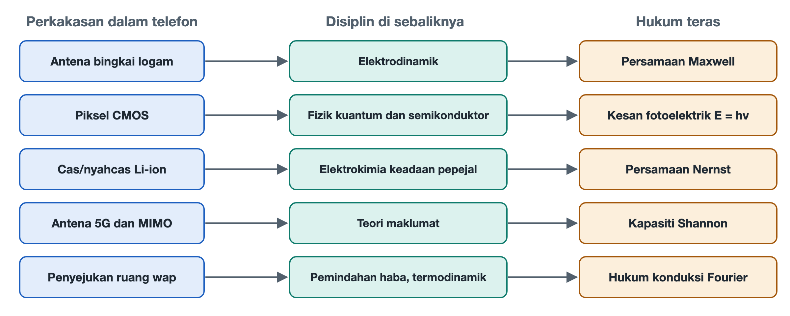

# 8.5 Panorama Pemetaan antara Objek Sebenar Telefon Pintar dan Teori Disiplin Asas

Terbalikkan telefon dan letakkannya di atas meja dengan bahagian belakang menghadap ke atas. Beberapa celah plastik halus pada bingkai tengah logam, cip fotosensitif sebesar kuku dalam modul kamera, bateri leper di bawah penutup belakang kaca, cip jalur asas yang mengendalikan 5G pada papan induk, serta kepingan logam nipis untuk penyebaran haba yang melekat rapat pada pemproses: semua komponen ini boleh dilihat dan disentuh. Empat bahagian terdahulu dalam bab ini masing-masing menjejaki empat daripada benang ini sehingga ke persamaan dalam buku teks. Bahagian ini menghimpunkan keempat-empat benang tersebut, menambah satu lagi benang iaitu penyebaran haba, lalu melukis peta pemetaan yang lengkap. Selepas ini, apabila pembaca melihat sesuatu fenomena pada telefon, mereka dapat mengenal pasti disiplin, teorem dan pengasas yang berkaitan dengannya.

## 8.5.1 Satu Jadual: Daripada Komponen kepada Hukum

Jadual di bawah disusun dalam empat lajur: "objek fizikal atau fenomena — disiplin — teorem atau model teras — tokoh perwakilan". Setiap baris boleh dibaca sebagai satu laluan dari dalam telefon menuju sains asas.

| Komponen fizikal dalam telefon / fenomena utama | Bidang disiplin yang menyokongnya | Teorem fizik teras / model matematik | Pengasas sains paling berpengaruh |
|---|---|---|---|
| Antena bingkai tengah logam, pancaran frekuensi radio tinggi | Elektrodinamik klasik / kejuruteraan frekuensi radio | Persamaan Maxwell (sinaran gelombang elektromagnet), persamaan gelombang | James Maxwell, Hertz |
| Fotodiod CMOS, hingar imej malam | Mekanik kuantum / fizik semikonduktor | Kesan fotoelektrik Einstein (E=hν), hingar tembakan Poisson | Planck, Einstein, Shockley |
| Pengecasan dan nyahcas bateri litium-ion, pemendapan litium semasa cas pantas | Kimia fizik / elektrokimia keadaan pepejal | Persamaan Nernst (keupayaan keseimbangan), hukum resapan Arrhenius | Nernst, Arrhenius, Goodenough |
| Komunikasi pantas 5G, berbilang antena MIMO | Teori maklumat / algebra matriks dan statistik | Formula kapasiti saluran Shannon, penguraian nilai singular matriks saluran ruang | Claude Shannon, Nyquist |
| Penyebaran haba perubahan fasa ruang wap, suhu simpang cip | Pemindahan haba / termodinamik klasik | Hukum konduksi haba Fourier, persamaan keseimbangan termodinamik haba pendam perubahan fasa | Fourier, Clausius |

Jadual ini bukan himpunan rawak. Lima barisnya tepat sepadan dengan lima jenis "aliran" paling asas dalam telefon: gelombang elektromagnet mengalir keluar, foton mengalir masuk, ion litium mengalir antara elektrod positif dan negatif, maklumat mengalir dalam saluran ruang, dan haba mengalir dari cip ke sarung. Bab Lima yang membincangkan "denyutan sistem" telah memperkenalkan rupa aliran-aliran ini dari sudut kejuruteraan, manakala bab ini menerangkan mengapa ia mesti mengalir sedemikian.

## 8.5.2 Imbasan Semula Lima Laluan Satu demi Satu

**Laluan pertama: celah bingkai tengah dan gelombang elektromagnet.** Celah pada bingkai tengah membahagikan gelang logam kepada beberapa segmen, dan setiap segmen ialah antena yang dikira dengan teliti. Persamaan Maxwell menunjukkan bahawa arus yang berubah akan menjana medan magnet yang berubah, dan medan magnet yang berubah pula menjana medan elektrik; kedua-duanya bergilir-gilir mendorong satu sama lain lalu membentuk gelombang elektromagnet yang merambat keluar. Persamaan gelombang menentukan hubungan antara panjang gelombang dan frekuensi, maka panjang antena mesti sepadan dengan jalur frekuensi operasinya. Semakin tinggi frekuensi, semakin pendek panjang gelombang, dan semakin mudah ia dilemahkan oleh dinding dan tangan manusia. Oleh itu, jurutera perlu menempatkan beberapa antena di sekeliling badan telefon supaya ia dapat bergilir-gilir menyambung tugas.

**Laluan kedua: piksel fotosensitif dan foton.** Apabila sebutir foton memasuki fotodiod CMOS, tenaganya ialah E=hν. Selagi tenaganya mencukupi, ia dapat mengujakan sebutir elektron; inilah kesan fotoelektrik yang pernah dijelaskan oleh Einstein. Ketibaan foton itu sendiri bersifat rawak dan mematuhi taburan Poisson: apabila purata N foton tiba, turun naiknya kira-kira √N. Pada waktu malam cahaya sedikit, N kecil, turun naik secara relatif menjadi lebih besar, lalu hingar muncul pada imej. Peranan "penderia besar" dan "bukaan besar" ialah mengumpul lebih banyak foton supaya turun naik statistik menjadi relatif kecil.

**Laluan ketiga: bateri dan ion dalam kekisi.** Voltan bateri litium ditentukan oleh perbezaan keupayaan elektrokimia antara bahan elektrod positif dan negatif, dan persamaan Nernst menerangkan bagaimana keupayaan berubah mengikut kepekatan dan suhu. Kelajuan resapan ion litium dalam kekisi elektrod mematuhi hukum Arrhenius; apabila suhu turun, resapan menjadi perlahan secara eksponen. Telefon yang tiba-tiba mati pada musim sejuk walaupun paparan bateri masih menunjukkan baki, serta keperluan mengawal arus semasa cas pantas untuk mengelakkan litium termendap pada permukaan elektrod negatif, kedua-duanya boleh dijelaskan dari sini. Kajian Goodenough dan rakan-rakannya terhadap bahan elektrod positif telah meletakkan asas bagi bateri telefon masa kini.

**Laluan keempat: berbilang antena dan kapasiti saluran.** Formula Shannon menetapkan bahawa maklumat yang boleh dihantar oleh sesuatu saluran pada lebar jalur dan nisbah isyarat kepada hingar tertentu mempunyai had atas. Untuk mempercepatkan 5G, pertama, lebar jalur diperluas; kedua, teknologi MIMO (berbilang input berbilang output) digunakan, iaitu beberapa antena menghantar dan menerima serentak. Dari sudut matematik, saluran ruang boleh ditulis sebagai satu matriks; dengan melakukan penguraian nilai singular ke atasnya, satu laluan yang sesak dapat dipecahkan kepada beberapa "subsaluran" yang hampir selari. Kerja Nyquist tentang pensampelan dan kadar simbol pula menetapkan peraturan rentak bagi komunikasi digital.

**Laluan kelima: ruang wap dan suhu simpang.** Laluan ini tidak disenaraikan secara berasingan dalam bahagian-bahagian terdahulu, jadi ia diterangkan di sini sebagai tambahan. Semasa cip beroperasi, pensuisan transistor menghasilkan haba. Hukum Fourier menyatakan bahawa magnitud aliran haba berkadar dengan kecerunan suhu dan keupayaan konduksi bahan, maka bahan yang baik mengalirkan haba seperti kuprum dan grafit digunakan untuk menyebarkan haba dengan cepat. Ruang wap mengandungi sedikit cecair yang dimeterai di dalamnya: cecair menyerap haba lalu mengewap di hujung panas, wap mengalir ke hujung sejuk lalu membebaskan haba dan memeluwap, kemudian kembali melalui struktur kapilari. Haba pendam perubahan fasa membolehkan kepingan logam yang sangat nipis memindahkan haba dalam jumlah besar. Hukum termodinamik yang dirumuskan oleh Clausius pula mengingatkan kita bahawa haba hanya mengalir dari suhu tinggi ke suhu rendah, dan had penyebaran haba telefon akhirnya bergantung pada perbezaan suhu antara badan telefon dengan udara di sekelilingnya.

## 8.5.3 Mengapa Perlu Melukis Peta Panorama Ini

Jika dilihat satu komponen sahaja, mudah untuk menganggapnya sebagai titik teknologi yang terpencil. Setelah dimasukkan ke dalam jadual ini, tiga lapisan hubungan dapat dilihat:

1. **Batasan datang daripada hukum, bukan pengeluar.** Isyarat menjadi lemah apabila menembusi dinding, hingar muncul dalam imej malam, bateri cepat susut dalam suhu rendah, dan prestasi diturunkan akibat panas: semuanya dikekang oleh salah satu hukum dalam jadual di atas. Kejuruteraan hanya boleh bergerak dalam ruang yang dibenarkan oleh hukum.
2. **Sebuah telefon yang sama menggunakan pelbagai disiplin.** Satu panggilan video serentak menggunakan elektrodinamik, fizik semikonduktor, elektrokimia, teori maklumat dan pemindahan haba; inilah maksud "integrasi tinggi".
3. **Di sebalik parameter terdapat kuantiti fizik.** "Penderia lebih besar", "cas lebih pantas", "5G lebih kuat" dan "penyebaran haba lebih baik" dalam majlis pelancaran semuanya boleh diterjemahkan semula kepada bilangan foton, resapan ion, kapasiti saluran dan aliran haba.

## 8.5.4 Antara Muka Kolaborasi AI: Menjejak Balik daripada Fenomena Fizikal

Jadual ini juga boleh digunakan secara terbalik: lihat fenomena dahulu, kemudian tanya baris mana yang berkaitan. Gesaan di bawah boleh terus diberikan kepada pembantu AI; gantikan bahagian dalam kurungan segi empat dengan fenomena yang anda perhatikan.

> Saya sedang membaca kandungan Bab Lapan tentang penjejakan prinsip dalam "Bacaan Asas Pengetahuan Sistem Era AI: Telefon Pintar". Saya memerhatikan satu fenomena fizikal khusus semasa menggunakan telefon: [masukkan fenomena khusus anda, contohnya: Mengapa pada musim sejuk di luar rumah, telefon tiba-tiba mati sendiri walaupun bateri masih 30%? / Mengapa isyarat 5G merosot jauh lebih teruk berbanding 4G selepas terhalang oleh dinding galas beban? / Mengapa semakin besar bukaan kanta dan saiz penderia kamera telefon, semakin kurang hingar imej malam?].
> Sila berdasarkan kerangka penjejakan disiplin dalam bab ini, bantu saya menganalisis semula mekanisme saintifik asasnya:
> 1. 【Hukum sains teras】: Fenomena ini dikekang oleh teorem fizik, kimia atau teori maklumat yang mana (seperti persamaan Arrhenius, persamaan Maxwell, persamaan Nernst atau taburan Poisson)?
> 2. 【Penaakulan fizik mikro】: Sila gunakan proses fizik mikro yang mudah difahami tetapi tepat untuk menerangkan perubahan yang berlaku pada suhu / kekisi / foton / gelombang elektromagnet pada saat itu.
> 3. 【Penyelesaian kompromi kejuruteraan】: Apakah kaedah yang digunakan oleh jurutera telefon moden dan saintis algoritma pada peringkat reka bentuk perkakasan atau sistem pengendalian untuk menangani had fizik ini?

Setelah mendapat jawapan, anda boleh merujuk jadual di atas untuk menyemak sama ada klasifikasi disiplin yang diberikan oleh AI tepat, kemudian kembali ke subbahagian berkaitan dalam bab ini untuk memeriksa proses penaakulannya. Dengan cara ini, AI berperanan sebagai rakan latihan, manakala penilaian akhir tetap dibuat oleh anda sendiri.

## 8.5.5 Rumusan

Bab ini bermula daripada empat persamaan dan akhirnya berlabuh pada jadual lima baris ini. Jadual ini menghubungkan komponen yang boleh dilihat di dalam telefon dengan hasil yang telah dikumpulkan oleh fizik, kimia dan teori maklumat selama beratus-ratus tahun. Bab seterusnya akan memperkenalkan secara sistematik cara memanfaatkan AI untuk menjadikan pertanyaan daripada objek fizikal kepada prinsip ini satu kebiasaan harian.
