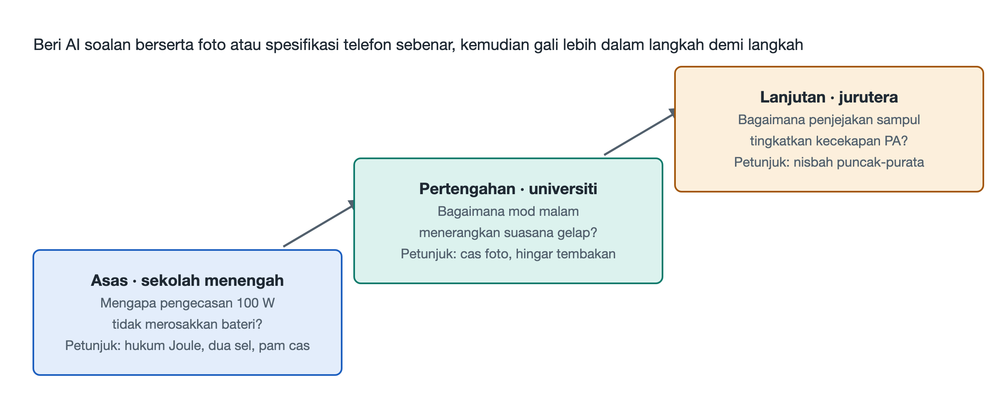

# 9.2 Penerokaan Kognitif Tiga Peringkat: Tangga Soalan daripada Pelajar Sekolah Menengah kepada Jurutera

Dalam bahagian sebelum ini, kita telah meminta AI mengenal pasti setiap cip dalam foto telefon yang dibuka. Namun, "mengenal pasti" hanyalah permulaan. Pembelajaran yang benar-benar bermakna ialah apabila kita membawa satu soalan yang baik dan membiarkan AI menemani kita bertanya lebih lanjut, sehingga kita menyentuh lapisan terdalam prinsipnya. Jika soalan cetek, jawapan AI juga berhenti di permukaan. Jika soalan tepat, AI dapat membawa kita menelusuri satu rantaian sistem yang lengkap.

Bahagian ini mereka bentuk sebuah tangga soalan tiga peringkat yang masing-masing sepadan dengan tiga latar belakang pengetahuan: pelajar sekolah menengah, pelajar universiti dan jurutera. Ketiga-tiga soalan diambil daripada fenomena paling biasa dalam penggunaan telefon harian: pengecasan, fotografi malam dan panggilan 5G. Semakin tinggi anak tangga, semakin mendalam konsep fizik dan kejuruteraan yang terlibat. Anda boleh bermula dari anak tangga anda sendiri, atau membaca ketiga-tiga soalan secara berturutan untuk merasai bagaimana telefon yang sama kelihatan pada tahap kedalaman yang berbeza.

## 9.2.1 Gambaran Keseluruhan Tangga: Tiga Kedalaman bagi Telefon yang Sama

| Anak Tangga | Perspektif Pembaca | Soalan Teras | Pengetahuan yang Diperlukan | Bab Berkaitan dalam Buku Ini |
|---|---|---|---|---|
| Asas | Pelajar sekolah menengah | Mengapa pengecasan pantas ratusan watt tidak menyebabkan bateri meletup? | Hukum Joule peringkat sekolah menengah rendah, pembahagian voltan dalam litar sesiri | 5.2, 8.3 |
| Pertengahan | Pelajar universiti | Mengapa fotografi malam boleh menjadikan malam kelihatan seperti siang? | Kesan fotoelektrik, kebarangkalian dan statistik, penjajaran imej | 5.3, 8.2 |
| Lanjutan | Jurutera | Bagaimanakah penjejakan sampul 5G meningkatkan kecekapan tenaga penguat kuasa? | Teori modulasi, reka bentuk bekalan kuasa, lebar jalur isyarat | 5.1, 8.4 |

Terdapat satu prinsip semasa menggunakannya: **jangan minta jawapan sekali gus, sebaliknya biarkan AI membimbing anda langkah demi langkah.** Contohnya, tambahkan satu ayat sebelum bertanya: "Tolong jangan terus beritahu saya kesimpulannya. Tanya dahulu apa yang saya sudah tahu, kemudian beri petunjuk langkah demi langkah." Dengan cara ini, AI menjadi rakan latihan, bukan sekadar ensiklopedia yang boleh bercakap.

## 9.2.2 Asas: Mengapa Pengecasan Pantas Ratusan Watt Tidak Menyebabkan Bateri Meletup?

**Senario permulaan**: Anda melihat majlis pelancaran menyebut "pengecasan pantas ratusan watt", dan reaksi pertama anda mungkin kebimbangan: dengan kuasa sebesar itu, adakah bateri akan terlampau panas dan terbakar?

**Laluan soalan susulan yang disyorkan**:

1. **Kembali dahulu kepada hukum Joule.** Fizik sekolah menengah rendah memberitahu kita bahawa haba yang dihasilkan apabila arus mengalir melalui konduktor ialah Q = I²Rt. Haba berkadar dengan kuasa dua arus. Oleh itu, faktor utama yang mempengaruhi pemanasan ialah arus, manakala kuasa itu sendiri hanyalah faktor sekunder. Anda boleh bertanya kepada AI: "Jika kuasa tidak berubah, voltan digandakan dan arus dikurangkan separuh, bagaimanakah pemanasan berubah?" Jawapannya: apabila rintangan tidak berubah, haba berkurang kepada satu perempat daripada asal.
2. **Kemudian lihat pembahagian voltan dua sel bersiri.** Banyak telefon pengecasan pantas membina bateri sebagai dua sel yang disambung secara sesiri. Selepas disambung secara sesiri, jumlah voltan menjadi dua kali ganda, dan pada kuasa pengecasan yang sama, arus yang mengalir melalui litar bateri boleh dikurangkan. Inilah idea "naikkan voltan, turunkan arus" yang diterapkan pada bateri. Anda boleh bertanya lagi kepada AI: "Mengapa tidak gunakan sahaja satu sel besar? Apakah kosnya jika dua sel disambung secara sesiri?" Ini akan membawa kepada topik keseragaman sel dan pengurusan pengimbangan.
3. **Akhir sekali lihat pengecasan terus dengan pam cas.** Voltan yang dihantar oleh pengecas perlu ditukar di dalam telefon sebelum memasuki bateri. Litar penurun voltan berasaskan induktor tradisional mengalami kehilangan tenaga yang ketara, yang bertukar menjadi haba dan kekal di dalam badan telefon. Pam cas (Charge Pump) menggunakan pensuisan kapasitor mengikut nisbah untuk menukar voltan, dengan kecekapan penukaran sekitar 98%. Ini bermakna sebahagian besar tenaga memasuki bateri, dan hanya sebahagian kecil yang menjadi haba.

**Hasil anak tangga ini**: Keselamatan pengecasan pantas datang daripada satu set reka bentuk gabungan, bukan semata-mata kerana "bateri lebih tahan lasak". Mengurangkan arus mengurangkan haba dari puncanya, penukaran berkecekapan tinggi mengurangkan kehilangan di peringkat pertengahan, dan bersama pemantauan suhu yang dibincangkan dalam Bab 6, haba sentiasa berada dalam julat yang terkawal. Satu formula sekolah menengah rendah sudah cukup untuk menerangkan parameter paling menonjol dalam majlis pelancaran.

## 9.2.3 Pertengahan: Mengapa Fotografi Malam Boleh Menjadikan Malam Kelihatan Seperti Siang?

**Senario permulaan**: Anda menekan butang pengatup pada lewat malam, skrin memaparkan "Sila kekal stabil", dan selepas satu atau dua saat, foto itu kelihatan terang seperti waktu senja. Cahaya sangat sedikit, jadi dari manakah datangnya kecerahan itu?

**Laluan soalan susulan yang disyorkan**:

1. **Bermula daripada cas fotojana.** Setiap piksel pada dasarnya ialah sebuah fotodiod. Foton yang mengenai cip silikon mengujakan elektron melalui kesan fotoelektrik, dan elektron ini ialah cas fotojana (Photo-generated Charge). Di tempat gelap, foton sedikit, maka cas yang dikumpul oleh setiap piksel juga sedikit, dan isyaratnya lemah. Anda boleh bertanya kepada AI: "Apakah hubungan antara bilangan cas yang dikumpul oleh piksel dengan kecerahan akhir?"
2. **Mengenali hingar tembakan Poisson.** Ketibaan foton pada piksel ialah peristiwa rawak yang mematuhi taburan Poisson. Turun naik yang disebabkan oleh sifat zarah cahaya ini dipanggil hingar tembakan (Shot Noise). Salah satu sifat pentingnya ialah: semakin lemah isyarat, semakin ketara hingar secara relatif. Inilah punca foto malam dipenuhi bintik hingar berwarna. Minta AI menerangkan: "Mengapakah nisbah isyarat kepada hingar meningkat mengikut √N apabila N foto ditindih?" Langkah ini ialah aplikasi langsung kebarangkalian dan statistik dalam kamera.
3. **Memahami penjajaran aliran optik dalam domain RAW.** Penindihan berbilang foto mempunyai satu prasyarat: setiap foto mesti dijajarkan dengan tepat. Semasa memegang telefon dengan tangan, tangan akan bergegar, dan orang serta kenderaan dalam bingkai juga bergerak. Dalam domain RAW, iaitu data penderia asal yang belum melalui pemprosesan warna, telefon menggunakan algoritma aliran optik (Optical Flow) untuk menganggarkan anjakan setiap blok piksel, menjajarkan berbilang bingkai blok demi blok, kemudian menggabungkannya. Operasi dipilih dalam domain RAW kerana data di sini paling hampir dengan statistik foton sebenar, dan ciri hingarnya belum diherotkan oleh pemprosesan seterusnya.

**Hasil anak tangga ini**: Apa yang dikatakan "menjadikan malam kelihatan seperti siang" sebenarnya tidak menambah cahaya daripada tiada, tetapi hanya mengumpulkan foton yang bertaburan dalam berbilang foto mengikut hukum statistik, lalu meratakan hingar rawak. Keseluruhan proses ini menghubungkan geganti fotografi pengiraan peringkat milisaat dalam Bab 5 dengan fizik pengimejan semikonduktor dalam Bab 8.

## 9.2.4 Lanjutan: Bagaimanakah Penjejakan Sampul 5G Meningkatkan Kecekapan Tenaga Penguat Kuasa?

**Senario permulaan**: Telefon 5G menjadi ketara panas dan cepat kehabisan bateri apabila isyarat lemah, dan salah satu penyumbang utamanya ialah penguat kuasa frekuensi radio (Power Amplifier, PA). Dari sudut kejuruteraan, bagaimanakah kita boleh menjadikannya kurang membazir tenaga?

**Laluan soalan susulan yang disyorkan**:

1. **Mengenali cabaran nisbah kuasa puncak kepada purata yang tinggi.** 5G menggunakan modulasi tertib tinggi, contohnya 1024-QAM (modulasi amplitud kuadratur). Ia memuatkan lebih banyak bit dalam satu simbol, dan amplitud isyarat turut berubah dengan mendadak; kuasa puncak jauh lebih tinggi daripada kuasa purata. Inilah nisbah kuasa puncak kepada purata yang tinggi (PAPR). PA mesti menyediakan voltan bekalan mengikut nilai puncak, tetapi sebahagian besar masa isyarat hanya berada di sekitar paras purata, maka voltan berlebihan itu menjadi haba.
2. **Memahami idea penjejakan sampul.** Penjejakan sampul (Envelope Tracking, ET) membolehkan voltan bekalan PA berubah secara masa nyata mengikut sampul isyarat: voltan tinggi apabila isyarat besar, voltan rendah apabila isyarat kecil. Sebagai analogi, bekalan tetap umpama membuka paip air besar sepanjang masa, manakala ET memutar injap mengikut keperluan. Anda boleh meminta AI melukis rajah perbandingan lengkung voltan dan sampul isyarat di bawah "bekalan tetap" dan "bekalan ET".
3. **Mendalami keperluan kelajuan bekalan kuasa dinamik.** Lebar jalur isyarat 5G boleh mencapai 100MHz, dan sampul berubah dengan sangat pantas. Cip bekalan kuasa ET mesti mempunyai kadar slew (Slew Rate) yang cukup tinggi untuk menyelesaikan penalaan voltan dalam skala masa mikrosaat atau lebih singkat, dan mesti disegerakkan dengan ketat dengan isyarat frekuensi radio. Sebaik sahaja masa tersasar, herotan akan berlaku, malah memburukkan kualiti komunikasi. Di sini anda boleh bertanya lagi kepada AI: "Apabila lebar jalur pemodulat ET tidak mencukupi, apakah masalah yang timbul pada spektrum?"

**Hasil anak tangga ini**: Isu kecekapan tenaga akhirnya bergantung pada koordinasi tiga perkara: kaedah modulasi, kelajuan tindak balas bekalan kuasa dan penyegerakan isyarat. Ia menghubungkan aliran elektromagnet frekuensi radio dalam Bab 5 dengan kos "menukar modulasi yang lebih kompleks untuk kadar yang lebih tinggi" di sebalik teorem Shannon dalam Bab 8.

## 9.2.5 Ringkasan: Nilai Tangga Terletak pada Keterhubungannya

Ketiga-tiga soalan kelihatan tergolong dalam tiga bidang berbeza, iaitu bateri, kamera dan frekuensi radio, tetapi logik asasnya sangat konsisten: di bawah kekangan fizik, gunakan reka bentuk sistem untuk meminimumkan kehilangan tenaga dan maklumat. Pelajar sekolah menengah bermula daripada hukum Joule, pelajar universiti memanfaatkan kebarangkalian dan statistik, jurutera menguasai koordinasi dinamik antara isyarat dan bekalan kuasa. Ketiga-tiganya melihat telefon yang sama di tangan mereka, cuma pada kedalaman yang berbeza.

Menyoal sesuatu fenomena hingga ke lapisan prinsip, kemudian kembali daripada prinsip kepada objek sebenar untuk pengesahan, proses ulang-alik inilah cara melatih "mata tembus sistem". Dalam bahagian seterusnya, kita akan meletakkan keupayaan menyoal ini ke dalam senario penggunaan yang lengkap, bermula daripada satu operasi sebenar untuk menjejaki operasi keseluruhan rantaian telefon.
