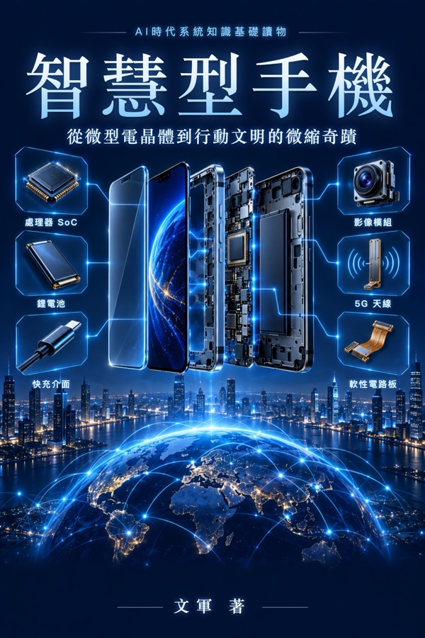

# 關於本書

**《智慧型手機》**——從微型電晶體到行動文明的微縮奇蹟

《AI時代系統知識基礎讀物》叢書，作者：文軍。繁體中文版，由簡體中文版翻譯而成。

> **徵求意見稿**：本書由 AI 輔助寫作（SageWrite 寫作系統，Claude 模型），已做過一輪事實查核，但尚未經過完整的人工審讀。發現錯誤、不清楚或可以講得更好的地方，歡迎在每一頁底部留言。留言會定期整理，用於修訂下一版。

## 怎樣讀這本書

本書採用「書 + 實物 + AI」的學習方式：書給出一張穩定的知識骨架，你手邊的實物就是教具，遇到想深入的地方，可以把書中的問題直接拿去問 AI，讓它繼續往下展開。

全書按九層認知階梯組織：對象 → 結構 → 功能 → 關係 → 流動 → 機制 → 關鍵技術 → 原理 → AI 協同。

## 留言

每頁底部的留言區由 Giscus 提供，留言保存在本書 GitHub 儲存庫的 Discussions 中，需要用 GitHub 帳號登入後留言。

## 版權

© 文軍。保留所有權利。
