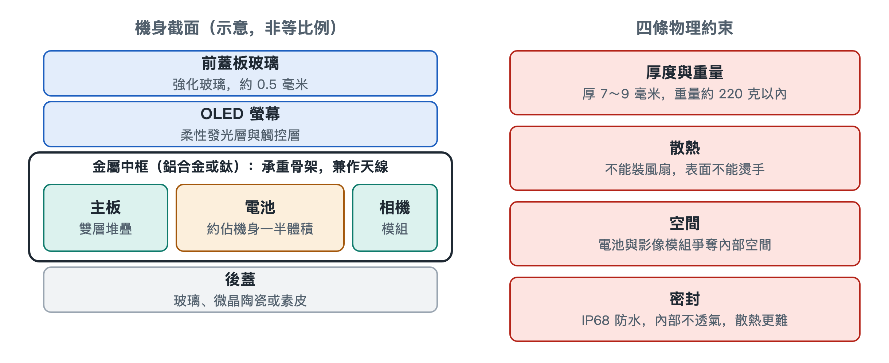

# 1.1 智慧型手機的物理形態與系統折衷

把手機平放在桌上，最直觀的印象是一塊會發光的長方形玻璃板。這塊板子看起來簡單，卻是工業設計與機械工程長期演進的結果。它的厚度、重量、材料和開孔位置，都是在極小空間裡反覆權衡後的妥協。讀懂這些妥協，是建立「系統透視眼」的第一步。

## 1.1.1 經典三明治：三層材料各司其職

拿起手機，用指甲沿側邊輕輕劃一圈，能摸到正面玻璃、側面金屬邊框和背面材質之間細微的接縫。絕大多數主流手機都採用這種「螢幕蓋板 + 金屬中框 + 背蓋」的夾層結構，工程師常把它叫作「三明治架構」。

| 層級 | 常見材料 | 主要職責 |
|---|---|---|
| 前蓋板玻璃 | 鋁矽酸鹽強化玻璃，代表廠商為美國康寧（大猩猩玻璃）、德國肖特 | 保護螢幕，抵禦刮擦與摔落 |
| 結構中框 | 航太級 6000/7000 系鋁合金或鈦金屬 | 承重骨架，兼作天線輻射體 |
| 背蓋板 | 玻璃、微晶陶瓷或素皮 | 讓無線充電的電磁波穿過，兼顧散熱與握感 |

**前蓋板**厚度約 0.5 毫米，比一張銀行卡還薄。它經過化學強化和微晶硬化處理，表面形成一層壓應力，像給玻璃預先繃緊了一層「鎧甲」，裂紋不容易擴展。

**中框**是整機的承重骨架。螢幕、主機板、電池都直接或間接固定在它上面，摔落時衝擊力也主要由它分散。它還有一項不太為人注意的兼職：側邊那幾道細細的塑膠縫隙，是用奈米射出成型工藝填入的絕緣材料，把一整圈金屬切成幾段，每一段就成了一根天線。骨架和天線合而為一，正是空間極度緊張時的典型做法，第四章會專門討論。

**背蓋**為什麼越來越少用整塊金屬？因為金屬會遮蔽電磁場，無線充電線圈的能量穿不過去。玻璃、陶瓷、素皮對電磁波「透明」，同時可以透過不同的表面處理改善手感和觀感。材料選擇背後，其實是充電、散熱、握持三種需求的折衷。

## 1.1.2 折疊螢幕：讓螢幕學會彎腰

近年來普及的折疊螢幕手機打破了剛性長方體的形態。螢幕要反覆彎折，帶來了全新的材料與機械難題。

- **超薄柔性玻璃（Ultra-Thin Glass，UTG）**：厚度只有 30 微米左右，接近一根頭髮的一半。玻璃一旦薄到這種程度，就能像紙一樣彎曲。再經過化學強化，它可以彎折數十萬次而不出現機械疲勞。部分機型也會使用透明聚醯亞胺薄膜（Colorless Polyimide，CPI）作為柔性蓋板。
- **水滴鉸鏈**：如果螢幕被硬生生對折成一條直線，彎折處會發生塑性變形，留下永久摺痕。水滴鉸鏈在闔上時為螢幕留出一個水滴形的收容腔，讓彎曲半徑變大、受力變緩。這個鉸鏈內部整合了上百個微型齒輪與凸輪結構，零件採用金屬射出成型（Metal Injection Molding，MIM）工藝製造：先把金屬粉末與黏結劑混合後像塑膠一樣射出成型，再燒結緻密，適合量產形狀複雜的小零件。

折疊形態也改變了內部佈局。機身分成兩半，常見的做法是採用雙主機板和分立的雙電芯，分別放在鉸鏈兩側，再用軟性線路跨過鉸鏈連接。一部折疊螢幕手機，相當於把兩部薄手機用精密機械「縫」在了一起。

## 1.1.3 鎖死形態的四條物理邊界

無論直板還是折疊，手機的形態都被幾條嚴苛的物理邊界限定。它們互相牽制，任何一項放鬆，都會擠壓其他幾項。

1. **厚度與重量**：整機厚度通常被壓在 7.0～9.0 毫米之間，重量一般控制在 220 克以內，業內常把 200 克左右視為「人機舒適線」。超過這條線，單手長時間握持和放進褲袋都會明顯吃力。
2. **無風扇散熱**：筆記型電腦可以裝風扇，手機不行。機身內既沒有空間，也無法開進風口，所有熱量只能依靠被動導熱，從晶片傳到中框、螢幕和背蓋，再散到空氣和手掌中。由於機身直接接觸皮膚，安全標準對可觸摸表面的溫度有限制（限值按材料和接觸時間分級），廠商通常把長時間手持的表面溫度控制在 40 多攝氏度。
3. **電池與影像的空間爭奪**：電池佔據了機身近一半的體積。剩下的空間裡，越做越大的相機模組是最「貪婪」的住戶。多給電池一毫米，就可能少給鏡頭一毫米，這就是為什麼續航和影像常常難以兼得。
4. **IP68 密封**：IP68 是國際通用的防塵防水等級標記，「6」代表完全防塵，「8」代表可承受持續浸水。為了達到它，機身接縫被膠條和密封圈層層封死。代價是內部密不透風，本就只能被動散熱的環境更加悶熱。

把這四條放在一起看，就會發現手機設計像一場「四方拉鋸」：

| 想要的 | 付出的代價 |
|---|---|
| 更薄更輕 | 電池變小，散熱面積減少 |
| 更大電池 | 機身變厚變重 |
| 更強影像 | 擠佔電池空間，背部凸起 |
| 更好防水 | 內部密閉，散熱更難 |

## 1.1.4 小結：一塊玻璃板裡的權衡帳本

手裡這部手機的每一處外形細節，都不是隨意的審美選擇。中框的縫隙是天線，背蓋的材質服務於無線充電，鏡頭凸起是空間不夠的結果，摸起來發燙的位置暗示了熱量的流向。理解了這些折衷，再看後面各章的晶片、射頻、快充與溫控，就會明白它們為何都要在毫米與毫瓦之間精打細算。下一節，我們將視線從機身移向社會，看看這塊玻璃板在現代生活中佔據了怎樣的位置。
