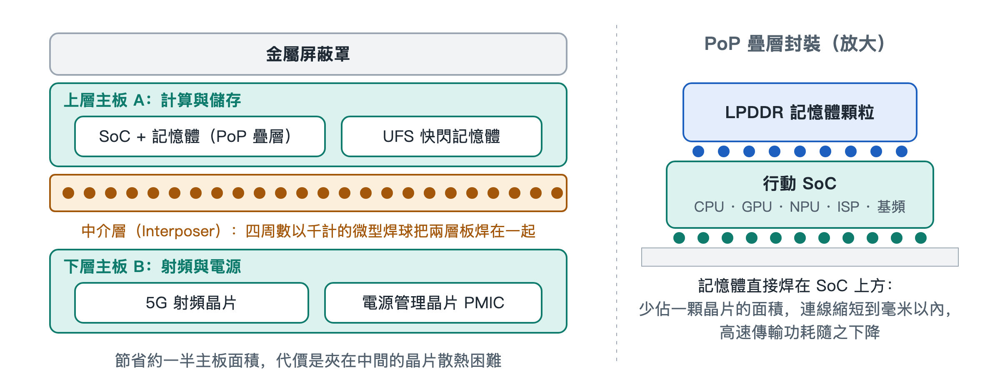

# 2.1 雙層堆疊主機板（Logic Board）與微型化封裝技術

擰下底部螺絲、撬開背蓋，再取下覆蓋在電路上的幾塊金屬蓋板，手機內部最核心的部件就露出來了：一塊輪廓彎彎折折、形狀很不規則的板子。它就是手機主機板，英文常稱 Logic Board（邏輯板）。它沒有電腦主機板那樣規整的矩形外形，而是被電池、相機模組和揚聲器擠成了「見縫插針」的樣子。更值得注意的是，這塊板子往往不只一層，而是像漢堡一樣上下疊在一起。



## 2.1.1 從「攤大餅」到「蓋樓房」

我們可以把主機板想像成一座城市。早年的功能型手機，主機板面積寬裕，晶片像平房一樣平鋪在一塊電路板上，道路寬敞，彼此也不擁擠。到了智慧型手機時代，機身越來越薄，電池越來越大，鏡頭越來越多，留給主機板的地盤被不斷壓縮，需要安放的晶片卻一年比一年多：處理器、記憶體、快閃記憶體、5G 射頻、電源管理……平鋪已經放不下了。

工程師的辦法和城市規劃者一樣：地不夠，就往上蓋樓。於是出現了雙層堆疊主機板（Stacked Logic Board），業界常形象地稱它為「漢堡主機板」或「三明治主機板」。它的基本結構可以用下面的剖面示意來理解：

```
┌──────────────────────────────────────────────┐
│        現代手機雙層堆疊主板架構剖面          │
├──────────────────────────────────────────────┤
│ 上層主板 A（計算與儲存）                      │
│  [行動 SoC 核心 + 記憶體堆疊] [UFS 快閃記憶體]│
│ ════════════════════════════════════════════ │
│        ▼            ▼            ▼           │
│   ●●● 中介框（Interposer）●●●                │
│ 四周數以千計的微型焊球，中間形成封閉空腔      │
│        ▲            ▲            ▲           │
│ ════════════════════════════════════════════ │
│ 下層主板 B（射頻與電源）                      │
│  [5G 射頻前端晶片群]        [PMIC 供電晶片]   │
└──────────────────────────────────────────────┘
```

這三層各有分工：

- **上層主機板（A 板）**：安放運算與儲存的核心——行動系統單晶片（SoC, System on Chip）及疊在它上面的記憶體，還有存放照片、應用程式的 UFS（通用快閃記憶體儲存，Universal Flash Storage）快閃記憶體顆粒。
- **下層主機板（B 板）**：承載 5G 射頻前端晶片群和電源管理單元（PMIC, Power Management IC）。這兩類晶片工作時發熱都不小。
- **中間連接框（Interposer，中介層）**：一圈環形的「框子」夾在上下兩板之間，框的上下表面佈滿數以千計的微小錫球，把兩塊板直接焊死、熔合成一個整體。電訊號就沿著這些錫球在上下層之間穿梭。

這種結構屬於球柵陣列（BGA, Ball Grid Array）式連接：不再用細長的接腳，而是用排成陣列的小錫球實現密集互連。焊好之後，環形中介層的中間留出一塊封閉空腔，上下兩板朝內一側的晶片就「藏」在這個空腔裡。

## 2.1.2 SLP：把電路「畫」得像晶片一樣細

光會疊層還不夠，每一層板子本身也必須更密。一般電路板（PCB, Printed Circuit Board）的走線較粗，放在今天的手機裡顯得太「佔地方」。於是手機主機板普遍採用類載板（SLP, Substrate-like PCB）製程。

所謂「類載板」，意思是它的精細程度接近晶片封裝用的載板。在這種製程下，走線的線寬與線距被壓縮到 30 微米以下。做個對照：一根頭髮的直徑大約幾十微米，也就是說，主機板上的銅線比髮絲還細，而且一根挨著一根，間隙同樣窄。

不僅橫向密，縱向也深。一塊指甲到名片大小的主機板，內部可以疊壓超過 10 層導電線路，層與層之間靠微小的孔洞相連，形成一張立體的高密度互連網路。如果說一般電路板是一張平面城市地圖，SLP 主機板更像一座擁有多層地下通道和高架橋的立體城市。

## 2.1.3 省下一半地盤，代價是散熱

雙層堆疊帶來的好處直截了當：與把所有晶片平鋪相比，它大約節省了一半的主機板面積。省下來的空間可以讓給電池，帶來更長的續航；也可以讓給更大的相機模組，或者讓機身更薄。

但工程上沒有白吃的午餐。回看剖面圖就會發現，上下兩塊板夾住的那個空腔幾乎是密閉的：藏在裡面的晶片被四周的焊環和上下的電路板包圍，熱量很難直接散到外面。而下層恰好放著本身就發熱不小的射頻晶片和電源管理晶片。這就像把兩間開著暖氣的屋子上下疊在一起，中間還封了窗戶——樓是省地了，屋裡卻更悶。

這種「空間換熱量」的取捨，是理解手機設計的一條主線。後面講到散熱屏蔽、溫度牆與熱節流時，讀者會一再看到它的影子。下面這張表概括了雙層主機板的利與弊：

| 維度 | 雙層堆疊主機板的做法 | 帶來的結果 |
|---|---|---|
| 面積 | 上下兩板疊合 | 約節省一半主機板面積 |
| 佈線密度 | SLP 製程，線寬／線距 30 μm 以下 | 小面積內實現超過 10 層高密度互連 |
| 層間連接 | 環形中介層，數以千計的微米級錫球 | 上下板電氣相通、結構牢固 |
| 功能分區 | A 板運算儲存，B 板射頻與電源 | 模組清晰，便於佈局 |
| 代價 | 中間形成封閉空腔 | 夾層晶片散熱困難，維修難度加大 |

## 2.1.4 誰在製造這塊「晶片城市」

這樣精密的板子，背後是一條專業化的產業鏈。高階類載板的製造商主要有中國台灣的欣興電子、華通電腦、鵬鼎控股，奧地利的奧特斯（AT&S），以及中國大陸的深南電路。它們負責把細如髮絲的線路一層層做出來。

板子做好、晶片焊上之後，還要和螢幕、電池、相機等部件組裝成整機。這一環由富士康、立訊精密、比亞迪電子、和碩等精密代工企業承擔。於是，一塊手掌裡的主機板，往往凝結了跨越多個國家和地區的分工協作——這一點，我們會在本章最後一節的供應鏈總覽中展開。

## 2.1.5 小結

手機主機板之所以長成「漢堡」的樣子，是空間壓力逼出來的：SLP 製程讓每一層更密，中介層焊環讓兩層合為一體，最終在極小面積裡塞下整支手機的運算、儲存、通訊與供電核心，同時也留下了散熱這道難題。主機板上最核心的那顆晶片——SoC，又用一種類似「疊羅漢」的方式與記憶體堆在一起，這正是下一節要拆解的對象。
