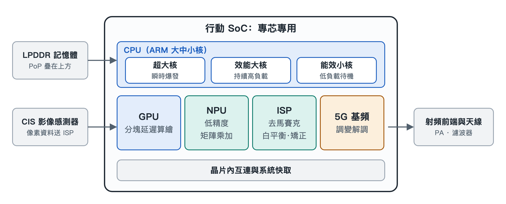

# 3.1 行動 SoC 的異質算力矩陣：專芯專用的能效哲學

打開手機，點開相機，對準窗外按下快門，再順手滑兩下短影音。這幾秒鐘裡，你可能以為手機裡有一顆「處理器」在埋頭苦幹。實際上，在指甲蓋大小的系統單晶片（System on Chip，SoC）內部，並不存在一個包辦一切的「全能處理器」。真正幹活的是一支分工明確的隊伍：有人負責瞬間衝刺，有人負責長跑，有人專門繪圖，有人專門算矩陣，有人專門處理光訊號。作業系統的排程器像一位調度員，根據每一項任務的性質，把它派給最合適的引擎，用盡可能少的電量把事情辦完。

這種「不同類型的運算單元協同工作」的做法，稱為異質運算（Heterogeneous Computing）。本節就來認識這支隊伍的四類主力：CPU、GPU、NPU 和 ISP。

## 3.1.1 為什麼不造一顆「超級全能芯」？

先想一個生活中的類比。一家醫院不會只僱一位「全科神醫」來處理所有病人，而是設急診、內科、放射科、檢驗科。急診醫師反應快，檢驗科的儀器能批次化驗，放射科的設備只拍片子卻拍得又快又準。各科室各司其職，整家醫院的效率反而最高。

手機面對的限制比醫院更嚴苛：電池容量有限，機身密閉散熱困難，使用者又要求隨時回應。通用處理器什麼都能算，但做專門任務時往往「大材小用」，需要執行大量指令、頻繁搬運資料，既慢又耗電。專用電路則把某類固定運算直接「刻」進硬體，同樣的工作耗電少得多。所以行動 SoC 的設計哲學可以概括為四個字：**專芯專用**。

## 3.1.2 CPU：大中小核的接力跑

中央處理器（Central Processing Unit，CPU）是整個系統的「總指揮」，負責執行作業系統和應用程式的主體邏輯。現代手機 CPU 通常把不同能力的核心組合在一起，形成三檔梯隊：

- **超大核**（如 Arm 的 Cortex-X 系列）：負責瞬時爆發。你點開一個應用程式、它從零開始載入的那一刻（稱為「冷啟動」），超大核全力衝刺，力求讓介面儘快出現。它效能最強，耗電也最大，只在關鍵時刻短暫出場。
- **效能大核**（如 A7xx 系列）：負責持續的高負載。玩一局遊戲要連續幾十分鐘穩定輸出算力，這類「耐力型」任務交給大核來扛。
- **能效小核**（如 A5xx 系列）：負責全天候的低負載工作。關螢幕收訊息、背景同步、播放音樂，這些輕活交給小核，功耗僅幾十毫瓦。

這就像一場接力賽：短跑選手負責起跑衝刺，中長跑選手維持節奏，後勤人員整天守著營地。排程器會根據任務輕重隨時調整人選，讓重活不至於拖慢，輕活不至於浪費。手機能「一天一充」而不是「半天一充」，大中小核的分工功不可沒。

## 3.1.3 GPU：把螢幕切成瓦片再畫

圖形處理器（Graphics Processing Unit，GPU）負責把遊戲場景、介面動畫畫到螢幕上。它擅長同時處理成千上萬個像素，屬於典型的「人多力量大」型運算單元。

但手機 GPU 面臨一個棘手問題：畫面資料要在晶片和記憶體之間來回搬運，搬運本身就非常耗電、發熱。為此，行動 GPU 普遍採用**分塊延遲渲染**（Tile-Based Deferred Rendering，TBDR）機制，做法分兩步：

1. **分塊**：把整塊螢幕切成許多微小的「瓦片」（Tile），每次只處理一小塊，這一小塊的資料可以放在晶片內部的高速快取裡，不必反覆存取外部記憶體。
2. **延遲著色**：在給像素「上色」之前，先判斷哪些物體被前面的物體擋住了，把看不見的像素提前剔除，只給最終可見的像素做著色計算。

打個比方：漆一面牆之前，先確認牆前面會擺一個大書櫃，那書櫃擋住的部分就不必刷漆了。這樣一來，顯示記憶體頻寬和發熱都節省了一大截。

## 3.1.4 NPU：專攻矩陣的神經網路引擎

神經網路處理器（Neural Processing Unit，NPU）是近年 SoC 中最受矚目的成員。人臉辨識、語音喚醒、影像分割乃至端側大模型，本質上都是在做海量的矩陣乘法與累加。

NPU 的特點是專門執行**低精度矩陣乘加運算**，例如 INT8、INT4 精度的通用矩陣乘法（General Matrix Multiply，GEMM）。所謂 INT8、INT4，是用 8 位元或 4 位元整數來表示數值，比常規的高精度浮點數「粗糙」一些，但神經網路對這種粗糙往往並不敏感，換來的卻是電路更小、速度更快、耗電更少。

正因如此，NPU 能以極高的能效比，在本地以毫秒級完成人臉解鎖時的特徵比對，也能支撐端側大模型推論。資料留在手機裡處理，既快速，也減少了上傳雲端帶來的隱私疑慮。

## 3.1.5 ISP：光訊號的硬體管線

影像訊號處理器（Image Signal Processor，ISP）是相機背後的「暗房」。影像感測器輸出的原始資料還不是我們看到的照片，需要經過一系列加工。ISP 用固定的硬體管線，以奈秒級的速度依序完成：

- **去馬賽克**：感測器每個像素只記錄一種顏色，需要推算還原出完整色彩；
- **壞點校正**：修補個別失靈的像素；
- **自動白平衡**：讓白色在不同光源下仍然呈現白色；
- **鏡頭畸變校正**：把邊緣彎曲的線條拉直。

在此基礎上，ISP 還會與 NPU 協同，完成計算攝影中的**多幀 HDR 合成**——把多張不同曝光的照片融合成一張亮部不過曝、暗部有細節的成品。按下快門的一瞬間，這條管線已經跑完了一整套工序。

## 3.1.6 四類引擎一覽

| 運算單元 | 英文縮寫 | 擅長的任務 | 關鍵機制 | 能效思路 |
|---|---|---|---|---|
| 中央處理器 | CPU | 系統邏輯、應用程式執行 | 超大核/大核/小核分級 | 輕重任務分派給不同核心 |
| 圖形處理器 | GPU | 遊戲畫面、介面渲染 | 分塊延遲渲染（TBDR） | 減少顯示記憶體搬運，剔除不可見像素 |
| 神經網路處理器 | NPU | 人臉辨識、端側大模型 | INT8/INT4 矩陣乘加 | 以低精度換取高能效 |
| 影像訊號處理器 | ISP | 照片與影片處理 | 硬體管線 | 固定工序硬體化，協同 NPU |

## 3.1.7 小結

行動 SoC 的強大，不在於某一個單元無所不能，而在於「讓合適的單元做合適的事」。CPU 分級接力，GPU 精打細算，NPU 專攻矩陣，ISP 管線作業，再由作業系統排程器統一指揮，才在有限電量和狹小空間裡實現了流暢體驗。理解了這支隊伍，再看發表會上「AI 算力」「圖形效能」等參數，就能知道它們各自對應的是哪一位「隊員」。下一節，我們將跟隨光線進入相機模組，看看光子如何一步步變成數位像素。
