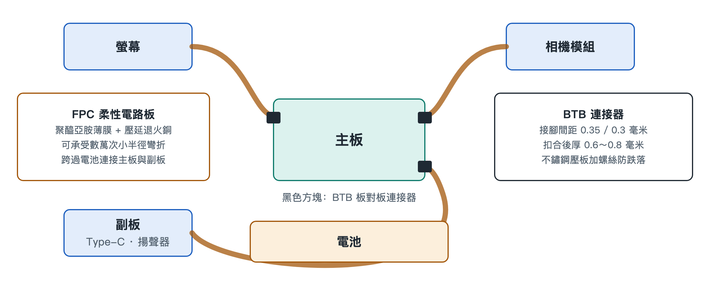

# 4.2 軟性電路板（FPC 軟板）：機身夾縫中的立體神經血管

把手機翻過來，隔著背蓋想像一下內部：主機板是一塊堅硬的「城市中心」，而相機蹲在機身上角，按鍵貼在側邊框，揚聲器藏在底部，螢幕覆蓋整個正面，電池則像一塊厚實的磚頭橫亙在中間。這些零件散落各處，彼此之間隔著高低落差、轉角和縫隙。是誰把它們連成一個整體？答案是一條條薄如紙片、金黃或橙褐色的軟帶，即柔性印刷電路板（Flexible Printed Circuit，簡稱 FPC，俗稱「軟板」）。

如果說主機板是手機的大腦與心臟，FPC 就是遍布全身的神經和血管。它既傳遞訊號，也輸送電能，而且必須在狹窄的夾縫裡轉彎、折疊、繞行。

## 4.2.1 為什麼硬板行不通

普通電路板（硬板）以玻璃纖維加樹脂為基材，結實但不能彎。在一部厚度不足一公分的手機裡，各個模組的高度、位置都不在同一平面上：螢幕在最上層，主機板在中層，電池在旁側，相機還會凸出機身。如果只用硬板和導線連接，要麼佔用大量空間，要麼在組裝和使用中被反覆拉扯而斷裂。

FPC 的思路是把電路「印」在一層柔軟的薄膜上，讓線路本身可以像布料一樣彎折。這樣，一條軟板就能從主機板出發，翻過電池的邊緣，沿著中框內壁爬到相機背後，全程貼合結構，幾乎不額外佔據體積。

## 4.2.2 兩種關鍵材料：聚醯亞胺與壓延銅

一條合格的手機軟板，核心在於兩種材料的搭配。

### 4.2.2.1 聚醯亞胺薄膜（Polyimide Film，簡稱 PI 膜）

PI 膜是 FPC 的「皮膚」和骨架，充當絕緣基材。它有兩個突出特點：一是耐高溫，能承受約 300℃ 的高溫，這意味著在迴焊（把元件焊到電路板上的高溫製程）時不會變形、起泡；二是極其堅韌，薄薄一層就能反覆彎折而不開裂。日常生活中，很難找到一種塑膠能同時做到「不怕燙」和「折不壞」，這正是 PI 被選中的原因。

### 4.2.2.2 壓延退火銅（Rolled Annealed Copper，簡稱 RA 銅）

導線用的銅也有講究。銅箔常見的製造方式有兩種：一種是電解沉積，銅原子像下雪一樣一層層堆積，晶粒呈垂直的柱狀；另一種是壓延，把銅錠反覆軋製、再經過退火（加熱後緩慢冷卻以消除內應力），使晶粒沿橫向被拉長、鋪展開來。

可以用一個比喻來理解兩者的差別：電解銅的晶粒像一排排豎著插的筷子，橫向一彎，筷子之間的縫隙就容易裂開；壓延退火銅的晶粒像順著方向鋪平的麵條，彎折時能整體跟著延展。因此，RA 銅更適合需要反覆彎折的部位，搭配 PI 膜，能承受數萬次小半徑彎折而不斷裂。

| 比較項目 | 普通硬板 | FPC 軟板 |
|---|---|---|
| 基材 | 玻璃纖維 + 樹脂 | 聚醯亞胺薄膜（PI 膜） |
| 導體 | 常規銅箔 | 壓延退火銅（RA 銅） |
| 可彎折性 | 基本上不可彎 | 可承受數萬次小半徑彎折 |
| 典型用途 | 承載晶片的主機板 | 跨區連接螢幕、相機、按鍵、電池等 |

## 4.2.3 跨越電池：連接主機板與副板

許多手機採用「主機板 + 副板」的配置：主機板位於機身上部，承載 SoC 等核心晶片；副板位於底部，負責充電埠、揚聲器、麥克風等。兩者之間橫著一塊厚重的電池組。

連接上下兩塊電路板的任務，就交給一條長長的 FPC。它從電池一側貼著邊框穿過，或從電池下方壓過，把充電電流、音訊訊號、射頻訊號等一併送達。這條軟板既要夠薄，不擠佔電池的空間；又要夠可靠，承受組裝時的折彎和日常使用中機身的輕微形變。拆過手機的人常常會注意到，這條「排線」是開機後必須首先斷開或最後連接的零件之一，足見它在系統中的樞紐地位。

## 4.2.4 托起懸浮的鏡片：潛望長焦裡的軟板

FPC 最精巧的用法之一出現在潛望式長焦相機中。為了實現對焦和防手震，鏡片組需要由微型馬達驅動，懸浮在磁場中做細微而快速的移動。問題在於：鏡片模組本身也要通電、傳訊號，必須連著線。

如果連線太硬，它就會像一根拽著氣球的繩子，拉住鏡片，干擾馬達的精確定位。FPC 在這裡的要求是極低的機械回彈力——彎曲後幾乎不產生「往回彈」的反作用力。這樣，馬達推動鏡片時，軟板只是柔順地跟隨，不施加多餘的拉扯，從而確保鏡片能以微秒級的響應保持懸浮和穩定。換句話說，這裡的軟板不僅是導線，更是機械系統的一部分，它的柔軟程度直接影響拍照是否清晰。

## 4.2.5 看不見的設計限制

FPC 的設計並不只是「做軟一點」那麼簡單，工程師需要同時權衡幾件事：

- **彎折半徑**：彎得越急，銅線承受的應力越大，必須在空間和壽命之間取捨；
- **固定與走向**：軟板要用膠貼、卡扣定位，避免在摔落或振動中摩擦磨損；
- **訊號完整性**：傳輸螢幕、相機等高速資料時，線路寬度、間距和屏蔽層都要精心設計，防止干擾；
- **組裝順序**：軟板往往需要先折疊再扣合，決定了整機的組裝流程。

## 4.2.6 小結

FPC 用耐高溫、極堅韌的聚醯亞胺薄膜作身體，用晶粒橫向延展的壓延退火銅作導線，讓電路第一次擁有了「可彎折」的形態。它跨越電池連接主副板，繞過邊框抵達相機與按鍵，甚至以近乎無阻力的柔順托起懸浮的鏡片，把散落在機身各處的模組縫合成一個整體。不過，軟板最終總要「插」到主機板上，這個插接點既要極小、又要牢靠，下一節將走近這道物理關卡——微型板對板（BTB）連接器。
