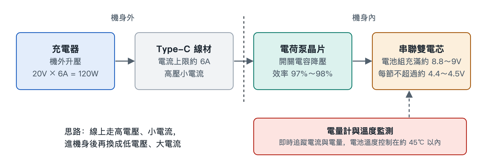

# 5.2 極致的能量階梯：百瓦超級閃充與電荷泵直充

拿起你的充電器看看，外殼上通常印著一排細小的輸出參數，比如「5V⎓3A」「10V⎓…」「20V⎓6A」。再看看手機底部那個小小的 Type-C 接口，它只有指甲蓋寬，裡面的金屬觸點細如髮絲。百瓦級的能量要在幾十分鐘內灌進一塊電池，必須先擠過這個接口，再穿過一段線纜。本節沿著電能的路徑，從插座一直跟到電芯內部，看看這一級一級的「能量階梯」是怎樣設計的。

## 5.2.1 瓶頸在哪裡：接口扛不住大電流

電功率等於電壓乘以電流（P = U × I）。想得到 120W，可以用 5V 配 24A，也可以用 20V 配 6A。兩組數字相乘結果一樣，對線纜和接口的考驗卻差別很大。

原因在於導體發熱。電流流過有電阻的導線和觸點，產生的熱量與電流的平方成正比（Q ∝ I²R）。電流翻一倍，發熱就變成四倍。Type-C 接口和常規線纜的觸點面積有限，按照規範，它能安全承載的電流上限大約是 **6A**。超過這個值，接口和線材會明顯發燙，觸點還可能氧化甚至燒蝕。

所以第一條設計原則是：**在機身外部，用高電壓、小電流來傳輸。**

## 5.2.2 第一級台階：充電器把電壓抬到 20V

可以把電能想成水流。電壓相當於水壓，電流相當於流量。水管口徑固定時，要送更多的水，就加大水壓，不必加粗水管。

充電器就是負責加壓的那台「水泵」。它把市電轉換成 **20V/6A** 的直流電，正好是 120W。這時線纜和接口裡的電流被壓在 6A 的規範紅線以內，傳輸段的發熱因此可控。

不過電池不能直接接受 20V。鋰電池對充電電壓的要求很嚴格，超出一點就可能引發安全風險。高壓送進了手機，還需要在機身內部降下來。

## 5.2.3 第二級台階：電荷泵把電壓「對摺」

傳統做法是在手機裡放一顆電感式降壓晶片。這類晶片的轉換效率不算低，但損失的那部分能量會全部變成熱，留在本來就擁擠的機身裡。百瓦級功率下，哪怕只損失幾個百分點，也是一個不小的「暖手寶」。

快充方案因此改用 **電荷泵（Charge Pump）** 晶片。它基於 **開關電容（Switched Capacitor）** 原理，可以用一個生活場景來理解：

> 有兩只相同的水桶。先把它們像積木一樣上下疊起來串聯，從高處接滿水；再把它們並排擺開並聯，一起往外倒。水的「高度」減半，同時倒出來的總流量翻倍。

晶片內部的開關以很高的頻率重複這個動作，讓電容在「串聯充電」和「並聯放電」之間來回切換，實現 **2:1** 的電壓變換：

| 位置 | 電壓 | 電流 | 功率 |
|---|---|---|---|
| 線纜與接口（電荷泵輸入） | 20V | 6A | 120W |
| 電荷泵輸出（進入電池） | 10V | 12A | 約 120W |

這裡的關鍵是效率。電荷泵主要靠電容和開關搬運電荷，不依賴電感的磁能轉換，轉換效率可以超過 **97%~98%**。損耗越小，留在機身裡的熱量就越少。大電流只在電荷泵到電池之間很短的一段路徑上流動，這段銅箔走線又短又寬，電阻很小，發熱也隨之被控制住。

這種電壓只做比例變換、幾乎直接灌入電池的方式，常被稱為 **直充**。

## 5.2.4 第三級台階：雙電芯串聯分擔電壓

10V 仍然高於單個鋰電芯能承受的範圍。解決辦法是把電池拆成兩只電芯，**串聯** 成一個電池組。

串聯電路中，兩只電芯流過同樣的電流，電池組的電壓是兩只電芯電壓之和。兩只電芯串聯後，電池組充滿時約 8.8～9V，每只電芯仍不超過各自的充電上限（約 4.4～4.5V）；電荷泵的輸出電壓也會跟著電池組當前的電壓調整，而不是固定死在 10V。打個比方，一個人扛不動的擔子，兩個人一前一後抬著就穩當了。

與單電芯方案相比，雙電芯串聯還有一個好處：同樣的充電功率下，每只電芯承受的負擔減輕，內部發熱也更均勻。代價是電池管理變得複雜，兩只電芯必須保持一致，不能一只充滿了另一只還空著。

## 5.2.5 看不見的守門人：庫侖計與分流電阻

高速充電的過程中，系統需要一直清楚「灌進去多少電、電池現在多熱」。這項工作由兩個元件配合完成：

- **庫侖計（Coulomb Counter）晶片**：庫侖是電荷量的單位。這顆晶片對流入和流出電池的電流做持續累計，好比給電池裝了一塊精確的「水錶」，由此推算剩餘電量，也就是螢幕上顯示的百分比。
- **雙向分流電阻（Shunt Resistor）**：一枚阻值極小的精密電阻，串在電池迴路中。電流流過時在它兩端形成微小的電壓差，晶片測出這個電壓差就能換算出電流。「雙向」的意思是充電和放電兩個方向都能測。

這些數據會即時回饋給充電管理系統。一旦溫度逼近設定上限，系統會主動降低充電功率。整套方案的目標是把電池溫度控制在約 **45℃** 的上限之內（具體數值各廠商不同）。這也是很多手機電量充到較高時速度明顯放緩的原因之一：系統在主動給電池和機身降溫。

## 5.2.6 小結：一條四級能量階梯

把整個過程串起來，就是一條清晰的鏈路：

1. **充電器升壓**：20V/6A，繞開接口的電流瓶頸；
2. **電荷泵對摺**：高效率轉換為 10V/12A，把熱損耗壓到最低；
3. **雙電芯串聯**：每只電芯不超過約 4.4～4.5V 的充電上限，保證電化學安全；
4. **計量與溫控**：庫侖計和分流電阻即時監測，守住約 45℃ 的電池溫度上限。

發表會上的「百瓦閃充」，背後是電壓、電流、發熱三者之間的一連串權衡。能量在機身裡奔流的同時，光子也在另一條路徑上高速轉化，下一節我們轉向按下快門的那一瞬間。
